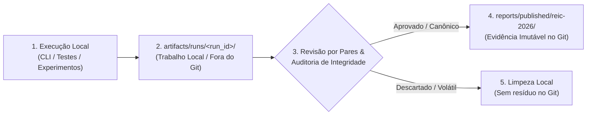

# 📁 Diretório de Execuções Locais de Trabalho (`artifacts/`)

> **Espaço de trabalho isolado para execuções ad-hoc, telemetria experimental e depuração do Sprint Planning MAS.**

Este diretório armazena saídas brutas geradas durante a execução do sistema em ambiente local ou de desenvolvimento. Ao contrário de `reports/published/`, o conteúdo de `artifacts/runs/` é **ignorado pelo controle de versão Git** (definido em `.gitignore`), garantindo que execuções diárias de testes não poluam o histórico do repositório nem sobrescrevam evidências científicas publicadas.

---

## 🧭 Ciclo de Vida da Curadoria Científica

O repositório adota um fluxo estrito de promoção de artefatos:



1. **Executar:** O desenvolvedor ou pesquisador executa o grafo via CLI (`main.py --run-id <id>` ou `--artifacts-dir artifacts/runs/<id>`).
2. **Armazenar em `artifacts/runs/<run_id>/`:** Os resultados são salvos de forma isolada por identificador de execução (`run_id`), imunes a condições de corrida com outras instâncias.
3. **Revisar:** A equipe analisa os logs, métricas agregadas e conformidade às restrições do problema (*Hard Constraints*).
4. **Publicar:** Somente após validação formal, os artefatos de referência são promovidos para `reports/published/reic-2026/` acompanhados do manifesto criptográfico congelado.

---

## 📂 Estrutura de um Run (`artifacts/runs/<run_id>/`)

Cada execução isolada em `artifacts/runs/` segue o seguinte layout padronizado:

```
artifacts/runs/<run_id>/
├── manifest.json       # Manifesto criptográfico de procedência (ExecutionManifest)
├── metrics.json        # Sumário executivo das métricas do run (latência, alocação, violações)
├── outputs/            # Artefatos finais produzidos (SprintPlan em JSON e Markdown)
└── traces/             # Trilha de deliberação BDI e telemetria de nós do LangGraph
```

### Anatomia dos Arquivos

| Arquivo / Pasta | Finalidade | Garantia de Integridade |
| :--- | :--- | :--- |
| **`manifest.json`** | Registra metadados imutáveis da execução: `run_id`, `execution_mode` (`offline_mock` ou `llm_experimental`), `git_commit`, `scenario_sha256` e `prompt_sha256`. | Validado estritamente via modelo Pydantic v2 `ExecutionManifest` (`ConfigDict(extra="forbid")`). |
| **`metrics.json`** | Consolidação das métricas numéricas observadas na rodada: tempo total, Story Points alocados, FTEs utilizados e contagem de violações. | Previne a necessidade de inspecionar logs volumosos para conferência de métricas. |
| **`outputs/`** | Armazena o plano de sprint aprovado (`sprint_plan.json`), arquivos `.csv` e tabelas geradas pelo validador. | Isolamento por `run_id` previne que duas execuções simultâneas colidam ou sobrescrevam arquivos. |
| **`traces/`** | Grava o fluxo de mensagens trocadas entre nós (Prioritizer, Allocator, Validator e Supervisor) e passos do Blackboard. | Permite auditoria diagnóstica de loops de replanejamento e auto-correção. |

---

## 🔒 Regras de Segurança e Proteção Git

1. **Exclusão no Git:** A regra `artifacts/runs/*` no `.gitignore` garante que nenhum dado volátil seja enviado ao repositório remoto.
2. **Preservação de Estrutura:** Apenas `artifacts/README.md` e o marcador `artifacts/runs/.gitkeep` permanecem versionados para garantir a existência do diretório em clones limpos.
3. **Bloqueio de Path Traversal:** A função de utilidade `validate_safe_benchmark_path()` assegura que qualquer tentativa de injetar caminhos com `..` ou caminhos absolutos arbitrários seja rejeitada antes de qualquer operação de escrita em disco.
