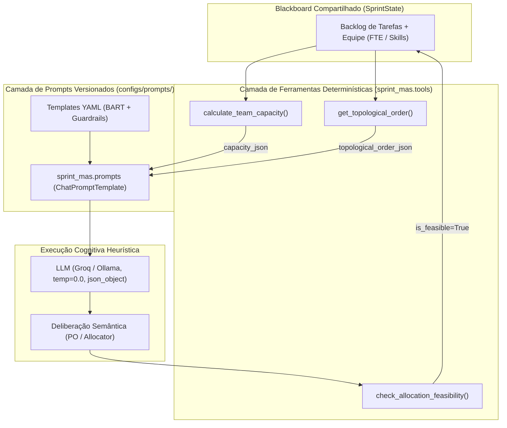

# ADR 0005: Prompts como Código (Técnica BART) e Ferramentas Determinísticas de Cálculo

## 1. Status & Metadados
- **Status:** Aprovada (2026-10-19 — Homologada formalmente pelo Security & QA Auditor)
- **Decisores:** Tech Lead (Elysson Alves de Lacerda), Tech Manager (Antigravity), Security & QA Auditor
- **Data:** 2026-10-19
- **Vínculo Científico:** REIC 2026 / WESAAC 2025 (Elicitação BART — Gerstberger, Silva e Guedes, 2024)
- **Escopo:** Fase 3 — Camada de Instrumentos Determinísticos (`@tool`) e Prompts Versionados (BART)

---

## 2. Contexto & Forças Motivadoras
Modelos de Linguagem de Grande Porte (LLMs) destacam-se no raciocínio semântico, interpretação qualitativa e síntese de objetivos de negócio. Entretanto, pesquisas e experiências empíricas demonstram que LLMs são inerentemente não-determinísticas e vulneráveis a alucinações em operações aritméticas estritas — notadamente:
1. Multiplicação ponderada de capacidade por disponibilidade de FTE (*Full-Time Equivalent*).
2. Soma cumulativa de Story Points contra tetos rígidos de capacidade da equipe.
3. Detecção de precedências causais e ciclos em grafos direcionados acíclicos (DAGs).

No sistema original em **n8n** (descrito no artigo do WESAAC 2025):
- Prompts ficavam embutidos nos nós de interface visual, sem versionamento no Git nem validação sintática antes do envio.
- Cálculos de capacidade eram frequentemente delegados ao próprio LLM ou a snippets ad-hoc em JavaScript desprovidos de tipagem e testes unitários.
- Como consequência observada nos testes manuais do paper, o desenvolvedor com dedicação parcial (`dev_D`, 0.5 FTE = 10 pts) frequentemente recebia sobrecarga de tarefas backend, violando as restrições da sprint.

Para a reengenharia no **LangGraph**, tornou-se imperativo adotar uma arquitetura híbrida cognitivo-determinística:
- Prompts isolados como código em arquivos declarativos (YAML) fundamentados no framework científico **BART**.
- Delegação de todas as operações aritméticas e causais a funções puras em Python decoradas com `@tool`.

---

## 3. Decisão Técnica Adotada

### 3.1 Prompts Versionados como Código (`configs/prompts/*.yaml`)
1. **Elicitação BART (Gerstberger et al., 2024):** Cada persona de agente é formalizada segundo as 17 questões BART, estruturadas em 6 dimensões operacionais:
   - **Persona**: Papel hiper-especializado (Product Owner, Engineering Allocator, Quality Lead).
   - **Gatilho (Trigger)**: Evento ou transição de nó no grafo LangGraph.
   - **Pré-condições**: Estado canônico no Blackboard (`SprintState`).
   - **Ações**: Roteiro deliberativo de análise e decisão.
   - **Restrições**: Guardrails invioláveis de negócio e limites de capacidade.
   - **Pós-condições / Objetivo**: Payload estruturado validado e persistido no estado.

2. **Engenharia de Prompt Declarativa:**
   - **Role-Based Persona:** Atribuição estrita de responsabilidade funcional.
   - **Constrained / Schema-Enforced Output:** Obrigatoriedade de saída em JSON canônico (`response_format: json_object`).
   - **Step-by-Step Deliberation (Zero-Shot CoT):** Roteiro ordenado de reflexão analítica prévia à decisão final.
   - **Negative Prompting & Guardrails:** Proibições explícitas em caixa alta (ex: "NUNCA exceda o teto de 0.5 FTE de dev_D").
   - **Deterministic Tool-Augmented Context:** Injeção das saídas exatas das ferramentas no contexto do prompt, liberando o modelo de realizar contas.
   - **Escape de Chaves Duplas (`{{ }}`):** Exemplos literais de schemas JSON nos templates YAML utilizam chaves escapadas para blindar o formatador f-string do LangChain contra variáveis-fantasma (*phantom variables*).

3. **Módulo de Ingestão (`sprint_mas.prompts`):**
   - Fornece `load_prompt_yaml` e `get_agent_prompt_template`.
   - Compilação para `ChatPromptTemplate` com validação de igualdade estrita de conjuntos de placeholders (`set(tpl.input_variables) == set(...)`).

### 3.2 Biblioteca de Ferramentas Determinísticas (`sprint_mas.tools`)
Funções puras decoradas com `@tool` do LangChain com tipagem forte e validações defensivas:
1. `calculate_team_capacity`: Computa $\text{capacidade} = \text{fte} \times \text{sprint\_days} \times \text{points\_per\_day}$ individual e total. Rejeita defensivamente valores não-positivos de dias/pontos ou FTE negativo.
2. `check_allocation_feasibility`: Audita a soma de pontos atribuídos contra o teto de cada membro. Conta com **proteção anti-IDOR**, bloqueando desenvolvedores e tarefas forjados ou não cadastrados no backlog/equipe.
3. `get_topological_order`: Computa a ordenação causal do DAG via algoritmo de Kahn ($O(V + E)$), com detecção antecipada de dependências órfãs e validação de aciclicidade.
4. `match_skills`: Matriz de aderência técnica com equivalência semântica para desenvolvedores Fullstack (absorvendo demandas backend e frontend).

---

## 4. Anatomia do Padrão / Fluxo (Design System Spec)

### Especificação das Camadas
- **Camada Declarativa (`configs/prompts/*.yaml`):** Imutável em runtime; versionada no Git; desacoplada da lógica de orquestração.
- **Camada de Ingestão (`sprint_mas/prompts.py`):** Resolve caminhos, carrega YAMLs via PyYAML e valida placeholders antes de qualquer chamada externa.
- **Camada Determinística (`sprint_mas/tools.py`):** Pureza de execução matemática; validações de fronteira defensivas e isolamento de concorrência.
- **Camada de Nós LangGraph (Fases 4-7):** Consome os templates compilados e injeta os artefatos das ferramentas no contexto.

---

## 5. Matriz de Estados e Comportamento (State Matrix)

| Estado / Cenário Operacional | Condição de Entrada | Comportamento da Ferramenta / Loader | Retorno / Efeito Arquitetural |
|---|---|---|---|
| **Cálculo de Capacidade Regular** | Equipe com desenvolvedores e FTEs válidos | `calculate_team_capacity(team, sprint_days=10, points_per_day=2.0)` | Dicionário `{dev_id: max_points, "total_team_capacity": sum}` |
| **Borda Inválida: Dias Negativos/Zero** | `sprint_days <= 0` | Validação defensiva antes do loop de cálculo | Lança `ValueError("Duração da sprint deve ser maior que zero.")` |
| **Borda Inválida: Taxa Negativa/Zero** | `points_per_day <= 0` | Validação defensiva de taxa de produtividade | Lança `ValueError("Taxa de pontos por dia deve ser maior que zero.")` |
| **Borda Inválida: FTE Negativo** | Desenvolvedor com `fte < 0.0` | Validação defensiva no perfil individual | Lança `ValueError("FTE do desenvolvedor 'dev_X' não pode ser negativo.")` |
| **Tipagem Inválida no Invoke** | Argumento incompatível passado via `.invoke()` | Validador Pydantic do `@tool` LangChain | Lança `pydantic.ValidationError` |
| **Tipagem Inválida na Função Pura** | Argumento incompatível na chamada pura `.func` | Tipagem de runtime do Python | Lança `TypeError` |
| **Alocação Válida (Sem Violação)** | $\sum \text{pts} \le \text{capacidade}$ para todos os devs | `check_allocation_feasibility(allocations, capacity, tasks)` | `{"is_feasible": True, "violations": []}` |
| **Sobrecarga de FTE Detectada** | `dev_D` com 15 pts (limite 10 pts) | Soma analítica exata e identificação do membro sobrecarregado | `{"is_feasible": False, "violations": ["dev_D excedeu em 5 pts..."]}` |
| **Ataque Anti-IDOR: Dev Desconhecido** | Alocação contém `dev_inexistente` | Verificação de pertinência contra `capacity.keys()` | `{"is_feasible": False, "violations": ["Desenvolvedor 'dev_X' não encontrado..."]}` |
| **Ataque Anti-IDOR: Tarefa Desconhecida** | Alocação contém `TSK-FORGED` | Verificação contra o conjunto `valid_task_ids` | `{"is_feasible": False, "violations": ["Tarefa 'TSK-X' não encontrada..."]}` |
| **Ordenação Causal Válida** | Backlog com DAG acíclico | Algoritmo de Kahn ($O(V + E)$) | Lista de tarefas ordenada respeitando precedências |
| **Dependência Órfã no Grafo** | Tarefa depende de ID não existente no backlog | Checagem prévia `dep not in all_ids` | Lança `ValueError("Dependência órfã detectada...")` |
| **Dependência Cíclica no Grafo** | Tarefas com referências mútuas circulares | Algoritmo de Kahn detecta nós remanescentes com grau > 0 | Lança `ValueError("Ciclo detectado no grafo de dependências...")` |
| **Interpolação com Chaves Duplas** | Schema JSON com `{{` e `}}` no template | LangChain parser trata como caractere literal | Preserva chaves literais sem gerar variáveis-fantasma |
| **Prompt Inexistente** | `load_prompt_yaml("inexistente")` | Resolução via `pathlib.Path` | Lança `FileNotFoundError` com caminho pedagógico |

---

## 6. Diretrizes de Do's & Don'ts (Boas Práticas vs. Anti-patterns)

| 🟢 DO (Boas Práticas Recomendadas) | 🔴 DON'T (Anti-patterns Proibidos) |
|---|---|
| **Use funções Python determinísticas (`@tool`)** para calcular capacidade e checar limites de FTE. | **Nunca peça ao LLM** para somar Story Points ou calcular frações de capacidade mentalmente no prompt. |
| **Mantenha todos os system prompts versionados em YAML** dentro de `configs/prompts/`. | **Nunca versione prompts** dentro de strings embutidas (*hardcoded*) no código dos nós LangGraph. |
| **Use escape de chaves duplas (`{{` e `}}`)** para exemplos de schema JSON de saída nos templates. | **Nunca use chaves simples (`{` e `}`)** em exemplos literais de saída, pois quebram o compilador f-string do LangChain. |
| **Configure temperatura fixa em 0.0** para todos os nós de priorização, alocação e supervisão. | **Nunca utilize temperaturas > 0.2** para tarefas deliberativas estruturadas de planejamento ágil. |
| **Valide placeholders com igualdade estrita de conjuntos** (`set == set`) nos testes de prompt. | **Nunca tolere variáveis-fantasma** ou placeholders residuais não documentados no YAML. |
| **Implemente barreiras defensivas anti-IDOR** checando se entidades alocadas existem na base canônica. | **Nunca assuma que a LLM respeitará IDs válidos**, ignorando checagem de integridade referencial. |
| **Mantenha ferramentas analíticas como funções puras**, retornando novos dicionários/estruturas. | **Nunca modifique dicionários de entrada in-place** ou utilize variáveis globais mutáveis nas tools. |
| **Trate `ValidationError` (LangChain Tool) e `TypeError` (Função Pura)** na estratégia de testes. | **Nunca assuma que o decorador `@tool`** se comporta identicamente à função Python nativa sem decorator. |

---

## 7. Consequências & Trade-offs

### Impactos Positivos:
- **Zero Alucinação Aritmética:** Elimina a causa raiz do estouro de capacidade identificado nos experimentos com n8n do WESAAC 2025.
- **Conformidade Científica com a Técnica BART:** Metodologia de elicitação formalizada (Gerstberger et al., 2024), assegurando rastreabilidade direta ao artigo da REIC 2026.
- **Rigor de Segurança e QA:** Auditoria de segurança defensiva com proteção anti-IDOR, barreira contra variáveis-fantasma e 100% de cobertura nos testes automatizados (66/66 aprovados).
- **Testabilidade e Modularidade:** Prompts e ferramentas podem ser testados unitariamente de forma isolada em milissegundos sem invocar APIs remotas.

### Trade-offs / Riscos Gerenciados:
- **Sobrecarga de Serialização:** A injeção de saídas determinísticas no contexto consome tokens de contexto (mitigado pelo uso de formatos JSON compactos e modelos com janelas de 8k-128k tokens).
- **Sincronização de Esquemas:** Mudanças nos parâmetros dos nós do LangGraph exigem atualização alinhada dos arquivos YAML correspondentes (mitigado pela suíte de testes `test_prompts.py`).

---

## 8. Rastreabilidade & Homologação de QA
- **Plano de Origem:** [`DOCUMENTOS-TASK/2026-10-19_plano-fase3-ferramentas-prompts.md`](file:///c:/Users/elyss/Desktop/REIC-WESAAC/DOCUMENTOS-TASK/2026-10-19_plano-fase3-ferramentas-prompts.md)
- **Parecer de QA:** [`DOCUMENTOS-TASK/2026-10-19_parecer-qa-fase3-ferramentas-prompts.md`](file:///c:/Users/elyss/Desktop/REIC-WESAAC/DOCUMENTOS-TASK/2026-10-19_parecer-qa-fase3-ferramentas-prompts.md) (100% Conforme, 66/66 testes aprovados em 0.61s)
- **Código de Produção:** [`sprint_mas/tools.py`](file:///c:/Users/elyss/Desktop/REIC-WESAAC/sprint_mas/tools.py) e [`sprint_mas/prompts.py`](file:///c:/Users/elyss/Desktop/REIC-WESAAC/sprint_mas/prompts.py)
- **Prompts Versionados:** [`configs/prompts/*.yaml`](file:///c:/Users/elyss/Desktop/REIC-WESAAC/configs/prompts/)
