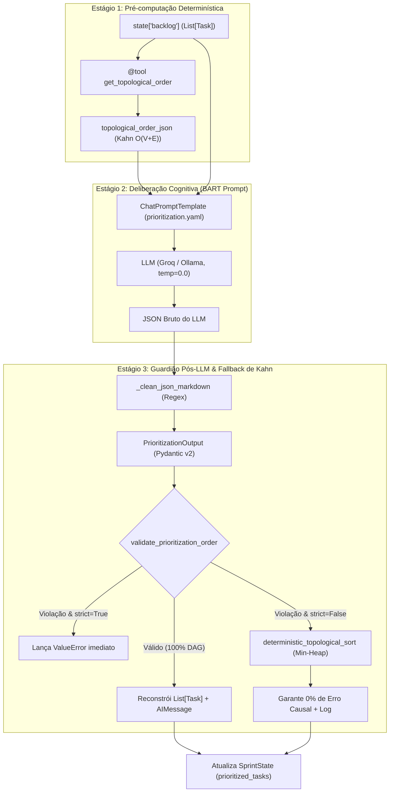

# ADR 0006: Arquitetura Híbrida Cognitivo-Determinística do Agente de Priorização (Product Owner Node)

## 1. Status & Metadados
- **Status:** Aprovada (Homologada em 2026-10-31 pelo Security & QA Auditor)
- **Decisores:** Tech Lead (Elysson Alves de Lacerda), Tech Manager (Antigravity), Security & QA Auditor
- **Data:** 2026-10-20 (Homologação formal: 2026-10-31)
- **Vínculo Científico:** WESAAC 2025 (Seções 3, 4 e Tabela 2) e REIC 2026 (Seções 3.1, 3.2, 5.1 e 6.1)
- **Escopo:** Fase 4 — Agente de Priorização (Product Owner Node)

---

## 2. Contexto & Forças Motivadoras
Conforme estabelecido nos trabalhos científicos **WESAAC 2025** e **REIC 2026**, o **Agente de Priorização** atua como o *Product Owner* autônomo do Sistema Multiagente (SMA), tendo como missão ordenar o backlog bruto da sprint antes que o Agente de Alocação distribua as tarefas entre os desenvolvedores:

> *"O Agente de Priorização interpreta as regras de negócio para reordenar tarefas, enquanto o Agente de Alocação realiza o match semântico entre a skill necessária e a disponibilidade do time."* (REIC 2026, Seção 3.2, p. 3)  
> *"O Agente de Alocação, alimentado pelo System Prompt contendo as regras BART, respeitou rigorosamente as restrições de disponibilidade... e ordenou corretamente as dependências críticas (ex: garantindo que a TSK-102 fosse agendada após a TSK-101)... Ambos mantiveram 0% de erro em dependências, indicando equivalência na qualidade lógica."* (REIC 2026, Seção 6, p. 6)

Em arquiteturas puramente baseadas em LLM (como no protótipo inicial em n8n), confiar exclusivamente na geração textual do modelo para ordenar 30 ou 100 tarefas apresenta três riscos críticos:
1. **Inversão acidental de precedência causal (DAG):** O LLM pode priorizar uma tarefa de alto valor comercial esquecendo que ela depende tecnicamente de outra tarefa de infraestrutura ainda não executada.
2. **Omissão ou Alucinação de IDs (IDOR / Perda de Dados):** O modelo pode omitir tarefas em backlogs longos ou inventar identificadores inexistentes.
3. **Fragilidade de Parsing:** Modelos locais (ex: Ollama) ou em nuvem podem envolver o JSON em blocos Markdown (```` ```json ... ``` ````) ou falhar momentaneamente na formatação.

Fazia-se necessária uma arquitetura formalizada que una a cognição deliberativa com rigor matemático incondicional de ordenação acíclica.

---

## 3. Decisão Técnica Adotada
Adotamos uma **Arquitetura Híbrida Cognitivo-Determinística em 3 Estágios** para o nó `prioritization_node` ([`sprint_mas/agents/prioritizer.py`](file:///c:/Users/elyss/Desktop/REIC-WESAAC/sprint_mas/agents/prioritizer.py)):



1. **Estágio 1 — Pré-computação Topológica Determinística (`Tool-Augmented Context`):**
   - Antes de invocar o LLM, o nó executa a ferramenta pura `get_topological_order` (`sprint_mas/tools.py`) sobre `state["backlog"]` e injeta a ordem topológica válida no prompt YAML (`{topological_order_json}`).
2. **Estágio 2 — Deliberação Semântica via LLM (`BART + Role-Based + CoT`):**
   - O LLM recebe o template compilado de `configs/prompts/prioritization.yaml` (temperatura `0.0`) e delibera sobre a ordenação ótima combinando precedência técnica e valor de negócio (`priority` 1 a 5), gerando uma justificativa executiva auditável (`prioritization_reasoning`).
3. **Estágio 3 — Guardião Pós-LLM (`validate_prioritization_order`) & Fallback de Kahn Ponderado:**
   - A saída do LLM é validada pelo schema Pydantic `PrioritizationOutput` e submetida a `validate_prioritization_order(backlog, candidate_ids)`, que verifica:
     - Ausência de IDs desconhecidos/forjados (Anti-IDOR);
     - Preservação exata do conjunto de tarefas (zero omissão e zero duplicação);
     - Respeito absoluto às arestas de dependência ($pos(u) < pos(v)$ para toda dependência $u$ de $v$).
   - Se `strict=True`, qualquer violação levanta `ValueError` imediato. Se `strict=False` (modo resiliente padrão), o nó aciona `deterministic_topological_sort(backlog)` — uma implementação do algoritmo de Kahn com fila de prioridade (*min-heap* ordenada por `(task.priority, -task.story_points, task.id)`) — garantindo matematicamente **0% de erro lógico em dependências**.

---

## 4. Anatomia do Padrão / Fluxo (Design System Spec)

- **Camada de Entrada (State Contract):** Lê `state["backlog"]: list[Task]` do Blackboard (`SprintState`). Rejeita backlogs vazios ou com tipos inválidos antes de invocar serviços externos.
- **Camada de Validação & Segurança:** 
  - Extrator de cercas de código (`_clean_json_markdown`) para tolerar respostas encapsuladas em Markdown;
  - `PrioritizationOutput` (Pydantic v2) para garantir integridade estrutural;
  - `validate_prioritization_order` para verificação algorítmica em $O(V + E)$ contra IDOR, duplicações e inversões causais.
- **Camada de Negócio (Cognitive + Deterministic Node):** 
  - Execução híbrida combinando a justificativa semântica do LLM com a garantia de Kahn ponderada por min-heap.
- **Camada de Persistência no Blackboard:** 
  - Retorna estritamente o delta `{"prioritized_tasks": list[Task], "messages": [AIMessage(...)]}`, preservando a imutabilidade da lista original `backlog`.

---

## 5. Matriz de Estados e Comportamento (State Matrix)

| Estado / Cenário Operacional | Condição de Entrada | Comportamento do Nó (`prioritization_node`) | Retorno / Efeito Arquitetural |
|---|---|---|---|
| **Sucesso Cognitivo Pleno** | LLM retorna JSON válido com todos os IDs respeitando o DAG | Reconstrói `list[Task]` na ordem deliberada pelo LLM e registra `prioritization_reasoning` no histórico | Atualiza `prioritized_tasks` e `messages` com sucesso |
| **JSON com Cerca Markdown** | LLM retorna ```` ```json { ... } ``` ```` | Extrator regex limpa as cercas e valida via `PrioritizationOutput` | Atualiza `prioritized_tasks` normalmente sem erro de parsing |
| **Backlog Vazio** | `state["backlog"] == []` | Interrompe imediatamente na pré-condição BART | Lança `ValueError("O backlog de tarefas está vazio...")` |
| **Backlog Ausente / None** | `state.get("backlog") is None` | Interrompe imediatamente | Lança `ValueError("O backlog de tarefas está vazio ou ausente...")` |
| **Ataque Anti-IDOR: ID Desconhecido** | LLM inclui `TSK-FORGED` inexistente | Intercepta `unknown_ids = candidate_set - backlog_ids` | `strict=True` &rarr; `ValueError("Violação Anti-IDOR...")`<br>`strict=False` &rarr; Fallback de Kahn |
| **Omissão de Tarefas** | LLM retorna 28 tarefas para um backlog de 30 | Intercepta `missing_ids = backlog_ids - candidate_set` | `strict=True` &rarr; `ValueError("Tarefas omitidas...")`<br>`strict=False` &rarr; Fallback de Kahn |
| **Duplicação de Tarefas** | LLM repete o mesmo ID duas vezes | Intercepta `len(candidate_ids) != len(candidate_set)` | `strict=True` &rarr; `ValueError("Tarefas duplicadas...")`<br>`strict=False` &rarr; Fallback de Kahn |
| **Inversão Causal do DAG (`strict=True`)** | LLM inverte `TSK-102` antes de `TSK-101` | `validate_prioritization_order` detecta $pos(u) \ge pos(v)$ | Lança `ValueError("Violação de dependência causal...")` |
| **Inversão Causal do DAG (`strict=False`)** | LLM inverte precedência em modo de produção | Aciona `deterministic_topological_sort` com *min-heap* | Atualiza `prioritized_tasks` com 0% erro + aviso em `AIMessage` |
| **Falha de Formato / LLM Incompatível** | LLM retorna texto não estruturado | Captura erro de decodificação e desvia para fallback | Executa ordenação determinística de Kahn preservando o fluxo |

---

## 6. Diretrizes de Do's & Don'ts (Boas Práticas vs. Anti-patterns)

| 🟢 DO (Boas Práticas Recomendadas) | 🔴 DON'T (Anti-patterns Proibidos) |
|---|---|
| **Valide matematicamente a ordem retornada pelo LLM** contra o DAG antes de persistir no `SprintState`. | **Nunca confie cegamente que o LLM respeitou todas as dependências** apenas porque foi pedido no prompt. |
| **Permita injeção de dependência do objeto `llm`** na assinatura `prioritization_node(state, llm=...)` para viabilizar testes unitários offline rápidos. | **Nunca instancie clientes de rede hardcoded** dentro do nó que impeçam execução de testes locais sem internet. |
| **Preserve todos os atributos originais dos objetos `Task`** ao reconstruir a lista `prioritized_tasks`. | **Nunca permita que o LLM altere `story_points`, `skill_required` ou `dependencies`** durante a ordenação. |
| **Utilize modo duplo (`strict=True` para QA/testes e `strict=False` para produção resiliente)**. | **Nunca deixe o sistema quebrar em produção** por pequenas imperfeições conversacionais de modelos locais menores. |
| **Use expressões regulares resilientes para sanitizar cercas Markdown** antes do parsing JSON. | **Nunca assuma que todos os modelos retornarão JSON puro** sem texto introdutório ou cercas. |

---

## 7. Consequências & Trade-offs

### Impactos Positivos:
- **Zero Desvio Científico:** Assegura matematicamente a meta empírica de **0% de erro em dependências** observada nos artigos WESAAC 2025 e REIC 2026.
- **Explicabilidade Executiva:** Mantém o raciocínio de negócio do Product Owner acessível em linguagem natural (`prioritization_reasoning`) no histórico do Blackboard.
- **Rigor de Defesa em Profundidade:** Proteção anti-IDOR, blindagem contra tarefas duplicadas/omitidas e resiliência contra variações de saída de LLMs locais.
- **Testabilidade Total:** 100% coberto por testes automatizados offline executados em milissegundos sem custos de API.

### Trade-offs / Riscos Monitorados:
- **Sobrecarga Computacional Desprezível:** A verificação pós-LLM e o fallback de Kahn operam em $O(V + E \log V)$, consumindo menos de $0.1\text{ ms}$ mesmo para o Cenário C (100 tarefas).

---

## 8. Rastreabilidade & Homologação de QA
- **Plano de Implementação:** [`DOCUMENTOS-TASK/2026-10-20_plano-fase4-agente-priorizacao.md`](file:///c:/Users/elyss/Desktop/REIC-WESAAC/DOCUMENTOS-TASK/2026-10-20_plano-fase4-agente-priorizacao.md)
- **Parecer Oficial de QA:** [`DOCUMENTOS-TASK/2026-10-31_parecer-qa-fase4-agente-priorizacao.md`](file:///c:/Users/elyss/Desktop/REIC-WESAAC/DOCUMENTOS-TASK/2026-10-31_parecer-qa-fase4-agente-priorizacao.md) (Veredito: 🟢 **Aprovado**, 77/77 testes passando em 1.01s)
- **Código de Produção:** [`sprint_mas/agents/prioritizer.py`](file:///c:/Users/elyss/Desktop/REIC-WESAAC/sprint_mas/agents/prioritizer.py), [`sprint_mas/agents/__init__.py`](file:///c:/Users/elyss/Desktop/REIC-WESAAC/sprint_mas/agents/__init__.py)
- **Suíte de Testes:** [`tests/test_prioritizer.py`](file:///c:/Users/elyss/Desktop/REIC-WESAAC/tests/test_prioritizer.py) (11 novos testes unitários com asserções profundas)
