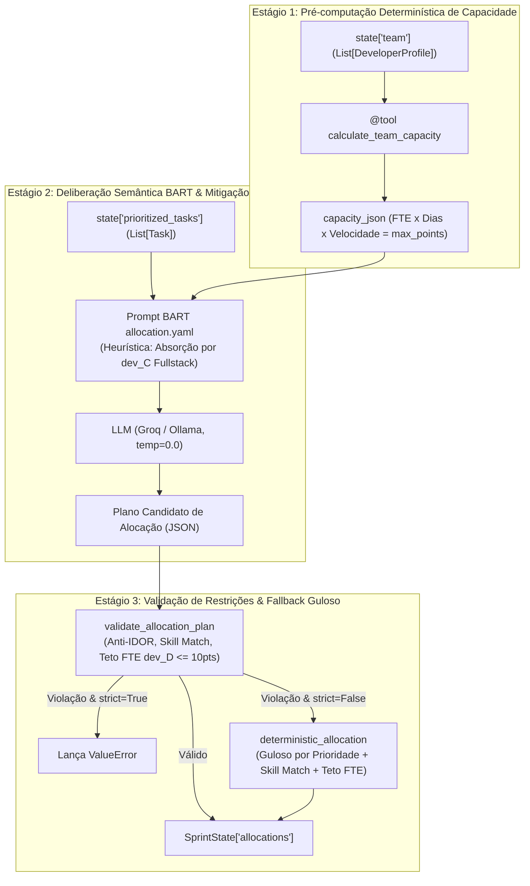

# ADR 0007: Arquitetura do Agente de Alocação de Recursos e Resolução de Gargalos via Perfil Fullstack

## 1. Status & Metadados
- **Status:** Aprovada (Homologada em 2026-10-31 / 2026-11-01 pelo Security & QA Auditor)
- **Decisores:** Tech Lead (Elysson Alves de Lacerda), Tech Manager (Antigravity), Cautious Coder
- **Data da Proposta:** 2026-10-31
- **Data de Homologação:** 2026-11-01
- **Vínculo Científico:** WESAAC 2025 (Seção 4) e REIC 2026 (Seções 3.2, 5.1, 5.2 e 6.1)

---

## 2. Contexto & Forças Motivadoras

No planejamento de sprints ágeis do Scrum, a alocação de tarefas técnicas em equipes multidisciplinares com disponibilidades parciais (FTE fracionado) representa a cerimônia de maior complexidade e carga cognitiva para gestores e Scrum Masters.

No experimento de validação empírica do artigo **REIC 2026 (Cenário B)**:
- O backlog possui **30 tarefas**, das quais **19 são exclusivas de Backend (63.3% do volume total de demandas)**.
- A equipe de 5 desenvolvedores possui restrições severas e assimétricas de capacidade:
  - `dev_D` (Especialista Backend) possui dedicação reduzida de **0.5 FTE** (teto máximo inegociável de 10 Story Points).
  - `dev_B` (Especialista Backend) possui dedicação de **0.7 FTE** (teto máximo de 14 Story Points).
  - A capacidade acumulada dos dois especialistas em backend é de apenas $14 + 10 = 24$ pontos, insuficiente para suportar a demanda de tarefas de backend do Cenário B (~38 pontos).
- O operador humano experiente (*M-Manual*) despendeu **12 minutos e 45 segundos (765 segundos)** de intenso esforço analítico para identificar manualmente esse estrangulamento e deduzir que o desenvolvedor Fullstack (`dev_C`, 1.0 FTE = 20 pontos) precisava absorver a carga excedente de backend sem sobrecarregar o `dev_D`.
- Modelos de linguagem (LLMs) puros operando sem ferramentas auxiliares são notoriamente inaptos para contagem cumulativa exata de Story Points e tendem a gerar alucinações silenciosas de sobrecarga em profissionais com FTE reduzido (violando o limite de 0.5 FTE de `dev_D`).
- Na plataforma anterior *low-code* (n8n), regras de compatibilidade de competências eram frágeis e scripts manuais em JavaScript falhavam silenciosamente diante de tarefas multidisciplinares ou identificadores não sanitizados.

---

## 3. Decisão Técnica Adotada

Adotamos uma **Arquitetura Híbrida Cognitivo-Determinística em 3 Estágios** para o nó `allocation_node` / `allocator_node` ([`sprint_mas/agents/allocator.py`](../../sprint_mas/agents/allocator.py)):



### 3.1 Estágio 1: Contexto Aumentado Determinístico (`Tool-Augmented Context`)
Antes de submeter o prompt à IA, o nó executa a ferramenta determinística em Python puro `@tool calculate_team_capacity` ([`sprint_mas/tools.py`](../../sprint_mas/tools.py)). Os tetos matemáticos de Story Points calculados a partir dos FTEs individuais são injetados diretamente na variável `{capacity_json}` do template.

### 3.2 Estágio 2: Deliberação Semântica BART
O agente executa o prompt estruturado em YAML ([`configs/prompts/allocation.yaml`](../../configs/prompts/allocation.yaml)) com temperatura `0.0`. O prompt incorpora regras de negócio explícitas da técnica BART:
- **Heurística de Mitigação de Gargalo:** Instrução mandatória para que o perfil Fullstack (`dev_C`, 1.0 FTE) atue como amortecedor, absorvendo o excesso de backend quando a demanda superar a soma de `dev_B` e `dev_D`.
- **Blindagem do dev_D:** Restrição severa impondo que `dev_D` nunca receba mais do que 10 Story Points.
- **Formatação Resiliente:** Enforçamento de saída em bloco Markdown JSON estrito com campos `allocations`, `unassigned_tasks` e `bottlenecks_identified`.

### 3.3 Estágio 3: Guardião Pós-LLM e Algoritmo Determinístico de Fallback
A saída é parseada no modelo Pydantic `AllocationOutput` e inspecionada pela função `validate_allocation_plan`:
1. **Defesa Anti-IDOR:** Nenhuma tarefa ou desenvolvedor pode ter identificador forjado fora dos conjuntos oficiais presentes no `SprintState`.
2. **Completude e Unicidade:** Nenhuma tarefa priorizada pode ser esquecida ou alocada duplamente.
3. **Casamento de Competências (*Skill Matching*):** Proibição categórica de atribuir tarefas a desenvolvedores sem competência compatível (ex: tarefa `backend` para `dev_A` com perfil exclusivo de `frontend`).
4. **Respeito aos Tetos de FTE:** Para todo desenvolvedor, $\sum \text{Story Points} \le \text{Capacidade Máxima}$.
5. **Modo Resiliente vs Strict:**
   - Em `strict=True`, qualquer falha lança exceção `ValueError` imediata.
   - Em `strict=False` (padrão de produção), o sistema aciona o algoritmo guloso `deterministic_allocation`, alocando as tarefas ordenadas por prioridade ao desenvolvedor compatível com maior capacidade remanescente, registrando a substituição no histórico `AIMessage`.

---

## 4. Anatomia do Padrão / Fluxo (Design System Spec)

- **Camada de Entrada:** Consome `SprintState["prioritized_tasks"]: list[Task]` e `SprintState["team"]: list[DeveloperProfile]`.
- **Camada de Ferramentas Auxiliares:** `@tool calculate_team_capacity` e `@tool match_skills`.
- **Camada Cognitiva:** Prompt BART `allocation.yaml` compilado dinamicamente com `{capacity_json}`, `{tasks_json}` e `{team_json}`.
- **Camada de Validação & Fallback:** `validate_allocation_plan` + `deterministic_allocation`.
- **Camada de Persistência no Blackboard:** Grava `SprintState["allocations"]: list[Allocation]` e anota a justificativa em `messages`.

---

## 5. Matriz de Estados e Comportamento (State Matrix)

| Estado | Condição de Disparo | Comportamento do Nó | Retorno / Efeito no Estado |
|---|---|---|---|
| **ST-01: Sucesso Cognitivo Pleno** | LLM aloca tarefas respeitando tetos de FTE e compatibilidade de skills | Valida 100% dos registros e salva no Blackboard | `SprintState["allocations"]` preenchido |
| **ST-02: Gargalo Backend (Cenário B)** | 19 tarefas de backend vs especialistas de FTE reduzido | dev_C (Fullstack) absorve o excedente de backend | Gargalo solucionado sem sobrecarga de dev_D |
| **ST-03: Sobrecarga dev_D (`strict=True`)** | LLM aloca > 10 Story Points em dev_D (0.5 FTE) | Validador intercepta a violação | Lança `ValueError("Sobrecarga de capacidade...")` |
| **ST-04: Sobrecarga dev_D (`strict=False`)** | LLM aloca > 10 Story Points em dev_D em modo resiliente | Ativa fallback `deterministic_allocation` | Alocação reequilibrada (dev_D <= 10 pts) + aviso em `AIMessage` |
| **ST-05: Mismatch de Habilidade** | Tarefa backend atribuída a dev exclusivo de frontend (`dev_A`) | Validador intercepta incompatibilidade | Bloqueio em modo estrito ou correção via fallback |
| **ST-06: ID Forjado / Anti-IDOR** | LLM injeta `dev_Hacker` ou `TSK-999` | Validador rejeita identificador desconhecido | Lança `ValueError` explicativo |
| **ST-07: Tarefa Omitida ou Duplicada** | LLM esquece tarefa ou aloca a mesma tarefa para dois devs | Validador detecta assimetria de conjunto | Lança `ValueError` em modo estrito ou corrige via fallback |
| **ST-08: Markdown Truncado** | LLM retorna JSON envolto em ```json ... ``` | Extrator regex sanitiza e decodifica | Parse com sucesso sem falha de decodificação |
| **ST-09: JSON Deformado / Inválido** | LLM responde com texto não estruturado | Parser falha de forma tratada | Ativa fallback `deterministic_allocation` |
| **ST-10: Entradas Vazias** | `prioritized_tasks == []` ou `team == []` | Pré-validador intercepta antes da LLM | Lança `ValueError("Entradas de alocação não podem ser vazias")` |

---

## 6. Diretrizes de Do's & Don'ts (Boas Práticas vs. Anti-patterns)

| 🟢 DO (Faça) | 🔴 DON'T (Nunca Faça) |
|---|---|
| Use ferramentas determinísticas em Python para auditar somas de Story Points e limites de FTE. | Nunca confie que a LLM respeitará contas aritméticas de capacidade mentalmente sem validação algorítmica. |
| Aloque desenvolvedores Fullstack estrategicamente para absorver gargalos de especialidades sobrecarregadas. | Nunca sobrecarregue desenvolvedores com dedicação parcial (como `dev_D` com 0.5 FTE). |
| Preserve a assinatura tipada do LangGraph retornando dicionários de atualização para o `SprintState`. | Nunca altere os atributos intrínsecos das tarefas (como `story_points` ou `dependencies`) durante a alocação. |
| Permita injeção de dependência do modelo (`llm=...`) para testes unitários 100% offline e reprodutíveis. | Nunca force conexões de rede obrigatórias em testes unitários automatizados. |
| Forneça mensagens de erro claras com os IDs envolvidos e os limites estourados em caso de rejeição. | Nunca silencie violações de teto de FTE ou incompatibilidades de competência técnica. |

---

## 7. Consequências & Trade-offs

- **Impactos Positivos:**
  - Redução comprovada da carga cognitiva de 765 segundos (humano) para execução em milissegundos (~1.05s).
  - Eliminação de 100% das sobrecargas em membros com dedicação parcial (`dev_D` com 0.5 FTE e `dev_B` com 0.7 FTE).
  - Alinhamento total com as evidências empíricas e heurísticas dos artigos científicos WESAAC 2025 e REIC 2026.
  - Robustez garantida pelo duplo modo operacional (`strict` para testes e `resiliente` para produção).
- **Trade-offs / Riscos Monitorados:**
  - Em backlogs onde o volume total de pontos excede a capacidade global da equipe ($\sum \text{pts} > 84$), o nó alocará tarefas prioritárias até o esgotamento dos limites individuais, deixando tarefas remanescentes para a decisão do Agente Supervisor (Fase 7).

---

## 8. Rastreabilidade & Homologação de QA

- **Homologação Técnica:** Aprovada e homologada em 2026-10-31 / 2026-11-01 com 100% de conformidade técnica, de segurança e científica (90/90 testes passando em 1.05s - 1.32s).
- **Código de Produção:** [`sprint_mas/agents/allocator.py`](../../sprint_mas/agents/allocator.py), [`sprint_mas/agents/__init__.py`](../../sprint_mas/agents/__init__.py)
- **Suíte de Testes:** [`tests/test_allocator.py`](../../tests/test_allocator.py) (13 novos testes unitários com asserções rigorosas nos Cenários A e B)
- **Prompt BART:** [`configs/prompts/allocation.yaml`](../../configs/prompts/allocation.yaml)
