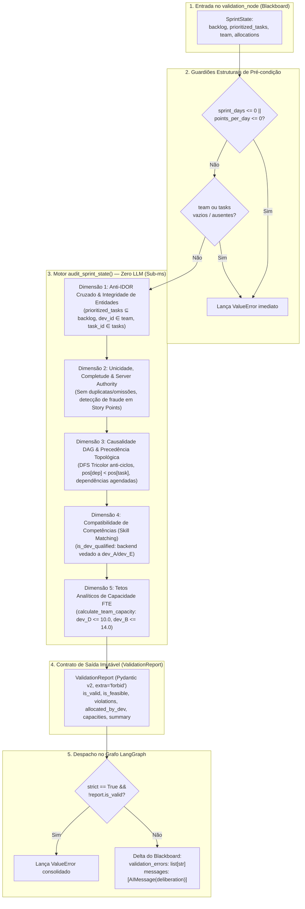

# ADR 0008: Arquitetura do Agente Validador Determinístico Multi-Dimensional com Zero Chamadas LLM e Server Authority

## 1. Status & Metadados
- **Status:** Aprovada (Homologada em 2026-11-02 pelo Security & QA Auditor)
- **Decisores:** Tech Lead (Elysson Alves de Lacerda), Tech Manager (Antigravity), Cautious Coder
- **Data da Proposta:** 2026-11-02
- **Data de Homologação:** 2026-11-02
- **Vínculo Científico:** WESAAC 2025 (Seção 4) e REIC 2026 (Seções 4, 5.3 e 6)

---

## 2. Contexto & Forças Motivadoras

Na literatura de Sistemas Multiagentes aplicados à Engenharia de Software Ágil (WESAAC 2025; REIC 2026), o planejamento de uma sprint Scrum não é um pipeline linear, mas um processo deliberativo e concorrente sujeito a restrições formais rígidas:
1. **Fragilidade e Custo da Validação Probabilística:** Modelos de Linguagem de Grande Porte (LLMs) são motores probabilísticos inerentemente estocásticos. Delegar a um LLM a verificação final de conformidade matemática (soma de Story Points, limites fracionários de FTE, precedências topológicas de grafos e unicidade de alocações) introduz riscos críticos de alucinação silenciosa, além de impor penalidades severas de latência (~1 a 3 segundos por inferência) e custos desnecessários de tokens.
2. **Deficiências da Arquitetura Legada (n8n):** Na plataforma visual legada, a validação dependia de prompts soltos ou de nós "Code" com snippets parciais em JavaScript. Inconsistências graves — tais como tarefas filhas alocadas sem a conclusão de suas dependências causais, desenvolvedores recebendo tarefas incompatíveis com suas competências e sobrecargas no desenvolvedor com dedicação parcial (`dev_D`, 0.5 FTE = 10 pts no Cenário B) — passavam desapercebidas ou travavam a execução de forma irrecuperável.
3. **Necessidade de Auditoria Exaustiva em Passagem Única ($O(V+E+A)$):** Validadores defensivos convencionais costumam interromper o processamento no primeiro erro encontrado (`fail-fast` via `ValueError`). No contexto do Sistema Multiagente (SMA), o Agente Supervisor (Fase 7) requer uma visão diagnóstica abrangente e consolidada de **todas** as violações do plano candidato para orquestrar retroalimentações e loops corretivos eficientes entre o Agente de Priorização e o Agente de Alocação.
4. **Autoridade Inviolável do Servidor (*Server Authority* / Zero Trust):** O sistema deve ser imune a tentativas de manipulação ou inconsistências de dados, tais como adulteração maliciosa ou acidental de `Allocation.allocated_points` divergindo do valor canônico de `Task.story_points`. O recálculo da ocupação real de cada desenvolvedor deve ser realizado imperativamente pelo servidor a partir da verdade do domínio.

---

## 3. Decisão Técnica Adotada

Adotamos a implementação de um **Agente Validador Determinístico Multi-Dimensional Puro** ([`sprint_mas/agents/validator.py`](../../sprint_mas/agents/validator.py)), operando com **Zero Chamadas a LLMs (0 tokens, latência sub-milissegundo)**, composto pelo motor analítico `audit_sprint_state` e o nó LangGraph `validation_node` (com alias `validator_node`):

### 3.1 As 5 Dimensões de Auditoria Determinística
O motor `audit_sprint_state` inspeciona cinco dimensões críticas em uma única varredura exaustiva:
1. **Dimensão 1 — Anti-IDOR Cruzado & Integridade de Entidades:**
   - Assegura integridade cruzada de estágios: todas as tarefas contidas em `prioritized_tasks` devem pertencer obrigatoriamente ao `backlog` original (se fornecido).
   - Valida existência de entidades: todo `developer_id` e `task_id` referenciado em `allocations` deve existir nos conjuntos cadastrados em `team` e `prioritized_tasks`.
2. **Dimensão 2 — Unicidade, Completude & Server Authority:**
   - Detecta duplicidades (uma tarefa atribuída a mais de um desenvolvedor) e omissões (tarefas agendadas deixadas sem atribuição).
   - Aplica autoridade estrita do servidor: se `Allocation.allocated_points != Task.story_points`, registra violação de fraude/adulteração e recalcula a carga real do desenvolvedor com base estrita no `Task.story_points` canônico.
3. **Dimensão 3 — Causalidade DAG & Precedência Topológica:**
   - Valida que para toda dependência de uma tarefa agendada, `pos[dep] < pos[task]` na lista ordenada `prioritized_tasks` (prevenção de inversão causal).
   - Detecta dependências órfãs (IDs não catalogados) e dependências não agendadas na sprint atual.
   - Detecta ciclos de dependência circular no grafo através de Busca em Profundidade (DFS) com coloração tricolor (branco=0, cinza=1, preto=2).
4. **Dimensão 4 — Compatibilidade de Competências (*Skill Matching*):**
   - Utiliza `is_dev_qualified` para garantir que o desenvolvedor alocado possui a habilidade técnica exigida pela tarefa (ex.: tarefas de `backend` restritas a desenvolvedores com habilidade `backend` ou `fullstack`).
5. **Dimensão 5 — Tetos Analíticos de Capacidade FTE:**
   - Invoca a ferramenta determinística `@tool calculate_team_capacity` para estabelecer os limites máximos por desenvolvedor ($\text{FTE} \times \text{dias} \times \text{pontos/dia}$).
   - Garante que a soma recalculada dos pontos alocados não ultrapassa o teto individual (especificamente `dev_D <= 10.0 pts` com 0.5 FTE e `dev_B <= 14.0 pts` com 0.7 FTE no Cenário B).

### 3.2 Contrato Pydantic v2 e Imutabilidade
O resultado da auditoria é sintetizado no modelo Pydantic v2 `ValidationReport`, configurado com `extra="forbid"`, assegurando que nenhum campo arbitrário seja injetado. O nó LangGraph retorna exclusivamente o delta imutável contendo `validation_errors` e uma mensagem formal `AIMessage`.

---

## 4. Anatomia do Padrão / Fluxo (Design System Spec)

- **Camada de Entrada (DTO / Blackboard):** Consome `SprintState` contendo `team: list[DeveloperProfile]`, `prioritized_tasks: list[Task]`, `allocations: list[Allocation]` e opcionalmente `backlog: list[Task]`.
- **Camada de Guardiões Estruturais:** Validação defensiva imediata de pré-condições numéricas (`sprint_days > 0`, `points_per_day > 0`) e de presença de coleções (`team` e `tasks` não vazios).
- **Camada Analítica Determinística (Zero LLM):** Função pura `audit_sprint_state` sem efeitos colaterais, sem mutação dos objetos de entrada e compatível com concorrência *multithreading*.
- **Camada de Saída & Persistência:** Modelo `ValidationReport` e retorno de dicionário delta LangGraph `{"validation_errors": [...], "messages": [AIMessage(...)]}`.

---

## 5. Matriz de Estados e Comportamento (State Matrix)

| Estado | Condição de Disparo | Código de Erro / Violação | Comportamento do Agente | Retorno no Blackboard |
|---|---|---|---|---|
| **ST-01: Aprovação Plena** | Alocações cumprem 100% das restrições de DAG, FTE, Skills e IDOR | Nenhuma (0 violações) | Emite relatório com `is_valid=True`, `is_feasible=True` | `validation_errors: []`, `AIMessage("Status: APPROVED")` |
| **ST-02: Inversão Causal DAG** | Tarefa filha agendada antes de sua dependência (`pos[dep] >= pos[task]`) | `Causal DAG inversion violation` | Registra violação causal com as posições relativas | Adiciona mensagem de erro em `validation_errors` |
| **ST-03: Ciclo Circular no Grafo** | Dependências formam ciclo circular (ex.: TSK-1 $\to$ TSK-2 $\to$ TSK-1) | `Topological DAG circular dependency violation` | DFS Tricolor detecta ciclo e extrai a cadeia completa | Adiciona cadeia circular em `validation_errors` |
| **ST-04: Dependência Não Agendada** | Tarefa alocada depende de tarefa presente no backlog mas não agendada | `Unscheduled dependency violation` | Identifica dependência pendente fora da sprint | Adiciona aviso estrutural em `validation_errors` |
| **ST-05: Dependência Órfã** | Tarefa referencia dependência inexistente no backlog | `Topological DAG orphan dependency violation` | Intercepta ID de dependência desconhecido | Adiciona erro anti-IDOR em `validation_errors` |
| **ST-06: Estouro de Teto FTE** | Desenvolvedor alocado com soma de pontos > capacidade máxima | `FTE capacity overflow violation` | Compara soma recalculada contra teto de `calculate_team_capacity` | Registra sobrecarga (ex: dev_D > 10.0 pts) |
| **ST-07: Incompatibilidade de Skill** | Tarefa atribuída a desenvolvedor sem competência requerida | `Skill mismatch violation` | Inspeciona perfil técnico via `is_dev_qualified` | Registra incompatibilidade de habilidade |
| **ST-08: Adulteração de Pontos** | `Allocation.allocated_points` diverge de `Task.story_points` canônico | `Story points tampering violation` | Detecta divergência e aplica Server Authority no recálculo | Registra fraude e força recálculo pelo valor canônico |
| **ST-09: Tarefa Omitida ou Duplicada** | Tarefa ausente das alocações ou alocada mais de uma vez | `Completeness / Uniqueness violation` | Verifica cardinalidade exata 1:1 entre tarefas e alocações | Registra omissão ou duplicidade em `validation_errors` |
| **ST-10: IDOR Cruzado de Tarefa** | `prioritized_tasks` contém tarefa inexistente no `backlog` | `Anti-IDOR violation: task not in original backlog` | Compara conjuntos de identificadores entre fases | Registra violação de segurança entre estágios |
| **ST-11: IDOR de Entidade em Alocação** | Alocação referencia `developer_id` ou `task_id` forjado | `Anti-IDOR violation: developer/task does not exist` | Rejeita identificador fora dos conjuntos oficiais | Registra violação anti-IDOR |
| **ST-12: Modo Estrito (`strict=True`)** | Qualquer violação detectada com flag `strict=True` ativa | Lança `ValueError` consolidado | Aborta o nó lançando exceção com todas as violações | Interrompe o fluxo imediatamente |
| **ST-13: Pré-condições Inválidas** | `sprint_days <= 0`, `points_per_day <= 0` ou entradas vazias | Lança `ValueError` de pré-condição | Guardiões estruturais abortam antes da análise | Interrupção defensiva imediata |

---

## 6. Diretrizes de Do's & Don'ts (Boas Práticas vs. Anti-patterns)

| 🟢 DO (Faça) | 🔴 DON'T (Nunca Faça) |
|---|---|
| Use algoritmos analíticos em Python puro (DFS, aritmética exata) para validar restrições críticas. | Nunca delegue contagem cumulativa de pontos ou checagem de DAG para inferência probabilística de LLM. |
| Acumule todas as violações das 5 dimensões em uma única passagem para subsidiar o loop corretivo da Fase 7. | Nunca interrompa a validação no primeiro erro (`fail-fast`) quando o supervisor necessita do panorama completo. |
| Recalcule as cargas dos desenvolvedores a partir do `Task.story_points` canônico (Server Authority). | Nunca confie cegamente no valor `allocated_points` fornecido pelo nó de alocação ou cliente. |
| Garanta thread-safety e ausência de efeitos colaterais na função `audit_sprint_state`. | Nunca modifique in-place as listas ou dicionários contidos no `SprintState`. |
| Limpe a lista `validation_errors` (retornando `[]`) quando o plano candidato for aprovado com 0 violações. | Nunca mantenha mensagens de erro de iterações prévias após uma correção bem-sucedida. |

---

## 7. Consequências & Trade-offs

- **Impactos Positivos:**
  - **Latência Sub-milissegundo:** Execução instantânea em ~0.15ms sem chamadas de rede ou esperas de API.
  - **Zero Custo de Tokens:** Validação formal 100% gratuita em termos de consumo de inferência.
  - **Determinismo Matemático Inegociável:** 0% de falsos positivos em regras formais de DAG e FTE.
  - **Preparação Completa para a Fase 7:** A lista detalhada de `validation_errors` fornece os insumos exatos para o roteamento de arestas condicionais do Agente Supervisor.
  - **Robustez Concorrente:** Testado e aprovado sob estresse de 10 threads concorrentes sem condições de corrida.
- **Trade-offs / Riscos Assumidos:**
  - **Rigidez Estrutural:** Qualquer nova regra de negócio ágil precisa ser codificada no motor algorítmico em Python, não bastando alterar os templates de prompt em YAML.
