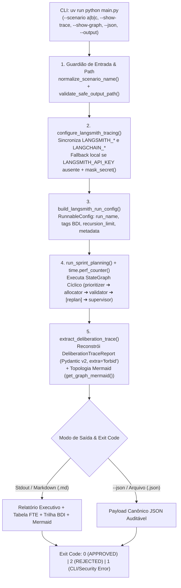

# ADR 0010: Observabilidade Híbrida LangSmith da Deliberação BDI e CLI Executiva Segura

## 1. Status & Metadados
- **Status:** Aprovada (Homologada em 2026-11-03 pelo Security & QA Auditor)
- **Decisores:** Tech Lead (Elysson Alves de Lacerda), Tech Manager (Antigravity), Cautious Coder
- **Data da Proposta:** 2026-11-03
- **Data de Homologação:** 2026-11-03
- **Vínculo Científico:** WESAAC 2025 (Seção 4) e REIC 2026 (Seções 5.3 e 6.3, p. 5–7)

---

## 2. Contexto & Forças Motivadoras

A execução do Sistema Multiagente (SMA) para planejamento de sprints Scrum requer observabilidade de ponta a ponta sobre o ciclo deliberativo BDI (*Belief–Desire–Intention*) e uma interface de linha de comando reprodutível para execução empírica dos Cenários A, B e C:

1. **Coleta Determinística das Métricas Experimentais (REIC 2026, Seções 5.3 e 6.3):**
   O protocolo experimental do artigo exige a aferição exata de três variáveis operacionais: (a) tempo de resposta monotônico entre o disparo e a consolidação do `SprintPlan` (`execution_time_ms`), (b) taxa de convergência e número de ciclos corretivos (`validation_attempts` e `replan_triggered`), e (c) inspeção qualitativa da deliberação de cada nó (`prioritizer` $\to$ `allocator` $\to$ `validator` $\to$ `replan` $\to$ `supervisor`) mapeada às camadas BDI.
2. **Assimetria de Variáveis LangSmith vs. LangChain e Falhas HTTP 401 Silenciosas:**
   Ecossistemas baseados em `langgraph` e `langchain-core` consultam tanto `LANGSMITH_TRACING` / `LANGSMITH_PROJECT` quanto `LANGCHAIN_TRACING_V2` / `LANGCHAIN_PROJECT`. Adicionalmente, habilitar `LANGSMITH_TRACING=true` sem uma `LANGSMITH_API_KEY` válida dispara tentativas de conexão em background que resultam em erros HTTP 401 e poluição de logs em ambientes locais ou de integração contínua (CI).
3. **Inspeção Offline da Deliberação BDI e Topologia do Grafo:**
   Pesquisadores e avaliadores acadêmicos precisam inspecionar a cadeia de raciocínio dos agentes e a máquina de estados compilada sem depender obrigatoriamente de conectividade externa ou de contas na nuvem LangSmith.
4. **Superfície de Segurança em Argumentos de Linha de Comando (Anti-Path Traversal & Segredos):**
   A exportação de relatórios via CLI (`--output`) introduz vetores de *Path Traversal* (ex: `--output ../../etc/passwd` ou sobrescrita de arquivos `.py`), enquanto dumps de configuração podem expor acidentalmente chaves sensíveis (`GROQ_API_KEY`, `LANGSMITH_API_KEY`) em logs ou artefatos JSON.

---

## 3. Decisão Técnica Adotada

Implementamos o módulo de **Observabilidade Híbrida e Telemetria BDI** ([`sprint_mas/telemetry.py`](../../sprint_mas/telemetry.py)) integrado ao orquestrador ([`sprint_mas/graph.py`](../../sprint_mas/graph.py)) e exposto através da **CLI Executiva Segura** ([`main.py`](../../main.py)), estruturado em quatro mecanismos complementares:

### 3.1 Sincronização e Fallback Automático do LangSmith (`configure_langsmith_tracing`)
A função `configure_langsmith_tracing` unifica as variáveis `LANGSMITH_TRACING` / `LANGCHAIN_TRACING_V2` e `LANGSMITH_PROJECT` / `LANGCHAIN_PROJECT`. Caso o tracing seja solicitado mas `LANGSMITH_API_KEY` esteja ausente ou vazia, o sistema desativa automaticamente o envio remoto (`tracing_enabled=False`) e opera em modo de telemetria local, retornando a chave mascarada via `mask_secret` (`***` para strings $\le 8$ caracteres ou `xxxx...yyyy` para strings maiores).

### 3.2 Enriquecimento de Metadados BDI no LangGraph (`build_langsmith_run_config`)
Cada invocação de `run_sprint_planning` constrói um `RunnableConfig` padronizado contendo:
- `run_name`: identificando o cenário (`sprint-mas:{scenario_name}`).
- `tags`: marcadores semânticos (`["sprint-mas", "bdi-architecture", "scenario:...", "reic-2026", "wesaac-2025"]`).
- `metadata`: parâmetros experimentais (`scenario`, `thread_id`, `sprint_goal`, `max_retries`, `sprint_days`, `points_per_day`, `bdi_layers`).
- `recursion_limit`: dimensionado dinamicamente como $\max(50, (max\_retries + 2) \times 5)$.

### 3.3 Extração Determinística da Trilha BDI (`extract_deliberation_trace`)
Sem mutar o `SprintState`, `extract_deliberation_trace` inspeciona o histórico `messages` e mapeia cada mensagem deliberativa para sua respectiva fase cognitiva BDI:
- `prioritizer` $\to$ `desires`
- `allocator` $\to$ `intentions_draft`
- `validator` $\to$ `governance_audit`
- `replan` $\to$ `corrective_replan`
- `supervisor` $\to$ `intentions_consolidated`

O resultado é encapsulado nos modelos imutáveis Pydantic v2 `DeliberationStep` e `DeliberationTraceReport` (`ConfigDict(extra="forbid")`), acompanhados do diagrama Mermaid extraído diretamente da estrutura compilada do grafo (`get_graph_mermaid`).

### 3.4 CLI Executiva com `argparse` Nativo e Guardião Anti-Path Traversal
O ponto de entrada `main.py` utiliza exclusivamente `argparse` da biblioteca padrão do Python 3.12 (zero novas dependências), validando o caminho de saída via `validate_safe_output_path`:
- Resolve caminhos absolutos e relativos contra a raiz do repositório com `target.is_relative_to(resolved_base)`.
- Restringe a escrita exclusivamente às extensões `.json` e `.md`.
- Padroniza códigos de saída POSIX/OS: `0` (plano aprovado), `2` (plano rejeitado pela governança / Circuit Breaker acionado) e `1` (erro de validação de parâmetros ou violação de segurança emitido em `stderr` sem stack trace bruto).

---

## 4. Anatomia do Padrão / Fluxo (Design System Spec)

- **Camada de Entrada (CLI & Validação):** `build_arg_parser()`, `normalize_scenario_name()` (whitelist contra `list_available_scenarios()`) e `validate_safe_output_path()`.
- **Camada de Configuração de Telemetria:** `configure_langsmith_tracing()`, `mask_secret()` e `build_langsmith_run_config()`.
- **Camada de Contratos de Rastreabilidade (DTOs):** `DeliberationStep` e `DeliberationTraceReport` com `ConfigDict(extra="forbid")`.
- **Camada de Reconstrução & Server Authority:** `extract_deliberation_trace()` e `_compute_developer_loads()` (que recalcula a utilização de FTE no servidor via `calculate_team_capacity.func`).
- **Camada de Apresentação & Exportação:** `format_cli_report()` (tabelas ASCII/Markdown) e `build_canonical_json_payload()` (serialização JSON canônica).

---

## 5. Matriz de Estados e Comportamento (State Matrix)

| Estado | Condição de Disparo | Modo de Tracing / Saída | Exit Code | Formato da Resposta / Efeito |
|---|---|---|:---:|---|
| **ST-01: Execução Aprovada (Cloud Tracing)** | Cenário viável (A ou B com poda) + `LANGSMITH_TRACING=true` + API Key válida | `ENABLED` (LangSmith Cloud + Local Trace) | `0` | `status: APPROVED`, `SprintPlan` completo, trace enviado ao LangSmith |
| **ST-02: Execução Aprovada (Local Fallback)** | Cenário viável + `LANGSMITH_API_KEY` ausente ou `LANGSMITH_TRACING=false` | `LOCAL FALLBACK` (100% Offline) | `0` | `status: APPROVED`, `DeliberationTraceReport` local sem erros HTTP 401 |
| **ST-03: Rejeição de Governança / Circuit Breaker** | `--scenario b --no-trim --max-retries 1` (estouro de FTE insolúvel sem poda) | Cloud ou Local | `2` | `status: REJECTED`, `sprint_plan: None`, lista de `validation_errors` detalhada |
| **ST-04: Exportação Segura de Artefato** | `--output reports/experiments/run.json` (ou `.md`) dentro do projeto | Escrita em disco validada | `0` ou `2` | Arquivo gravado com codificação UTF-8 dentro do diretório permitido |
| **ST-05: Bloqueio Anti-Path Traversal** | `--output ../evil.json`, `/tmp/out.json` ou extensão `.py` / `.exe` | Interceptado por `validate_safe_output_path` | `1` | `CLI Execution Error: Security violation...` em `stderr` (zero escrita em disco) |
| **ST-06: Parâmetros Inválidos de CLI** | `--scenario inexistente`, `--max-retries 99`, `--sprint-days 0` | Interceptado na validação de entrada | `1` | Mensagem de erro concisa em `stderr` sem exposição de stack trace |

---

## 6. Diretrizes de Do's & Don'ts (Boas Práticas vs. Anti-patterns)

| 🟢 DO (Faça) | 🔴 DON'T (Nunca Faça) |
|---|---|
| Use `configure_langsmith_tracing()` antes de invocar o grafo para sincronizar variáveis e validar a presença da API key. | Nunca ative `LANGCHAIN_TRACING_V2="true"` sem verificar se `LANGSMITH_API_KEY` está preenchida. |
| Aplique `mask_secret()` em qualquer chave de API antes de incluí-la em dicionários de status, logs ou payloads JSON. | Nunca exponha `LANGSMITH_API_KEY` ou `GROQ_API_KEY` em texto claro em relatórios ou no terminal. |
| Valide qualquer caminho de arquivo fornecido pelo usuário com `validate_safe_output_path()` e `Path.is_relative_to()`. | Nunca execute `open(args.output, "w")` diretamente sobre argumentos recebidos via linha de comando. |
| Utilize `time.perf_counter()` para medir `execution_time_ms` de forma monotônica e imune a ajustes de relógio do SO. | Nunca use `time.time()` para benchmarking de latência de execução de grafos. |

---

## 7. Consequências & Trade-offs

- **Impactos Positivos:**
  - **Observabilidade Dual (Cloud + Offline):** Rastreabilidade completa no dashboard web do LangSmith quando online e reconstrução local idêntica via `--show-trace` e `--show-graph` quando offline.
  - **Segurança Operacional de CLI:** Bloqueio comprovado contra *Path Traversal*, escrita de extensões arbitrárias e vazamento de credenciais.
  - **Automação de Benchmarks Científicos:** Códigos de saída distintos (`0`, `1`, `2`) e saída `--json` canônica habilitam a execução automatizada de baterias experimentais na Fase 9.
  - **Suíte de Testes Expandida:** 24 novos testes em [`tests/test_cli_telemetry.py`](../../tests/test_cli_telemetry.py), elevando a suíte global para **149 testes passando (100% OK)**.
- **Trade-offs / Riscos Assumidos:**
  - **Identificação Baseada em Cabeçalhos Deliberativos:** A reconstrução local de `DeliberationStep` mapeia os nós a partir dos cabeçalhos padronizados emitidos pelos agentes no `SprintState["messages"]`, exigindo que os nós mantenham o prefixo contratual `### <Agent> Agent Deliberation`.
