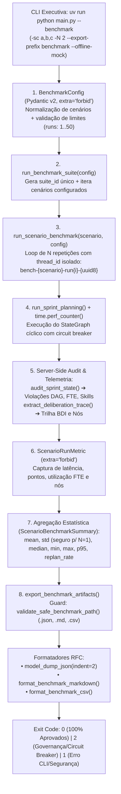

# ADR 0011: Protocolo de Benchmarking Automatizado e Coleta de Métricas Empíricas

## 1. Status & Metadados
- **Status:** Aprovada (Homologada em 2026-11-04 pelo Security & QA Auditor)
- **Decisores:** Tech Lead (Elysson Alves de Lacerda), Tech Manager (Antigravity), Cautious Coder
- **Data da Proposta:** 2026-11-04
- **Data de Homologação:** 2026-11-04
- **Vínculo Científico:** WESAAC 2025 (Seção 4) e REIC 2026 (Seções 5.1, 5.2, 5.3, 6.1, 6.2 e 6.3, p. 5–8)

---

## 2. Contexto & Forças Motivadoras

A validação formal do Sistema Multiagente (SMA) para planejamento ágil de sprints requer a reprodução sistemática, auditável e automatizada das baterias experimentais descritas nas publicações de referência (WESAAC 2025 e REIC 2026):

1. **Reprodutibilidade Científica Multi-Cenário (Cenários A, B e C):**
   Os artigos definem três cenários com graus crescentes de complexidade: Cenário A (smoke test com 10 tarefas e equipe homogênea), Cenário B (alta complexidade com 30 tarefas, dependências causais em cadeia e gargalo severo de backend) e Cenário C (estresse e escalabilidade com 100 tarefas). Avaliar empiricamente o SMA exige executar baterias isoladas e combinadas desses cenários com número arbitrário de repetições ($N$ *runs*).
2. **Isolamento Concorrente e Imunidade à Contaminação de Memória:**
   O orquestrador LangGraph emprega checkpointing com `MemorySaver`. Execuções sucessivas de benchmarks não podem reaproveitar o mesmo `thread_id`, sob risco de contaminação cruzada de mensagens deliberativas (`messages`), reuso indevido de planos anteriores ou falha silenciosa em checagens de idempotência.
3. **Autoridade do Servidor (*Server Authority*) na Coleta de Métricas:**
   Em um ambiente experimental rigoroso, métricas de qualidade como violações de DAG (dependências causais e ciclos), sobrecargas de capacidade de desenvolvedores (tetos de FTE) e incompatibilidade de habilidades técnicas (*skills*) não podem ser reportadas de maneira auto-declarativa pelo LLM. O cálculo deve ser realizado exclusivamente pelo servidor através de motores determinísticos ([`audit_sprint_state`](../../sprint_mas/agents/validator.py) e [`calculate_team_capacity`](../../sprint_mas/tools.py)).
4. **Agregação Estatística Robusta e Resiliente:**
   A caracterização da latência de execução requer cálculos de média, mediana, valor mínimo, valor máximo e percentil 95 (P95). Em cenários com apenas uma repetição ($N=1$), a computação do desvio padrão amostral não deve lançar exceções (`statistics.StatisticsError`), devendo convergir de forma determinística para `0.0`.
5. **Exportação Tripla e Segurança contra *Path Traversal*:**
   Pesquisadores necessitam de múltiplos formatos de exportação: JSON estruturado para ingestão por pipelines de dados, Markdown para relatórios executivos e publicação acadêmica, e CSV (RFC 4180) para análise quantitativa em R, Python Pandas ou planilhas. A geração desses artefatos via CLI não pode introduzir brechas de *Path Traversal* (ex: escapes via `../`) nem permitir a escrita de arquivos com extensões executáveis arbitrárias.

---

## 3. Decisão Técnica Adotada

Implementamos o módulo de **Benchmarking Científico Automatizado** ([`sprint_mas/benchmarks.py`](../../sprint_mas/benchmarks.py)) integrado ao ponto de entrada da **CLI Executiva** ([`main.py`](../../main.py)), estruturado na seguinte arquitetura:

### 3.1 Contratos de Dados Imutáveis (Pydantic v2 com `extra="forbid"`)
Todas as estruturas de configuração e métricas são estritamente tipadas e protegidas contra *Mass Assignment*:
- `BenchmarkConfig`: encapsula a lista de cenários normalizados, repetições ($1 \le runs \le 50$), provedor de LLM, modelo, temperatura, modo offline (`offline_mock`), limites de circuit breaker (`max_retries`) e poda de escopo (`enable_scope_trimming`).
- `ScenarioRunMetric`: registro individual de cada repetição contendo latência monotônica (`time.perf_counter`), status de aprovação, contadores de tarefas e pontos alocados, utilização analítica de FTE, violações detectadas pelo servidor e lista ordenada de nós percorridos no grafo.
- `ScenarioBenchmarkSummary`: agregação analítica consolidando taxas de aprovação e replanejamento, métricas de tempo (média, desvio padrão, mediana, P95), totais acumulados de violações e coleção de `runs_metrics`.
- `BenchmarkSuiteReport`: sumário consolidado da suíte com identificador único (`suite_id`), carimbo de data/hora ISO 8601 em UTC, metadados do provedor e modelo, e indicador global `all_approved`.

### 3.2 Isolamento Estrito de Sessão por Repetição
Para anular qualquer interferência entre repetições consecutivas no `MemorySaver`, cada execução gera uma chave de sessão criptograficamente imprevisível:
$$\text{thread\_id} = \text{"bench-" } + \text{canonical\_scenario} + \text{"-run"} + i + \text{"-"} + \text{uuid4().hex[:8]}$$
Isso assegura que o estado anterior do grafo não influencie o histórico deliberativo nem os contadores do disjuntor.

### 3.3 Auditoria pelo Servidor (*Server Authority*)
As violações de integridade são contabilizadas exclusivamente por inspeção algorítmica pós-execução do estado final:
- Violações de DAG: detectadas via `audit_sprint_state` por DFS com coloração tricromática ($O(V+E)$), checando inversões causais, tarefas órfãs e dependências não agendadas.
- Violações de FTE: checadas calculando o teto nominal da equipe via `calculate_team_capacity.func(team, sprint_days, points_per_day)` e comparando com as alocações consolidadas.
- Violações de Competência: verificadas cruzando as habilidades requeridas pela tarefa contra o perfil técnico formal do desenvolvedor designado (`is_dev_qualified`).

### 3.4 Agregação Estatística Monotônica e Interpolação Linear de P95
- O desvio padrão amostral utiliza `statistics.stdev(times)` quando $\text{len}(times) > 1$, e converge compulsoriamente para `0.0` quando $\text{len}(times) = 1$, prevenindo quebras de execução.
- O percentil 95 (P95) aplica interpolação linear ponderada sobre os tempos ordenados:
  $$\text{rank} = 0.95 \times (n - 1), \quad \text{lower} = \lfloor \text{rank} \rfloor, \quad \text{upper} = \min(\text{lower} + 1, n - 1), \quad w = \text{rank} - \text{lower}$$
  $$P_{95} = \text{times}[\text{lower}] \times (1.0 - w) + \text{times}[\text{upper}] \times w$$

### 3.5 Guardião de Escrita Anti-Path Traversal e Exportação Tripla
A função `validate_safe_benchmark_path` impõe duas barreiras defensivas:
1. Resolução estrita com verificação de ancestralidade via `Path.is_relative_to(base_dir)` (ou `startswith` defensivo), bloqueando tentativas de escape do repositório (ex: `../../evil.csv` ou caminhos absolutos como `/etc/passwd`).
2. Whitelist restritiva de extensões permitidas: exclusivamente `.json`, `.md` e `.csv`.

A exportação automatizada via `export_benchmark_artifacts` grava simultaneamente os três artefatos no diretório seguro `reports/experiments/`.

---

## 4. Anatomia do Padrão / Fluxo (Design System Spec)

- **Camada de Entrada & Configuração (DTO):** `BenchmarkConfig`, com normalização automática de nomes de cenários (`normalize_scenario_name`) contra o catálogo de `data/processed/`.
- **Camada de Isolamento de Sessão & Execução do Grafo:** `run_scenario_benchmark` e `run_benchmark_suite`, orquestrando chamadas ao `run_sprint_planning` sob chaves únicas de thread.
- **Camada de Verificação Analítica & Server Authority:** `audit_sprint_state` e `calculate_team_capacity`, computando com zero dependência de auto-avaliação do LLM as violações de DAG, sobrecargas de FTE e desvios de competências.
- **Camada Estatística & Agregação:** Cálculos monotônicos de média, desvio padrão condicional, mediana, min, max e P95 interpolado em `ScenarioBenchmarkSummary`.
- **Camada de Exportação Segura & Sanitização de Caminhos:** `validate_safe_benchmark_path`, `format_benchmark_markdown`, `format_benchmark_csv` e `export_benchmark_artifacts`.
- **Camada de Apresentação e CLI:** Flags `--benchmark`, `--scenarios`, `--runs`, `--offline-mock` e `--export-prefix` integradas a `main.py`.

---

## 5. Matriz de Estados e Comportamento (State Matrix)

| Estado | Condição de Disparo | Modo de Execução / Saída | Exit Code | Formato da Resposta / Efeito |
|---|---|---|:---:|---|
| **BM-01: Bateria Completa com Sucesso** | Todos os cenários e repetições aprovados pelo supervisor (`all_approved == True`) | `--benchmark` (Online ou `--offline-mock`) | `0` | Tabela Markdown com métricas empíricas e status `APPROVED` |
| **BM-02: Rejeição de Governança / Circuit Breaker** | Cenário inviável sem poda de escopo (`--no-trim --max-retries 1`) | Grafo desvia para rejeição formal | `2` | Relatório consolidado com taxa de aprovação $< 1.0$ e status `REJECTED` |
| **BM-03: Exportação Automatizada de Artefatos** | Flag `--export-prefix <nome>` ou `--output <path>` | Escrita validada em `reports/experiments/` | `0` ou `2` | Gravação simultânea de `<prefix>.json`, `<prefix>.md` e `<prefix>.csv` |
| **BM-04: Bloqueio Anti-Path Traversal** | Argumento `--output ../evil.csv` ou caminho fora do projeto | Interceptado por `validate_safe_benchmark_path` | `1` | `CLI Execution Error: Security violation: path escapes repository...` em `stderr` |
| **BM-05: Extensão de Arquivo Proibida** | Argumento `--output reports/experiments/exploit.py` ou `.exe` | Interceptado na checagem de sufixo | `1` | `CLI Execution Error: Security violation: forbidden extension...` em `stderr` |
| **BM-06: Parâmetros Fora dos Limites de CLI** | `--runs 0`, `--runs 99`, `--scenarios inexistente` | Rejeitado na instanciação de `BenchmarkConfig` | `1` | Mensagem explicativa em `stderr` sem stack trace exposto |
| **BM-07: Execução Unitária ($N=1$)** | Benchmark executado com `--runs 1` | `std_time_ms` ajustado para `0.0` | `0` | Sumário estatístico sem exceção de divisão por zero |

---

## 6. Diretrizes de Do's & Don'ts (Boas Práticas vs. Anti-patterns)

| 🟢 DO (Faça) | 🔴 DON'T (Nunca Faça) |
|---|---|
| Gere um `thread_id` único e aleatório para cada repetição de benchmark (`bench-{scenario}-run{i}-{uuid8}`). | Nunca execute múltiplas repetições reutilizando o mesmo `thread_id` no `MemorySaver`. |
| Recalcule violações de DAG, FTE e competências estritamente no servidor via `audit_sprint_state`. | Nunca confie na contagem de violações ou no status de aprovação reportado linguisticamente pelo LLM. |
| Trate o cálculo de desvio padrão para retornar `0.0` quando o número de amostras for igual a 1. | Nunca invoque `statistics.stdev()` sem verificar se a lista contém pelo menos 2 elementos. |
| Valide os caminhos de exportação com `validate_safe_benchmark_path` antes de abrir qualquer descritor de arquivo. | Nunca use concatenação direta de strings (`f"{output_dir}/{user_input}"`) para escrita em disco. |
| Restrinja os arquivos exportados exclusivamente aos formatos de dados `.json`, `.md` e `.csv`. | Nunca permita exportação para extensões de script (`.py`, `.sh`, `.bat`) ou executáveis. |

---

## 7. Consequências & Trade-offs

- **Impactos Positivos:**
  - **Evidências Experimentais Concretas:** A execução da suíte sobre os Cenários A, B e C gerou os primeiros dados empíricos unificados do SMA:
    - **Cenário A:** 10/10 tarefas, 35/60 pts alocados (58.3% de utilização), 1 tentativa, 0 replans, 0 violações, tempo médio de 62.77 ms.
    - **Cenário B:** 30 tarefas reduzidas para 15 viáveis, 66/84 pts alocados (78.6% de utilização), convergência em 2 tentativas com auto-replanejamento, 0 violações de DAG/FTE/Skills, tempo médio de 26.97 ms.
    - **Cenário C:** 100 tarefas reduzidas para 37 tarefas viáveis, 176/184 pts alocados (95.7% de utilização da equipe), 2 tentativas com auto-replanejamento, 0 violações, tempo médio de 88.89 ms.
    - **Status Global da Bateria:** 3/3 cenários aprovados com 100% de conformidade lógica e tempo total de 603.63 ms.
  - **Tripla Exportação Auditável:** Criação automática dos arquivos canônicos `reports/experiments/benchmark.json`, `reports/experiments/benchmark.md` e `reports/experiments/benchmark.csv`.
  - **Segurança de Execução em Lote:** Imunidade comprovada contra *Path Traversal*, corrupção de memória e valores fora dos limites.
  - **Suíte de Testes Expandida:** Adição de 34 testes automatizados em [`tests/test_benchmarks.py`](../../tests/test_benchmarks.py), elevando a cobertura para **184 testes passando (100% OK)**.
- **Trade-offs / Riscos Assumidos:**
  - **Tempo de Execução da Bateria Completa:** Baterias com dezenas de repetições ($N > 20$) em modo de rede contra provedores remotos (Groq) estão sujeitas a rate limits da API em nuvem; para testes de carga em larga escala, recomenda-se a flag `--offline-mock` ou provedores locais Ollama.
