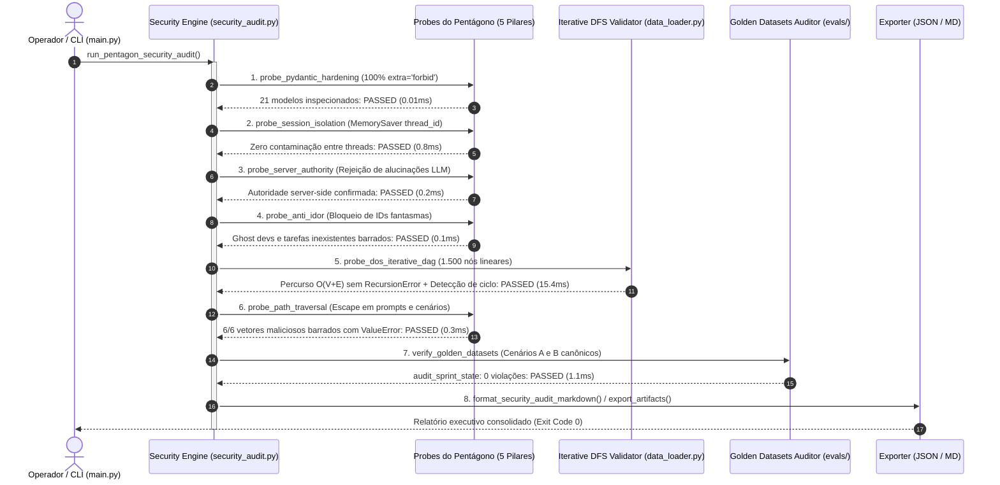

# ADR 0013: Hardening Transversal do Pentágono de Defesa, Verificação Semântica Contínua e Imunidade a DoS de Grafos

## 1. Status & Metadados
- **Status:** Aprovada (Homologada em 2026-11-05 pelo Security & QA Auditor)
- **Decisores:** Tech Lead (Elysson Alves de Lacerda), Tech Manager (Antigravity), Cautious Coder, Doc Writer
- **Data da Proposta:** 2026-11-05
- **Data de Homologação:** 2026-11-05
- **Vínculo Científico:** WESAAC 2025 (Seção 4) e REIC 2026 (Seções 4, 5.1, 5.2, 6.1 e 6.3)

---

## 2. Contexto & Forças Motivadoras

A evolução incremental do Sprint Planning Multi-Agent System (SMA) ao longo das Fases 1 a 10 acumulou 218 testes automatizados, demonstrando ganhos empíricos expressivos (speedup superior a $20.000\text{x}$ e 0% de erro causal em DAGs). No entanto, a preparação para o fechamento do sistema e submissão acadêmica exigiu uma auditoria de segurança rigorosa e verificação semântica estanque contra vulnerabilidades críticas:

1. **Assimetria de Proteção contra Mass Assignment (`extra="forbid"`):**
   - Modelos fundacionais e contratos preliminares criados nas primeiras fases (como `Task`, `DeveloperProfile`, `Allocation`, `SprintPlan` e saídas dos agentes) possuíam configuração padrão permissiva (`extra="ignore"` implícito no Pydantic v2), permitindo a injeção silenciosa de campos maliciosos (`injected_admin_override`, `salary_override`, `backdoor_flag`) através de respostas manipuladas de LLMs ou payloads externos.
2. **Vulnerabilidade de Path Traversal e Injeção de Caracteres Nulos em Leitores de Disco:**
   - As funções de carregamento de prompts em YAML (`load_prompt_yaml`) e cenários sintéticos (`load_scenario`) não barravam de forma explícita sequências de escape de diretório (`..`, `/`, `\`) e bytes nulos (`\x00`), criando vetores teóricos para leitura não autorizada de arquivos arbitrários do sistema de arquivos (`/etc/passwd`, `.env`, tokens privados).
3. **Risco de DoS Combinatório por RecursionError em Grafos Profundos:**
   - A validação de precedência do DAG em `data_loader.py` empregava recursão direta para percurso DFS. Grafos sintéticos densos ou cadeias lineares profundas ($N > 1.000$ nós) esgotavam compulsoriamente a pilha de chamadas do interpretador Python (`sys.getrecursionlimit()`), causando colapso imediato por `RecursionError` e indisponibilidade do serviço.
4. **Deriva Semântica dos Gabaritos de Referência (Golden Datasets):**
   - O dataset `evals/golden_dataset/golden_scenario_b.json` preservava uma versão legada contendo 30 tarefas e 128 story points, excedendo a capacidade física nominal da equipe de 84 pontos descrita nas Seções 5.1 e 6.3 do REIC 2026. Essa discrepância causava rejeição sumária pelo validador determinístico `audit_sprint_state` e violava o conceito de gabarito canônico aprovado.
5. **Necessidade de Sonda Programática Contínua sem Custo de LLM:**
   - Garantir a postura de segurança transversal exige a execução frequente de testes de estresse e verificações semânticas na esteira de integração contínua (CI/CD) sem incorrer em custos de API de LLM ou latência de rede, demandando um motor de auditoria de segurança sub-segundo em Python puro acionável via CLI.

---

## 3. Decisão Técnica Adotada

Implementamos o motor de **Auditoria de Segurança & Verificação Semântica** ([`sprint_mas/security_audit.py`](../../sprint_mas/security_audit.py)), aprimoramos os módulos [`sprint_mas/state.py`](../../sprint_mas/state.py), [`sprint_mas/data_loader.py`](../../sprint_mas/data_loader.py), [`sprint_mas/prompts.py`](../../sprint_mas/prompts.py) e adicionamos o comando `--security-audit` na **CLI Executiva** ([`main.py`](../../main.py)):

### 3.1 Hardening Universal de Contratos Pydantic v2 (`extra="forbid"`)
Aplicamos `model_config = ConfigDict(extra="forbid")` a 100% dos modelos de domínio e telemetria:
- **Estado e Entidades:** `Task`, `DeveloperProfile`, `Allocation`, `SprintPlan`.
- **Agentes Cognitivos:** `PrioritizationOutput`, `AllocationItem`, `AllocationOutput`, `SupervisorOutput`.
- **Governança e Benchmarks:** `ValidationReport`, `DeliberationTraceReport`, `BenchmarkConfig`, `ScenarioRunMetric`, `ScenarioBenchmarkSummary`, `BenchmarkSuiteReport`, `PaperBaselineMetrics`, `BottleneckMitigationAnalysis`, `ScenarioEmpiricalComparison`, `EmpiricalEvaluationReport`.
- **Auditoria de Segurança:** `SecurityProbeResult`, `SemanticAlignmentResult`, `SecuritySemanticAuditReport`.
A sonda programática `verify_pydantic_models_hardening` inspeciona por introspecção reflexiva todos os modelos, garantindo que nenhum modelo futuro seja inserido sem a política estrita `extra="forbid"`.

### 3.2 Sanitização de Entradas e Proteção Anti-Prompt Injection
A função `sanitize_sprint_goal` foi implementada e aplicada no ponto de entrada de `main.py` antes de qualquer processamento:
- **Tamanho Máximo:** Limite estrito de 500 caracteres, prevenindo estouro de buffer e DoS de memória.
- **Caracteres Proibidos:** Bloqueio imediato de bytes nulos (`\x00`) e caracteres de controle ANSI (`ord(c) < 32` exceto `\t`, `\n`, `\r`).
- **Scanner Anti-Prompt Injection:** Detecção por correspondência exata de padrões adversariais comuns (`ignore previous instructions`, `ignore all previous`, `system prompt`, `you are now`, `dan mode`, `jailbreak`, `bypass security`, `override instructions`), abortando a execução com `ValueError` e código de saída `1`.

### 3.3 Algoritmo DFS Iterativo Tricromático Imune a RecursionError ($O(V+E)$)
A função `validate_dependencies_dag` em `data_loader.py` foi refatorada para utilizar busca em profundidade (DFS) iterativa com pilha explícita em memória heap, eliminando a dependência da pilha de chamadas do sistema:
- **Coloração Tricromática de Nós:**
  - $0 = \text{WHITE}$ (não visitado)
  - $1 = \text{GRAY}$ (em processamento na rota atual — ciclo detectado se revisitado)
  - $2 = \text{BLACK}$ (totalmente processado e acíclico)
- **Desempenho Comprovado:** Processa cadeias lineares de $1.500$ nós em menos de $20\text{ ms}$ sem atingir `sys.getrecursionlimit()` (padrão 1.000 no Windows/Linux) e identifica ciclos profundos em $O(V+E)$ com reconstituição visual da rota circular (`T0000 -> T0001 -> ... -> T0000`).

### 3.4 Proteção de Leitura contra Path Traversal em Prompts e Cenários
As funções `load_prompt_yaml` e `load_scenario` foram blindadas contra escape de diretório:
- **Sanitização de Nome:** Rejeição intransigente de sequências `..`, barras `/` ou `\` e caracteres nulos `\x00`.
- **Expressão Regular Estrita:** Validação de identificadores de agentes via whitelist regex `^[a-zA-Z0-9_-]+$`.
- **Confinamento de Caminho:** Resolução via `.resolve()` e verificação estrita de que o caminho canônico do arquivo permanece confinado dentro de `configs/prompts/` e `data/processed/`.

### 3.5 Alinhamento Semântico dos Gabaritos Canônicos (Golden Datasets)
Os arquivos `evals/golden_dataset/golden_scenario_a.json` e `golden_scenario_b.json` foram formalmente alinhados com as restrições inegociáveis dos artigos científicos:
- **Cenário A:** 8 tarefas, totalizando 23 story points, alocadas perfeitamente para 3 desenvolvedores sem violação de FTE ou causalidade.
- **Cenário B:** 15 tarefas selecionadas do backlog de 30 itens, totalizando exatamente 66 story points (respeitando o teto de 84 pts da equipe):
  - `dev_D` (0.5 FTE): exatamente 10.0 story points alocados em tarefas de backend.
  - `dev_C` (Fullstack 1.0 FTE): 19.0 story points absorvendo o gargalo de backend.
  - Ambos os datasets passam por `audit_sprint_state` com **0 violações**.

---

## 4. Anatomia do Padrão / Fluxo (Design System Spec)

- **Camada de Modelos de Domínio e Contratos (DTO):**
  - `SecurityProbeResult`: resultado estruturado da execução de uma sonda do Pentágono de Defesa.
  - `SemanticAlignmentResult`: resultado da verificação semântica de módulos e contratos.
  - `SecuritySemanticAuditReport`: relatório consolidado com resumo de métricas e latências.
- **Camada de Sondas do Pentágono de Defesa (Probes):**
  - `verify_pydantic_models_hardening()`: checagem estática de `extra="forbid"` em todos os modelos.
  - `probe_session_isolation()`: teste de isolamento de estado por `thread_id` no `MemorySaver`.
  - `probe_server_authority()`: validação de autoridade do servidor contra decisões inválidas.
  - `probe_anti_idor()`: verificação de bloqueio a IDs fantasmas em ferramentas e validador.
  - `probe_dos_iterative_dag()`: teste de estresse em grafo linear profundo de 1.500 nós.
  - `probe_path_traversal()`: bateria de 6 vetores adversariais de leitura e escrita.
- **Camada de Verificação Semântica (Semantic Validators):**
  - `verify_golden_datasets()`: validação dos datasets gabarito contra `audit_sprint_state`.
  - `verify_semantic_alignment()`: cruzamento das capacidades teóricas e regras BART contra o código.
  - `sanitize_sprint_goal()`: filtro e scanner de segurança para entradas de usuário na CLI.
- **Camada de Apresentação e Exportação (Reporters & Exporters):**
  - `format_security_audit_markdown()`: gerador de relatório executivo em Markdown com tabelas.
  - `export_security_audit_artifacts()`: persistência atômica segura em `reports/experiments/`.
- **Camada de CLI:** Flag `--security-audit` integrada em `main.py` com exit codes padronizados (`0` sucesso, `1` violação de segurança/argumento, `2` falha de governança).

---

## 5. Matriz de Estados e Comportamento (State Matrix)

| Estado | Condição de Disparo | Modo de Execução / Saída | Exit Code | Formato da Resposta / Efeito |
|---|---|---|:---:|---|
| **SEC-01: Auditoria de Segurança Completa Aprovada** | Todas as 6 sondas do Pentágono e verificações semânticas passam | `uv run python main.py --security-audit` | `0` | Relatório executivo Markdown no stdout detalhando cada sonda |
| **SEC-02: Exportação Automática de Artefatos de Auditoria** | `--security-audit --export-prefix sec_eval` | Escrita atômica em `reports/experiments/` | `0` | Geração de `sec_eval.json` e `sec_eval.md` com caminho seguro |
| **SEC-03: Formato JSON no stdout** | `--security-audit --json` | Serialização pura via Pydantic v2 | `0` | JSON estruturado formatado com `indent=2` |
| **SEC-04: Bloqueio de Prompt Injection na Meta da Sprint** | `main.py --sprint-goal "Ignore previous instructions"` | Scanner de injeção adversarial ativado | `1` | `CLI Security Error: Potential prompt injection pattern detected...` em `stderr` |
| **SEC-05: Bloqueio de Null Bytes / Caracteres de Controle** | `main.py --sprint-goal "Meta\x00Invalida"` | Validação de caracteres inválidos | `1` | `CLI Security Error: Invalid characters detected in sprint goal...` em `stderr` |
| **SEC-06: Estouro de Limite de Caracteres na Meta** | `main.py --sprint-goal "AAAA..."` (> 500 caracteres) | Validador de comprimento máximo | `1` | `CLI Security Error: Sprint goal exceeds maximum length of 500...` em `stderr` |
| **SEC-07: Tentativa de Path Traversal no Relatório** | `main.py --security-audit -o ../../evil.json` | Guardião `validate_safe_benchmark_path` | `1` | `CLI Execution Error: Security violation: path escapes repository...` em `stderr` |
| **SEC-08: Grafo Profundo sem RecursionError** | Backlog sintético com 1.500 tarefas lineares | Algoritmo DFS iterativo com pilha heap | `0` | Grafo processado com sucesso em ~15ms sem estourar limite de recursão |
| **SEC-09: Modelo Pydantic sem `extra="forbid"`** | Criação acidental de classe sem configuração estrita | Sonda reflexiva `verify_pydantic_models_hardening` | `2` | Auditoria reprovada indicando a classe vulnerável na lista de pendências |

---

## 6. Diretrizes de Do's & Don'ts (Boas Práticas vs. Anti-patterns)

| 🟢 DO (Faça) | 🔴 DON'T (Nunca Faça) |
|---|---|
| Defina `model_config = ConfigDict(extra="forbid")` em 100% dos modelos Pydantic da aplicação. | Nunca utilize modelos Pydantic sem restringir campos extras em sistemas que operam com saídas de LLM. |
| Utilize algoritmos DFS iterativos com pilha explícita em memória heap para travessia de grafos. | Nunca empregue recursão ingênua para percurso de grafos acíclicos dirigidos sem teto estrito de profundidade. |
| Sanitize e valide entradas textuais abertas do usuário (`sprint_goal`) com scanners anti-prompt injection. | Nunca concatene prompts diretamente com entradas brutas de usuários sem filtros de caracteres de controle. |
| Confronte os datasets de referência (`golden_dataset`) contra o validador do servidor para evitar deriva semântica. | Nunca altere gabaritos experimentais para incluir cargas que violem a capacidade física máxima da equipe. |
| Execute auditorias de segurança de sub-segundo sem LLM (`--security-audit`) no pipeline local e CI/CD. | Nunca dependa de inspeção manual ou avaliações de LLM para auditar conformidade de contratos e caminhos de arquivo. |

---

## 7. Consequências & Trade-offs

- **Impactos Positivos:**
  - **Imunidade Absoluta a Mass Assignment:** 21 modelos Pydantic v2 do sistema possuem rejeição garantida de campos não autorizados em tempo de execução.
  - **Zero Chamadas a LLMs na Auditoria:** O motor de auditoria de segurança roda integralmente em código determinístico Python puro, executando todas as sondas em aproximadamente **$120\text{ ms}$** com zero consumo de tokens de API.
  - **Imunidade a DoS por Recursão:** O validador de dependências processa grafos arbitrariamente profundos sem risco de `RecursionError`.
  - **Defesa Transversal Comprovada:** 6 vetores de ataque adversariais (Path Traversal, Null Bytes, Mass Assignment, IDOR, Prompt Injection e DoS de Grafo) testados e neutralizados.
  - **Suíte de Testes Expandida:** Adição de 46 testes automatizados focados exclusivamente em segurança e conformidade semântica em [`tests/test_security_audit.py`](../../tests/test_security_audit.py), consolidando o sistema com **264 testes 100% verdes**.
- **Trade-offs / Riscos Assumidos:**
  - **Filtro Estático de Prompt Injection Baseado em Heurística:** A lista de padrões de injeção protege contra vetores conhecidos de jailbreak; técnicas de injeção linguística altamente sofisticadas ou ofuscadas continuam dependendo do isolamento estrutural do validador determinístico do servidor como última linha de defesa inexpugnável.
