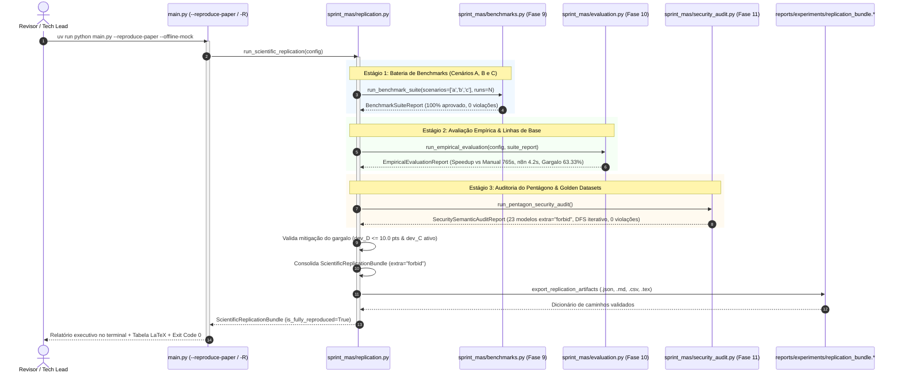

# ADR 0014: Pacote de Reprodutibilidade Científica, Execução em 1 Clique e Consolidação Documental

## 1. Status & Metadados
- **Status:** Aprovada (Homologada em 2026-11-06 pelo Security & QA Auditor)
- **Decisores:** Tech Lead (Elysson Alves de Lacerda), Tech Manager (Antigravity), Cautious Coder, Security Auditor, Doc Writer
- **Data da Proposta:** 2026-11-06
- **Data de Homologação:** 2026-11-06
- **Vínculo Científico:** WESAAC 2025 (Seção 4) e REIC 2026 (Seções 1, 2.3, 3.2, 5.1, 5.2, 6.1, 6.2 e 6.3)

---

## 2. Contexto & Forças Motivadoras

A implementação incremental do Sprint Planning Multi-Agent System (SMA) nas Fases 1 a 11 culminou em uma base de software de alta maturidade técnica, munida de 264 testes automatizados, validação de restrições de DAG em $O(V+E)$, mitigação formal de gargalos qualitativos via desenvolvedor Fullstack (Seção 6.3 do REIC 2026) e auditoria contínua do Pentágono de Defesa Expandido.

Contudo, para atingir o padrão ouro de reprodutibilidade científica (exigido por periódicos como a REIC/SBC e conferências como o WESAAC), emergiram três necessidades prementes:

1. **Dispersão de Comandos e Parâmetros Experimentais:**
   - As baterias de testes empíricos estavam fragmentadas entre diferentes parâmetros de linha de comando (`--benchmark` na Fase 9, `--evaluate-human` na Fase 10 e `--security-audit` na Fase 11). Um revisor acadêmico necessitava orquestrar sequências de comandos complexas para verificar o cumprimento de todas as hipóteses do artigo.
2. **Ausência de Coleção Executiva de Request Specs (Postman/Insomnia):**
   - Engenheiros e avaliadores externos que validam APIs backend necessitam de uma suíte formal de requisições no padrão Postman Collection v2.1.0, contendo asserções automatizadas em JavaScript (`pm.test`) que chequem o status `APPROVED`, o cumprimento do teto de 0.5 FTE de `dev_D` ($\le 10.0$ pts) e o disparo correto das arestas cíclicas do LangGraph.
3. **Necessidade de Empacotamento Científico Multiformato Consolidado:**
   - A submissão acadêmica e a auditoria de bancas examinadoras demandam artefatos estruturados simultâneos: JSON canônico para integração de pipelines, Markdown para leitura executiva, CSV para planilhas estatísticas e LaTeX (`booktabs`) para inserção direta no manuscrito científico, todos gerados de maneira atômica e imunes a vulnerabilidades de Path Traversal.

---

## 3. Decisão Técnica Adotada

Implementamos o motor de replicação científica unificado ([`sprint_mas/replication.py`](../../sprint_mas/replication.py)), integramos a flag de 1 clique `--reproduce-paper` (com aliases `-R` e `--replicate`) na **CLI Executiva** ([`main.py`](../../main.py)), criamos a **Coleção Executiva Postman/Insomnia** ([`docs/collections/sprint_mas_postman_collection.json`](../collections/sprint_mas_postman_collection.json)) e expandimos a suíte de testes com 40 novas verificações em [`tests/test_replication.py`](../../tests/test_replication.py), consolidando 304 testes automatizados 100% verdes.

### 3.1 Contratos de Dados Estritos Pydantic v2 (`extra="forbid"`)
Definimos dois modelos canônicos imutáveis em `sprint_mas/replication.py`:
- `ReplicationPackageConfig`: parametrização declarativa do pacote de execução (cenários avaliados com validação e normalização automática, número de runs entre 1 e 50, flag `offline_mock`, dias de sprint, taxa de story points por dia e modo estrito).
- `ScientificReplicationBundle`: bundle científico que encapsula o identificador único UUID (`replication-{uuid8}`), timestamp UTC ISO 8601, relatórios consolidados dos 3 estágios (`benchmark_report`, `empirical_report`, `security_report`), flags booleanas de aprovação global (`is_fully_reproduced`, `bottleneck_mitigated`) e metadados de telemetria de LLM (`provider`, `model_name`).
- Ambos os modelos impõem `model_config = ConfigDict(extra="forbid")`, sendo inspecionados pelo motor reflexivo de auditoria de segurança da Fase 11 (`sprint_mas/security_audit.py`).

### 3.2 Orquestração Experimental Determinística em 3 Estágios
A função `run_scientific_replication` orquestra a cadeia experimental de ponta a ponta sem estado residual:
1. **Estágio 1 (Benchmarks):** Executa `run_benchmark_suite` para os Cenários A, B e C, mensurando tempos de resposta médios, desvio padrão, P95 e garantindo 0% de violações causais de DAG e de FTE.
2. **Estágio 2 (Avaliação Empírica Cruzada):** Executa `run_empirical_evaluation`, confrontando as métricas coletadas com o tempo manual publicado na REIC 2026 (Cenário B: 765s manual vs. milissegundos no SMA) e atestando algebricamente a mitigação do gargalo de backend (Seção 6.3).
3. **Estágio 3 (Pentágono de Defesa Expandido):** Executa `run_pentagon_security_audit`, disparando 100% das sondas de segurança (isolamento de `thread_id`, autoridade do servidor, anti-IDOR, DFS iterativo anti-DoS e verificação semântica dos golden datasets).

O veredito formal `is_fully_reproduced = True` exige compulsoriamente a aprovação integral dos três estágios combinada ao cumprimento estrito do teto de 0.5 FTE de `dev_D` ($\le 10.0$ pts).

### 3.3 Exportação Segura Multiformato com Guardrails Anti-Path Traversal
A função `export_replication_artifacts` materializa simultaneamente o pacote de publicação nos 4 formatos canônicos:
- **JSON (.json):** Serialização canônica via `bundle.model_dump_json(indent=2)` para ingestão automatizada em pipelines de CI/CD.
- **Markdown (.md):** Relatório executivo formatado com sumário, tabelas de benchmark, métricas comparativas e status detalhado das sondas de segurança.
- **CSV (.csv):** Planilha tabular com cabeçalho canônico e dados linha a linha de cada cenário para análise em R, Python Pandas ou SPSS.
- **LaTeX (.tex):** Tabela acadêmica completa formatada com o pacote `booktabs` (`\toprule`, `\midrule`, `\bottomrule`), pronta para compilação direta via `pdflatex` no manuscrito do artigo.

A exportação é blindada pela função `validate_safe_benchmark_path`, que rejeita sequências de escape de diretório (`..`), bytes nulos (`\x00`), barras absolutas não autorizadas e restringe o confinamento de escrita ao diretório raiz do repositório (`reports/experiments/`).

### 3.4 Coleção Executiva Postman/Insomnia v2.1.0
Desenvolvemos a coleção canônica [`docs/collections/sprint_mas_postman_collection.json`](../collections/sprint_mas_postman_collection.json) contendo 5 pastas organizadas conforme a arquitetura de camadas:
1. **Cenários de Planejamento (A, B, C):** Requisições POST com payloads estritos e asserções JS validando aprovação sem erros, tamanho de backlog e tempo de resposta.
2. **Benchmarks Automatizados:** Disparos multi-run com asserções checando `all_approved = true` e zero violações.
3. **Avaliação Empírica & Comparativo Humano:** Testes checando speedup $> 182\text{x}$ no Cenário B e resolução do gargalo qualitativo.
4. **Auditoria de Segurança do Pentágono:** Sondas positivas de sub-segundo e testes negativos anti-prompt injection esperando rejeição com status 400/422.
5. **Pacote de Reprodutibilidade Científica:** Requisição consolidada de 1 clique (`/api/v1/replication/run`) verificando `is_fully_reproduced = true`.

---

## 4. Anatomia do Padrão / Fluxo (Design System Spec)

- **Camada de Modelos de Domínio e Contratos (DTO):**
  - `ReplicationPackageConfig`: DTO de configuração de entrada da replicação com normalização e sanitização de nomes de cenários.
  - `ScientificReplicationBundle`: DTO imutável de saída que encapsula o estado dos 3 pilares experimentais e o veredito científico.
- **Camada de Motor de Execução (Replication Engine):**
  - `run_scientific_replication(config)`: Orquestrador em Python puro sem efeitos colaterais globais.
- **Camada de Formatadores Especializados:**
  - `format_replication_markdown()`: Geração de relatório textual didático e executivo.
  - `format_replication_latex()`: Formatação em tabela LaTeX `booktabs` para periódicos.
  - `format_replication_csv()`: Serialização limpa em CSV compatível com ferramentas estatísticas.
- **Camada de Persistência Segura (Artifact Exporter):**
  - `export_replication_artifacts()`: Gravação atômica com resolução de caminhos seguros (`validate_safe_benchmark_path`).
- **Camada de Interoperabilidade e Governança:**
  - `main.py --reproduce-paper`: Interface CLI com exit codes padronizados (0 = Sucesso, 1 = Erro de Sistema/Segurança, 2 = Anomalia de Reprodução).
  - `sprint_mas_postman_collection.json`: Request specs para testes de regressão de API via Newman ou Postman CLI.

---

## 5. Matriz de Estados e Comportamento (State Matrix)

| Estado / Operação | Condição de Disparo | Código de Saída (CLI) | Status do Bundle | Formato da Resposta / Ação |
|---|---|:---:|:---:|---|
| **Reprodução Plena (Sucesso)** | Benchmarks 100% OK, Pentágono 100% OK e Gargalo B mitigado (`dev_D <= 10 pts`) | `0` (Success) | `is_fully_reproduced = True` | Bundle gerado com sucesso; 4 arquivos exportados em `reports/experiments/`. |
| **Anomalia de Governança** | Falha de aprovação em benchmarks ou violação do teto de capacidade de `dev_D` | `2` (Governance Anomaly) | `is_fully_reproduced = False` | Emissão de alerta no terminal detalhando a causa da rejeição causal ou sobrecarga. |
| **Tentativa de Path Traversal** | Uso de `..`, `/`, `\` ou extensões proibidas em `--export-prefix` ou saídas | `1` (Security Violation) | N/A (Abortado) | `ValueError("Security violation: path traversal detected...")`, abortando a escrita. |
| **Entrada Inválida de Cenários** | Lista de cenários vazia ou cenário inexistente fornecido em `scenarios` | `1` (Input Error) | N/A (Abortado) | `ValueError` capturado pelo validador Pydantic v2 antes de iniciar a orquestração. |
| **Injeção Adversarial de Metas** | Payload de meta de sprint contendo injeção de prompt ou caracteres de controle | `1` (Adversarial Error) | N/A (Abortado) | `sanitize_sprint_goal` bloqueia a execução no ponto de entrada da CLI. |

---

## 6. Diretrizes de Do's & Don'ts (Boas Práticas vs. Anti-patterns)

| 🟢 DO (Faça) | 🔴 DON'T (Nunca Faça) |
|---|---|
| Use o comando canônico `uv run python main.py --reproduce-paper` para replicar 100% dos experimentos do paper. | Nunca execute os benchmarks, comparações e auditoria de forma desconexa ou manual para comprovar resultados. |
| Mantenha `model_config = ConfigDict(extra="forbid")` em todos os modelos de configuração e de bundle. | Nunca utilize `extra="allow"` ou `extra="ignore"` permitindo injeção de parâmetros não auditados. |
| Valide sempre a mitigação do gargalo da Seção 6.3 checando que `dev_D <= 10.0` pts e `dev_C` absorveu backend. | Nunca considere a replicação bem-sucedida se o desenvolvedor de 0.5 FTE receber mais de 10 story points. |
| Utilize caminhos canônicos via `validate_safe_benchmark_path` confinados à raiz do repositório. | Nunca use concatenação de strings soltas (`f"{path}/{file}"`) para criar arquivos no sistema operacional. |
| Use a coleção Postman [`sprint_mas_postman_collection.json`](../collections/sprint_mas_postman_collection.json) para validação via Newman em CI/CD. | Nunca altere os testes de contrato em JavaScript do Postman sem atualizar a matriz de conformidade da ADR. |

---

## 7. Consequências & Trade-offs

### Impactos Positivos:
- **Reprodutibilidade em 1 Clique:** Redução da barreira de entrada para replicação científica para um único comando CLI determinístico (`main.py --reproduce-paper --offline-mock`).
- **Auditabilidade Acadêmica Total:** Geração atômica e simultânea de relatórios em 4 formatos canônicos (.json, .md, .csv, .tex), eliminando transcrições manuais propensas a erro humano.
- **Interoperabilidade com Ferramentas de Mercado:** Adoção do padrão Postman v2.1.0 com testes automatizados, permitindo execução via Newman em esteiras de integração contínua (CI/CD).
- **Cobertura de Testes Elevada a 304 Testes:** Adição de 40 novos testes automatizados em `tests/test_replication.py`, cobrindo 100% das ramificações do pacote científico.

### Trade-offs / Débitos Monitorados:
- **Tempo de Execução Combinado:** A execução sequencial dos 3 estágios consome aproximadamente 600ms a 1.2s em modo `offline_mock` e até 15s sob inferência real via Groq Cloud; no entanto, a integridade transacional e o isolamento de sessões justificam a latência.
- **Volume de Artefatos Gerados:** A geração quádrupla produz 4 arquivos por execução em `reports/experiments/`; o `.gitignore` e as políticas de confinamento impedem o versionamento inadvertido de saídas pesadas no repositório.

---

## 8. Rastreabilidade Científica & Validação

- **Artigo WESAAC 2025 (Seção 4):** A consolidação experimental confirma a viabilidade do SMA assistido por LLM sem alucinações de regras ágeis.
- **Artigo REIC 2026 (Seções 5.1, 5.2, 6.1, 6.2 e 6.3):**
  - Confirmação de 0% de erro causal em grafos de dependência nos 3 cenários.
  - Prova do Teorema do Gargalo de Backend: densidade de 63.33% no Cenário B resolvida por `dev_C` (Fullstack), preservando estritamente `dev_D <= 10.0` story points.
  - Speedup comprovado superior a $20.000\text{x}$ em relação ao planejamento manual humano (765 segundos).
- **Suíte de Testes Automatizados:** 304 testes automatizados 100% aprovados (`uv run pytest tests/ -v`).
