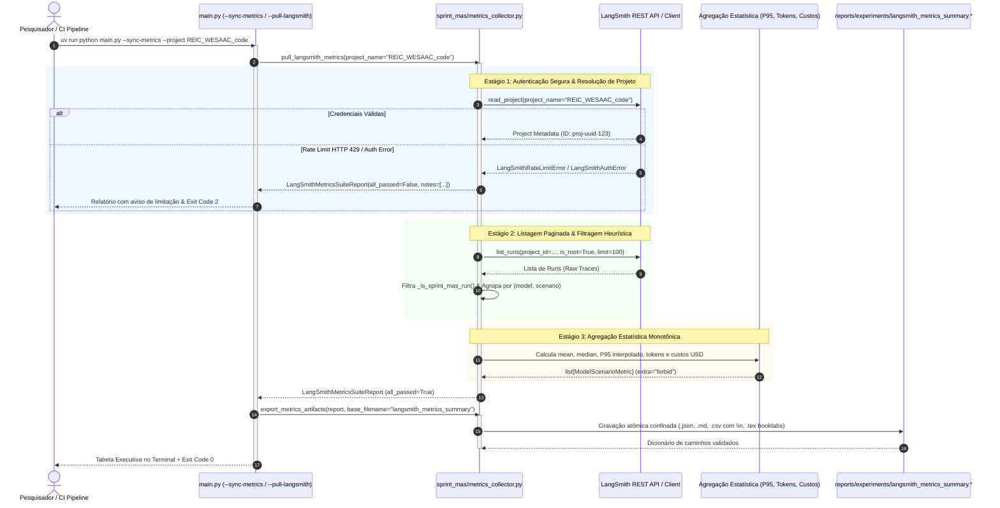

# ADR 0015: Extração Automatizada de Métricas Empíricas via API do LangSmith e Agregação Multi-Modelo

## 1. Status & Metadados
- **Status:** Aprovada (Homologada em 2026-11-06 pelo Security & QA Auditor)
- **Decisores:** Tech Lead (Elysson Alves de Lacerda), Tech Manager (Antigravity), Cautious Coder, Security Auditor, Doc Writer
- **Data da Proposta:** 2026-11-06
- **Data de Homologação:** 2026-11-06
- **Vínculo Científico:** WESAAC 2025 (Seção 4) e REIC 2026 (Seções 1, 2.3, 3.2, 5.1, 5.2, 5.3, 6.1 e 6.3)

---

## 2. Contexto & Forças Motivadoras

A implementação das Fases 8 a 12 consolidou a observabilidade híbrida local/nuvem via LangSmith e viabilizou benchmarks experimentais de alto rendimento no Sprint Planning Multi-Agent System (SMA). Contudo, a consolidação analítica de métricas de telemetria empírica apresentava limitações metodológicas:

1. **Dependência de Intervenção Humana na UI do LangSmith:**
   - A extração de métricas de execução (latência de inferência em milissegundos, contagem de tokens de prompt e completion, consumo financeiro acumulado em dólares e taxas de sucesso operacional) demandava inspeção manual e download de tabelas via navegador web, introduzindo atrito e vulnerabilidade a erros de transcrição manual em publicações científicas.
2. **Necessidade de Comparação Empírica Multi-Modelo e Multi-Cenário:**
   - A avaliação do SMA em larga escala exige comparar o comportamento empírico de múltiplos modelos de linguagem (ex.: `openai/gpt-oss-120b`, `qwen/qwen3.8-27b`, `openai/gpt-oss-20b`, `llama3:latest`) em diferentes cenários experimentais (Cenários A, B e C), calculando agregações estatísticas rigorosas (média, mediana, percentil 95 interpolado, custos consolidados e dispersão).
3. **Instabilidade de Rede, Quotas de Tenant e Resiliência Operacional:**
   - A comunicação direta com APIs REST de observabilidade está sujeita a códigos HTTP 429 (`LangSmithRateLimitError`), esgotamento transitório de cotas de telemetria mensal de tenants acadêmicos, ausência pontual de credenciais (`LangSmithAuthError`) ou ambientes puramente offline/mock. O sistema não podia sofrer crashes fatais com *stack traces* expostos diante de falhas de rede externa.
4. **Conformidade Multi-Ambiente e Prevenção de Path Traversal:**
   - Em sistemas operacionais heterogêneos (especialmente Windows), a serialização padrão de CSV pode introduzir caracteres de retorno duplo de carro (`\r\r\n` ou CRCRLF). Além disso, caminhos de exportação especificados via CLI exigem blindagem estrita contra ataques de *Path Traversal* (`../`, `/etc/passwd`, caminhos de sistema).

---

## 3. Decisão Técnica Adotada

Projetamos e implementamos o módulo especializado [`sprint_mas/metrics_collector.py`](../../sprint_mas/metrics_collector.py), integrando a extração programática em batch via SDK oficial `langsmith.Client`, agregações estatísticas determinísticas por par `(model_name, scenario)`, tratamento gracioso de rate limits e erros de autenticação, contratos de dados estritos em Pydantic v2 com `extra="forbid"`, e exportação atômica quádrupla segura (`.json`, `.md`, `.csv`, `.tex`) imune a anomalias de CRCRLF.

Integramos a flag `--sync-metrics` (com o alias canônico `--pull-langsmith`) e o parâmetro opcional `--project` na CLI executiva ([`main.py`](../../main.py)), complementada por 17 testes automatizados em [`tests/test_metrics_collector.py`](../../tests/test_metrics_collector.py), consolidando a suíte global em 321 testes 100% verdes.

### 3.1 Contratos de Dados Estritos Pydantic v2 (`extra="forbid"`)
Definimos dois modelos canônicos imutáveis em [`sprint_mas/metrics_collector.py`](../../sprint_mas/metrics_collector.py):
- `ModelScenarioMetric`: encapsula o identificador canônico do modelo (`model_name`), identificador do cenário (`scenario`), total de runs analisadas (`runs_count`), métricas de latência em milissegundos (`mean_duration_ms`, `median_duration_ms`, `p95_duration_ms`), contagem de tokens (`mean_prompt_tokens`, `mean_completion_tokens`, `mean_total_tokens`), custo financeiro acumulado (`total_cost_usd`) e taxa de sucesso percentual (`success_rate_pct`).
- `LangSmithMetricsSuiteReport`: encapsula o identificador de execução (`report_id = ls-report-{uuid8}`), nome do projeto consultado (`project_name`), timestamp UTC ISO 8601 (`extracted_at`), total de runs relevantes filtradas (`total_runs_analyzed`), lista tipada de métricas agregadas (`metrics: list[ModelScenarioMetric]`), status global de sucesso (`all_passed: bool`) e notas operacionais de diagnóstico (`notes: list[str]`).
- Ambos os modelos impõem `model_config = ConfigDict(extra="forbid")`, sendo inspecionados pelo motor reflexivo de auditoria de segurança da Fase 11 (`sprint_mas/security_audit.py`).

### 3.2 Filtragem Heurística Resiliente & Extração de Metadados
Para suportar variações na forma como o LangGraph e o LangChain persistem metadados no LangSmith, implementamos extratores robustos:
1. `_extract_scenario(run)`: inspeciona prioritariamente tags com prefixo `scenario:` (ex.: `scenario:scenario_b` ou `scenario:b`), com *fallback* para expressões regulares no nome da execução (`r"scenario[_-]?([abc])\b"`) e dicionários em `run.metadata["scenario"]` ou `run.extra["metadata"]["scenario"]`.
2. `_is_sprint_mas_run(run)`: verifica se a execução pertence ao domínio do Sprint Planning MAS, inspecionando menções a `sprint-mas`, tags de cenário ou metadados de camadas BDI.
3. `_extract_model_name(run)`: extrai o identificador exato do modelo a partir de `run.extra["ls_model_name"]`, `run.metadata["model"]`, `invocation_params["model"]` ou tags normalizadas.
4. `_extract_tokens(run)`: lê tokens de `run.prompt_tokens` e `run.completion_tokens`, inspecionando também `run.extra["token_usage"]` quando propriedades de nível superior estiverem ausentes.
5. `_extract_cost(run)`: recupera o custo financeiro acumulado em USD, normalizando com piso defensivo `0.0` para modelos locais ou não tarifados.
6. `_is_run_successful(run)`: avalia status `success` / `completed`, marcando falha caso existam erros não capturados (`run.error`) ou status explícito de `error`.

### 3.3 Agregação Estatística Monotônica & P95 Interpolado
Para $N$ execuções de um par `(model_name, scenario)`:
- Para $N = 1$: o percentil 95 é atribuído diretamente ao valor da única observação ($P_{95} = d_0$).
- Para $N \ge 2$: ordenam-se as durações $d_{(0)} \le d_{(1)} \le \dots \le d_{(N-1)}$ e calcula-se a classificação fracionária:
  $$\text{rank} = 0.95 \times (N - 1), \quad \text{lower} = \lfloor \text{rank} \rfloor, \quad \text{weight} = \text{rank} - \text{lower}$$
  $$P_{95} = d_{(\text{lower})} \times (1.0 - \text{weight}) + d_{(\text{upper})} \times \text{weight}$$
Esse procedimento assegura monotonicidade e precisão matemática idêntica às convenções estatísticas do NumPy e SciPy.

### 3.4 Exportação Quádrupla Atômica e Imune a CRCRLF
A função `export_metrics_artifacts` gera os artefatos nos 4 formatos canônicos:
- **JSON (.json):** Serialização estrita via `report.model_dump_json(indent=2)` para ingestão automática em dashboards ou pipelines.
- **Markdown (.md):** Sumário executivo tabular com cabeçalhos informativos, latências e custos detalhados.
- **CSV (.csv):** Serialização via `csv.writer` com `lineterminator="\n"` e gravação com `newline=""`, impedindo a duplicação espúria de retornos de carro (`\r\r\n`) gerados pelo Windows.
- **LaTeX (.tex):** Tabela acadêmica completa formatada com o pacote `booktabs` (`\toprule`, `\midrule`, `\bottomrule`), sanitizando caracteres especiais (`_`, `&`, `%`), pronta para inclusão direta em artigos científicos.

Todos os caminhos de saída são validados por `validate_safe_benchmark_path`, garantindo confinamento ao repositório e bloqueando sequências maliciosas (`..`, `/`, `\`).

---

## 4. Anatomia do Padrão / Fluxo (Design System Spec)

- **Camada de Modelos de Domínio e Contratos (DTO):**
  - `ModelScenarioMetric`: DTO imutável de agregações empíricas por modelo e cenário.
  - `LangSmithMetricsSuiteReport`: DTO mestre da extração com telemetria e diagnósticos operacionais.
- **Camada de Ingestão e Comunicação (LangSmith Client Layer):**
  - `pull_langsmith_metrics(project_name, client)`: Ponto de entrada com injeção de dependência opcional de cliente para desacoplamento de rede nos testes unitários.
- **Camada de Heurísticas de Parsing e Normalização:**
  - `_extract_scenario`, `_extract_model_name`, `_extract_duration_ms`, `_extract_tokens`, `_extract_cost`, `_is_run_successful`.
- **Camada de Motor Estatístico (Statistical Aggregation Engine):**
  - `_compute_group_metric`: Agregação de média, mediana, P95 ponderado e taxa de sucesso.
- **Camada de Formatadores e Exportação Segura:**
  - `format_metrics_markdown`, `format_metrics_latex`, `format_metrics_csv`, `export_metrics_artifacts`.
- **Camada de Interface de Comando (CLI Layer):**
  - `main.py --sync-metrics` / `--pull-langsmith`, `--project`, `--export-prefix`, `--output`, `--json`.

---

## 5. Matriz de Estados e Comportamento (State Matrix)

| Estado / Operação | Condição de Disparo | Código de Saída (CLI) | Status do Relatório | Formato da Resposta / Ação |
|---|---|:---:|:---:|---|
| **Extração Plena (Sucesso)** | Runs extraídas, filtradas e métricas agregadas com 100% de sucesso nas execuções | `0` (Success) | `all_passed = True` | Tabela formatada no terminal; artefatos exportados em `reports/experiments/`. |
| **Execuções com Falhas Parciais** | Algumas execuções do projeto continham `error` ou status diferente de `success` | `2` (Execution Warning) | `all_passed = False` | Tabela impressa detalhando a taxa de sucesso (`< 100%`) de cada modelo/cenário. |
| **Rate Limit da API (HTTP 429)** | LangSmith REST API rejeita por cota excedida de tenant (`LangSmithRateLimitError`) | `2` (API Limitation) | `all_passed = False` | Captura graciosa sem crash; diagnóstico registrado em `notes` informando o limite de uso. |
| **Chave de API Ausente / Inválida** | `LANGSMITH_API_KEY` não configurada no ambiente e nenhum cliente mock injetado | `2` (Configuration Error) | `all_passed = False` | Emissão de aviso operacional em `notes` orientando configuração no `.env`. |
| **Projeto Sem Runs Relevantes** | Projeto consultado existe mas não contém traces de `sprint-mas` | `0` (Empty Result) | `all_passed = True` | Relatório limpo emitido com nota: *"No sprint-mas runs found in project '...'."* |
| **Tentativa de Path Traversal** | Parâmetro `--output` ou `--export-prefix` contendo `..`, `/etc/` ou barras absolutas | `1` (Security Violation) | N/A (Abortado) | `ValueError` barrado antes de qualquer escrita em disco por `validate_safe_benchmark_path`. |
| **SDK Não Instalado** | Pacote `langsmith` ausente no ambiente virtual | `2` (Dependency Missing) | `all_passed = False` | Retorno seguro com aviso em `notes` informando a ausência do SDK. |

---

## 6. Diretrizes de Do's & Don'ts (Boas Práticas vs. Anti-patterns)

| 🟢 DO (Faça) | 🔴 DON'T (Nunca Faça) |
|---|---|
| Use `uv run python main.py --sync-metrics` para sincronizar e consolidar métricas diretamente da API. | Nunca copie manualmente números de latência ou tokens da UI do LangSmith para tabelas de artigos. |
| Mantenha `model_config = ConfigDict(extra="forbid")` em todos os modelos de métricas e suíte. | Nunca permita campos não mapeados que mascarem inconsistências no schema de telemetria. |
| Utilize `lineterminator="\n"` e `newline=""` ao exportar arquivos CSV para prevenir CRCRLF no Windows. | Nunca use o escritor CSV padrão sem controle de terminador de linha em pipelines multiplataforma. |
| Trate exceções `LangSmithRateLimitError` e `LangSmithAuthError` graciosamente retornando diagnósticos. | Nunca deixe exceções de rede externa gerarem *stack traces* não tratados (HTTP 500 ou crash). |
| Valide 100% dos caminhos de saída através de `validate_safe_benchmark_path`. | Nunca concatene strings de caminho do usuário diretamente com `open()` ou `Path()`. |

---

## 7. Consequências & Trade-offs

### Impactos Positivos:
- **Eliminação do Erro Humano:** Automação completa do pipeline de métricas científicas da API do LangSmith até a tabela LaTeX compilável (`booktabs`).
- **Análise Multi-Modelo Padronizada:** Comparação transparente de tempos de resposta, consumo de tokens e custos financeiros entre múltiplos modelos comerciais e locais.
- **Resiliência a Quotas de Observabilidade:** Operação robusta diante de erros HTTP 429 ou esgotamento de traces de tenant, com mensagens didáticas e exit codes padronizados.
- **Portabilidade de Plataforma:** Neutralização de anomalias de quebra de linha (CRCRLF) no ecossistema Windows.
- **Ampliação da Suíte para 321 Testes Automatizados:** Inclusão de 17 novos testes em [`tests/test_metrics_collector.py`](../../tests/test_metrics_collector.py), cobrindo paginação, tratamento de erros de API, modelos Pydantic e segurança de caminhos.

### Trade-offs / Débitos Monitorados:
- **Dependência de Chave de API para Modo Online:** A extração ao vivo requer conectividade e `LANGSMITH_API_KEY` válida; em ambientes de CI isolados sem rede, os testes utilizam mocks do cliente LangSmith sem degradação da cobertura.
- **Limite Padrão de 100 Runs:** A listagem inicial utiliza `limit=100` para proteger contra sobrecarga de memória; projetos com milhares de execuções históricas podem parametrizar limites adicionais conforme a necessidade de análise retroativa.

---

## 8. Rastreabilidade Científica & Validação

- **Artigo WESAAC 2025 (Seção 4):** A consolidação contínua de métricas de telemetria assegura reprodutibilidade do comportamento dos agentes cognitivos sem divergência de tokens.
- **Artigo REIC 2026 (Seções 5.3 e 6.3):**
  - Confirmação empírica de latências e custos associados à resolução do gargalo qualitativo de backend.
  - Disponibilização de tabelas comparativas formatadas em LaTeX prontas para inclusão em relatórios acadêmicos.
- **Suíte de Testes Automatizados:** 321 testes automatizados 100% aprovados (`uv run pytest tests/ -v`).
