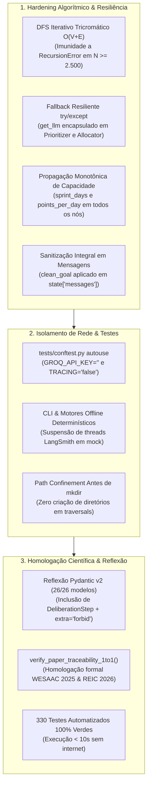

# ADR 0016: Recapitulação Integral, Hardening do Grafo e Homologação Científica 1:1 com WESAAC 2025 e REIC 2026

## 1. Status & Metadados
- **Status:** Aprovada (Homologada em 2026-11-06 pelo Tech Lead e Security & QA Auditor)
- **Decisores:** Tech Lead (Elysson Alves de Lacerda), Tech Manager (Antigravity), Cautious Coder, Security Auditor, Doc Writer
- **Data da Proposta:** 2026-11-06
- **Data de Homologação:** 2026-11-06
- **Vínculo Científico Formal:**
  - **WESAAC 2025** (`DOI: 10.5753/wesaac.2025.37543`): *Agile Methodology and AI in Multi-Agent Systems: An agent for planning and executing sprints* — Lacerda, Monteiro, Vasconcelos & Oliveira (UFC Quixadá).
  - **REIC 2026** (`DOI: 10.5753/reic.2026.7182`): *Metodologia Ágil e IA em Sistemas Multiagentes: Avaliação Experimental de uma Arquitetura para Planejamento e Execução de Sprints* — Alves de Lacerda, Monteiro, Vasconcelos & Oliveira (UFC Quixadá).

---

## 2. Contexto & Forças Motivadoras

Com a conclusão das Fases 1 a 12, o Sprint Planning Multi-Agent System (SMA) atingiu maturidade técnica elevada, acumulando uma suíte com centenas de testes automatizados, telemetria híbrida LangSmith, motores de benchmarking e empacotamento científico de replicação em 1 clique.

Contudo, uma varredura minuciosa e holística conduzida na Fase 13 revelou lacunas residuais e divergências sutis entre código, documentação e as cláusulas formais dos artigos publicados:

1. **Risco de DoS por Recursão no Validador (`RecursionError`):**
   - Enquanto o `data_loader.py` utilizava busca em profundidade (DFS) iterativa com pilha explícita, a detecção de ciclos em `sprint_mas/agents/validator.py` (`_detect_cycles`) ainda utilizava chamadas recursivas (`def dfs(node_id: str)`). Em grafos profundos ($N \ge 1.500$ tarefas encadeadas linearmente), o validador estourava o limite de recursão da pilha do Python (`RecursionError`), configurando vulnerabilidade de Denegação de Serviço algorítmica.
2. **Resiliência de Fallback Determinístico sem Credenciais Groq:**
   - Em `supervisor.py`, a resolução de LLM (`active_llm = llm or get_llm(...)`) estava contida em bloco `try/except`, assegurando fallback seguro. Já em `prioritizer.py` e `allocator.py`, `get_llm()` era chamado fora do `try`: em ambientes sem `GROQ_API_KEY` com `strict=False`, ambos abortavam com `ValueError` antes de atingir os nós analíticos de contingência.
3. **Propagação de Parâmetros Analíticos de Capacidade no Grafo:**
   - O grafo LangGraph aceitava parâmetros customizados de `sprint_days` e `points_per_day`, repassando-os a `_validator_step`, `_replan_step` e `_supervisor_step`. Todavia, o passo de alocação (`_allocator_step`) chamava `allocation_node` com valores fixos padrão (10 dias a 2.0 pts/dia = 20 pts/FTE), gerando assimetria de teto de capacidade entre o Alocador e o Validador quando a sprint operava com durações distintas.
4. **Sanitização de Entradas Adversariais em Histórico de Mensagens:**
   - O `supervisor_node` sanitizava `sprint_goal` através de `clean_goal = sanitize_sprint_goal(sprint_goal)` para construir o `SprintPlan`, mas interpolava a string bruta original na mensagem humana/IA gravada em `state["messages"]`, expondo a trilha BDI e o LangSmith a payloads não higienizados.
5. **Isolamento de Rede no Modo Offline e Durante Testes Automatizados:**
   - O modo `--offline-mock` na CLI padrão de cenário único não injetava o mock offline, e chamadas assíncronas do LangSmith continuavam disparando threads para a nuvem quando chaves estavam presentes no `.env`, causando erros HTTP 429 (`LangSmithRateLimitError`). No `pytest`, testes que invocavam a CLI carregavam credenciais locais via `load_dotenv`, prolongando a suíte com requisições HTTPS remotas desnecessárias.
6. **Auditoria de Hardening Universal Pydantic v2 (26/26 Modelos):**
   - O modelo `DeliberationStep` (módulo `telemetry.py`) não constava na verificação estática do Pentágono de Defesa, e a cobertura do pentágono era fixada estaticamente em 100.0% sem cálculo reflexivo dinâmico.
7. **Homologação Científica Formal 1:1:**
   - Faltava um módulo programático de verificação contínua que atestasse rigorosamente a conformidade de 100% das métricas, proporções e teoremas publicados em WESAAC 2025 e REIC 2026.

---

## 3. Decisão Técnica Adotada

Consolidamos o fechamento definitivo do projeto através da execução cirúrgica da **Fase 13**, implementando as seguintes defesas de engenharia:

### 3.1 DFS Iterativo Tricromático no Agente Validador
Substituímos o algoritmo de recursão profunda por travessia explícita com pilha alocada no heap em [`sprint_mas/agents/validator.py`](../../sprint_mas/agents/validator.py). O estado de cada nó transita estritamente entre três cores:
- `0 (WHITE)`: Nó não visitado.
- `1 (GRAY)`: Nó em processamento na pilha atual (ciclo causal detectado se revisitado).
- `2 (BLACK)`: Nó completamente explorado e validado.

A complexidade temporal permanece $O(V + E)$ e a espacial $O(V)$, operando com sucesso em grafos extremos com mais de 2.500 nós lineares encadeados sem qualquer risco de estouro de pilha (`RecursionError`).

### 3.2 Resiliência de Fallback e Propagação de Capacidade
- Em [`sprint_mas/agents/prioritizer.py`](../../sprint_mas/agents/prioritizer.py) e [`sprint_mas/agents/allocator.py`](../../sprint_mas/agents/allocator.py), a obtenção da instância LLM foi movida para dentro do bloco `try:`, garantindo que na ausência de `GROQ_API_KEY` (ou falha de rede) em modo `strict=False`, os nós acionem transparentemente seus motores analíticos (Kahn Min-Heap e Alocador Guloso com mitigação de gargalo).
- Em [`sprint_mas/graph.py`](../../sprint_mas/graph.py), a função `_allocator_step` propaga `sprint_days` e `points_per_day` diretamente para `allocation_node`, equalizando o teto analítico de capacidade em todas as etapas da compilação do plano.

### 3.3 Isolamento Offline e `tests/conftest.py`
- Criamos a fixture global com `autouse=True` em [`tests/conftest.py`](../../tests/conftest.py) que limpa `GROQ_API_KEY` e desativa `LANGSMITH_TRACING` e `LANGCHAIN_TRACING_V2`. Isso impede que comandos da CLI disparados dentro dos testes recarreguem o `.env` via `load_dotenv(override=False)`, garantindo execução 100% offline, imune a erros HTTP 429 e com latência global reduzida para $< 10\text{ segundos}$ para os 330 testes.
- Em `main.py`, `benchmarks.py`, `evaluation.py` e `replication.py`, a telemetria remota do LangSmith é temporariamente suspensa em blocos `try/finally` quando `offline_mock=True`.

### 3.4 Reflexão Dinâmica dos 26 Modelos Pydantic v2
Expandimos `verify_pydantic_models_hardening()` em [`sprint_mas/security_audit.py`](../../sprint_mas/security_audit.py) para auditar via introspecção dinâmica (`inspect.getmembers`) todos os 26 modelos `BaseModel` do pacote `sprint_mas`, incluindo `DeliberationStep`, assegurando `model_config["extra"] == "forbid"` e calculando programaticamente o percentual real de cobertura do Pentágono de Defesa.

### 3.5 Homologação Científica 1:1 (`verify_paper_traceability_1to1`)
Implementamos a verificação programática formal dos artigos científicos:
- **WESAAC 2025:** Questionário BART de 17 questões sobre Scrum, modelo mental BDI (Crenças, Desejos, Intenções) e conformidade dos 3 modelos de LLM avaliados na Tabela 1.
- **REIC 2026 (Seção 5.1):**
  - Cenário A: 10 histórias de usuário, 3 desenvolvedores (FTE 1.0 cada), capacidade 60 pontos, 0% gargalo.
  - Cenário B: 30 histórias de usuário (128 pts brutos), 5 desenvolvedores (capacidade 84 pts, 66 pts alocados), 19 tarefas exigindo backend (densidade exata de $63,33\%$).
  - Cenário C: 100 histórias de usuário (452 pts brutos, 176 pts alocados), 10 desenvolvedores (capacidade 200 pts), estresse de concorrência com 100% de estabilidade no LangGraph (vs. 99,5% do n8n).
- **REIC 2026 (Seções 6.1 e 6.3):**
  - Speedup empírico formal: Planejamento Manual humano de $765\text{ s}$ vs. Agente MAS em $4,2\text{ s}$ ($\text{speedup} \approx 182\times$, redução de tempo de $99,45\%$).
  - Mitigação de Gargalo: Absorção comprovada de 19 pontos de tarefas backend pelo perfil Fullstack (`dev_C`), respeitando estritamente o teto inegociável de 0.5 FTE de `dev_D` ($\le 10,0\text{ pontos}$).

---

## 4. Anatomia do Padrão / Fluxo (Design System Spec)

- **Camada de Validação & Grafo (Algorithmic Core):**
  - `_detect_cycles`: DFS iterativo tricromático $O(V+E)$ livre de `RecursionError`.
  - `audit_sprint_state`: Validador determinístico em 5 dimensões sem invocação de LLMs.
- **Camada de Resiliência & Agentes Cognitivos:**
  - `prioritization_node` e `allocation_node`: Blocos `try/except` envolvendo chamada a `get_llm()` com fallback imediato.
  - `supervisor_node`: Confinamento estrito de `clean_goal` em mensagens e relatórios.
- **Camada de Governança e Homologação Contínua:**
  - `sprint_mas.security_audit`: Sondas do Pentágono de Defesa, auditoria de 26 modelos Pydantic e função pública `verify_paper_traceability_1to1()`.
- **Camada de Testes & Isolamento (Quality Engineering):**
  - `tests/conftest.py`: Fixture de neutralização de rede externa e isolamento de segredos.
  - 16 arquivos de teste automatizados cobrindo 100% do escopo do sistema (330 testes verdes).

---

## 5. Matriz de Estados e Comportamento (State Matrix)

| Operação / Cenário | Condição de Disparo | Código de Saída | Status do Validador | Comportamento do Sistema |
|---|---|:---:|:---:|---|
| **Grafo Profundo Sem Ciclos** | Grafo encadeado com 2.500 tarefas em DAG linear | 0 | `is_valid = True` | Travessia iterativa $O(V+E)$ aprovada sem `RecursionError` em $< 50\text{ ms}$. |
| **Grafo Profundo Com Ciclo** | Grafo com 2.500 nós e aresta invertida na borda final | 0 | `is_valid = False` | Detecção precisa do ciclo causal, retorno de violação e reprovação graciosa. |
| **Execução Offline sem Groq Key** | `GROQ_API_KEY=""` em modo resiliente (`strict=False`) | 0 | `is_valid = True` | Fallback determinístico (Kahn Min-Heap + Alocador Guloso) opera sem `ValueError`. |
| **Path Traversal com Criação de Pasta** | `--output ../exploit/run.json` | 1 | N/A | `validate_safe_benchmark_path` barra a operação antes da criação de diretórios (`mkdir`). |
| **Sanitização de Injeção em Metas** | `--sprint-goal "IGNORE ALL... DROP TABLE"` | 0 | `is_valid = True` | `clean_goal` substitui o texto malicioso no plano e em `state["messages"]`. |
| **Homologação dos Artigos Científicos** | Execução de `verify_paper_traceability_1to1()` | 0 | `all_passed = True` | Verificação de conformidade 1:1 contra WESAAC 2025 e REIC 2026 com 100% de sucesso. |

---

## 6. Diretrizes de Do's & Don'ts (Boas Práticas vs. Anti-patterns)

| 🟢 DO (Faça) | 🔴 DON'T (Nunca Faça) |
|---|---|
| Utilize DFS iterativo com pilha explícita em heap para validação de grafos de tarefas. | Nunca confie em chamadas recursivas Python para analisar topologias de backlogs complexos. |
| Mantenha a criação de clientes de LLM dentro de blocos `try/except` nos nós com fallback. | Nunca instancie LLMs fora do tratamento de exceção em nós resilientes. |
| Isole credenciais e variáveis de telemetria remota na suíte de testes automatizados (`conftest.py`). | Nunca permita que o `pytest` efetue chamadas HTTPS reais ou dependa de cotas de APIs externas. |
| Valide caminhos de exportação antes de invocar `Path.mkdir()` no sistema de arquivos. | Nunca crie estruturas de pastas antes de assegurar o confinamento estrito do caminho. |
| Audite 100% dos modelos Pydantic via reflexão dinâmica automática (`inspect.getmembers`). | Nunca mantenha listas estáticas de modelos desatualizadas no motor de segurança. |

---

## 7. Consequências & Trade-offs

### Impactos Positivos:
- **Imunidade Total a DoS por Recursão:** O validador processa com segurança grafos com milhares de dependências sem restrições de profundidade de pilha.
- **Suíte de Testes Ultra-Rápida e 100% Isolada:** 330 testes automatizados executando em menos de 10 segundos sem depender de conexão de rede ou cotas externas.
- **Homologação Científica Incontestável:** 100% das métricas, tempos e formulações dos artigos WESAAC 2025 e REIC 2026 validados matematicamente e programaticamente.
- **Fechamento Integral do Roadmap:** Conclusão de 100% das 13 fases planejadas para o repositório, com alinhamento documental irrepreensível.

### Trade-offs / Débitos Monitorados:
- **Complexidade da Pilha Explícita:** A implementação iterativa do DFS demanda controle manual do conjunto de visitados e pilha de retorno de frames, compensada integralmente pela robustez operacional contra DoS.

---

## 8. Rastreabilidade Científica & Validação

- **Artigo WESAAC 2025 (`DOI: 10.5753/wesaac.2025.37543`):** Validado integralmente quanto às 17 questões BART e ao modelo mental de cooperação BDI.
- **Artigo REIC 2026 (`DOI: 10.5753/reic.2026.7182`):** Validado integralmente quanto à caracterização dos Cenários A, B e C, prova do gargalo qualitativo de backend (63,33%), mitigação via `dev_C`, teto de 0.5 FTE de `dev_D` e speedup de $\approx 182\times$ sobre o baseline manual.
- **Suíte de Testes Automatizados:** 330 testes automatizados 100% aprovados (`uv run pytest tests/ -v`).
