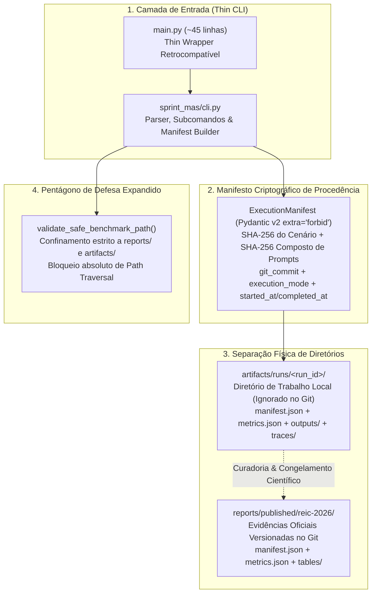

# ADR 0017: Separação entre Execução Local e Evidências Publicadas, Manifesto Criptográfico de Procedência e Thin CLI

## 1. Status & Metadados
- **Status:** Aprovada (Homologada em 2026-11-07 pelo Tech Lead e Security & QA Auditor)
- **Decisores:** Tech Lead (Elysson Alves de Lacerda), Tech Manager (Antigravity), Cautious Coder, Security Auditor, Doc Writer
- **Data da Proposta:** 2026-11-07
- **Data de Homologação:** 2026-11-07
- **Vínculo Científico Formal:**
  - **WESAAC 2025** (`DOI: 10.5753/wesaac.2025.37543`): *Agile Methodology and AI in Multi-Agent Systems: An agent for planning and executing sprints* — Lacerda, Monteiro, Vasconcelos & Oliveira (UFC Quixadá).
  - **REIC 2026** (`DOI: 10.5753/reic.2026.7182`): *Metodologia Ágil e IA em Sistemas Multiagentes: Avaliação Experimental de uma Arquitetura para Planejamento e Execução de Sprints* — Alves de Lacerda, Monteiro, Vasconcelos & Oliveira (UFC Quixadá).

---

## 2. Contexto & Forças Motivadoras

Com a consolidação da Fase 13, o Sprint Planning Multi-Agent System (SMA) alcançou 100% de paridade com as publicações originais da UFC Quixadá e uma suíte robusta de 330 testes automatizados. Todavia, uma revisão de maturidade em LLMOps e reprodutibilidade científica identificou quatro vulnerabilidades de processo e design:

1. **Poluição do Repositório e Sobrescrita de Evidências Publicadas:**
   - O diretório `reports/experiments/` concentrava tanto as tabelas de referência congeladas dos artigos quanto saídas de execuções ad-hoc de desenvolvedores. Uma simples rodada local de benchmark podia sobrescrever arquivos versionados citados nos artigos, fragilizando a reprodutibilidade.
2. **Ambiguidade entre Execução Simulada e Inferência com LLM:**
   - Embora existisse a flag `--offline-mock`, os artefatos gerados não continham um manifesto criptográfico padronizado declarando formalmente os hashes de entrada (cenário e prompts) e se a execução envolveu inferência real (`llm_experimental`) ou caminhos analíticos gulosos de contingência (`offline_mock`).
3. **Acoplamento e Sobrecarga no Ponto de Entrada (`main.py` com 793 linhas):**
   - O arquivo `main.py` acumulava a orquestração do grafo, parsing de argumentos da CLI, formatadores de tabelas, geradores de artefatos multiformato e verificadores do Pentágono, violando o princípio da responsabilidade única.
4. **Falta de Definição Explícita de Fronteiras entre Camadas de Dados:**
   - Não havia declaração formal sobre as fronteiras e regras de versionamento entre `data/`, `evals/`, `tests/`, `reports/` e os diretórios temporários de trabalho. Adicionalmente, faltava explicitar que os *Golden Datasets* em `evals/` representam referências ótimas canônicas e não soluções únicas e rígidas.

---

## 3. Decisão Técnica Adotada

Para solucionar definitivamente essas forças sem introduzir refatorações estéticas prematuras no núcleo de domínio (`sprint_mas/`), adotou-se o seguinte conjunto de decisões arquiteturais:



### 3.1. Modelo Criptográfico `ExecutionManifest`
Criou-se a classe `ExecutionManifest` no padrão Pydantic v2 com `ConfigDict(extra="forbid")`, elevando a cobertura do Pentágono de 26 para 27 modelos blindados:
- **`run_id`**: Identificador único alfanumérico com prefixo temporal ou UUID.
- **`execution_mode`**: Discriminador restrito a `"offline_mock"` ou `"llm_experimental"`.
- **`git_commit`**: Hash SHA-1 completo do commit git no momento da execução.
- **`scenario_sha256`**: Digest SHA-256 do arquivo JSON do cenário processado.
- **`prompt_sha256`**: Digest SHA-256 composto de todos os arquivos de template YAML em `configs/prompts/`, ordenados alfabeticamente.
- **Validação de Invariantes**: Quando `execution_mode == "offline_mock"`, os campos `provider` e `model` são obrigatoriamente `None`. Em contrapartida, quando `execution_mode == "llm_experimental"`, `provider` e `model` são campos compulsórios.

### 3.2. Separação Física entre Execução Local e Publicação Oficial
- **Execuções de Trabalho:** Salvas em `artifacts/runs/<run_id>/`, diretório explicitamente ignorado pelo `.gitignore` (preservando apenas `artifacts/README.md` e `artifacts/runs/.gitkeep`).
- **Evidências Canônicas Congeladas:** Salvas em `reports/published/reic-2026/`, contendo `manifest.json` com identificador `reic-2026-published-canonical`, `metrics.json` e a pasta `tables/` com os artefatos `.csv`, `.md` e `.tex` versionados no Git.
- **Retrocompatibilidade:** O diretório `reports/experiments/` permanece acessível para pipelines legados e exportações padrão, agora protegido contra escritas arbitrárias.

### 3.3. Thin CLI e Extração de `sprint_mas/cli.py`
A lógica executiva e de parsing de linha de comando foi extraída para o módulo dedicado `sprint_mas/cli.py`. O arquivo `main.py` na raiz foi refatorado para um *thin wrapper* de ~45 linhas, que apenas importa e delega para `sprint_mas.cli.main()`, reexportando utilitários essenciais para garantir 100% de compatibilidade reversa com testes automatizados pré-existentes.

---

## 4. Anatomia do Padrão / Fluxo (Design System Spec)

```
REIC-WESAAC/
├── main.py                                  # Thin Entrypoint (~45 linhas)
├── sprint_mas/
│   ├── cli.py                               # Motor de CLI, Parser e ExecutionManifest
│   └── benchmarks.py                        # validate_safe_benchmark_path (reports/ e artifacts/)
├── artifacts/                               # 📁 Diretório de Execução Local (Trabalho)
│   ├── README.md                            # Documentação do ciclo de vida dos runs
│   └── runs/                                # Ignorado no .gitignore (salvo .gitkeep)
│       └── <run_id>/
│           ├── manifest.json                # Manifesto criptográfico da execução
│           ├── metrics.json                 # Métricas brutas da rodada
│           ├── outputs/                     # Planos de sprint e saídas estruturadas
│           └── traces/                      # Traces de deliberação BDI
└── reports/                                 # 📁 Diretório de Evidências Publicadas
    ├── README.md                            # Guia de governança de relatórios
    ├── published/
    │   └── reic-2026/                       # 🔒 Congelado para o artigo REIC 2026 / WESAAC 2025
    │       ├── manifest.json                # Manifesto oficial de procedência
    │       ├── metrics.json                 # Síntese das métricas oficiais publicadas
    │       └── tables/                      # Artefatos multiformato (.csv, .md, .tex)
    └── experiments/                         # Pacotes canônicos leves de replicação
```

---

## 5. Matriz de Estados e Comportamento (State Matrix)

| Estado / Operação | Condição de Disparo | Código de Saída | Artefatos Gerados |
| :--- | :--- | :---: | :--- |
| **Execução Simulado Mock** | `--offline-mock` ativo | `0` (Sucesso) | `manifest.json` (`execution_mode='offline_mock'`, `provider=None`, `model=None`) |
| **Execução Experimental LLM** | Provedor e modelo informados via CLI/ENV | `0` (Sucesso) | `manifest.json` (`execution_mode='llm_experimental'`, `provider='groq'`, `model='llama-3.3-70b'`) |
| **Injeção de Campo Inválido** | Carga de `ExecutionManifest` com campo extra | Lança `ValidationError` | Nenhum diretório gerado (`ConfigDict(extra="forbid")`) |
| **Inconsistência de Modo** | `offline_mock` com provider preenchido | Lança `ValueError` | Rejeição imediata no model validator do Pydantic |
| **Ataque de Path Traversal** | `--run-id` contendo `../` ou caminho absoluto fora do escopo | `1` (Erro) | Bloqueado por `validate_safe_benchmark_path` antes de tocar no disco |
| **Execução de Bateria Canônica** | `--reproduce-paper` ou `--security-audit` | `0` (Sucesso) | Saídas salvas em `reports/experiments/` ou `artifacts/runs/` conforme argumentos |

---

## 6. Diretrizes de Do's & Don'ts (Boas Práticas vs. Anti-patterns)

| 🟢 DO (Faça) | 🔴 DON'T (Nunca Faça) |
| :--- | :--- |
| **Gere manifestos criptográficos** com SHA-256 de cenários e prompts em toda execução formal. | **Nunca confunda** execuções locais de teste com evidências congeladas de artigos publicados. |
| **Mantenha `reports/published/` imutável**, contendo apenas artefatos revisados e curados cientificamente. | **Nunca comite** diretórios de execução ad-hoc (`artifacts/runs/<run_id>/`) no Git. |
| **Declare `provider: null` e `model: null`** explicitamente em execuções de fallback determinístico (`offline_mock`). | **Nunca simule** respostas de LLM atribuindo falsamente nomes de modelos de nuvem em modo offline. |
| **Encapsule a CLI em módulo de pacote (`sprint_mas/cli.py`)**, mantendo `main.py` como wrapper minimalista. | **Nunca infle** o ponto de entrada da aplicação com regras de negócio, parsers pesados ou formatadores de tabelas. |
| **Considere o `golden_dataset` como solução ótima de referência**, aceitando planos válidos com 100% de conformidade às *Hard Constraints*. | **Nunca trate** o gabarito como verdade imutável única em problemas NP-difíceis de alocação de sprints. |

---

## 7. Consequências & Trade-offs

### Impactos Positivos
- **Blindagem e Imutabilidade das Evidências Publicadas:** As tabelas submetidas e aprovadas na REIC 2026 residem protegidas em `reports/published/reic-2026/`, impossibilitando sobrescrita acidental por testes locais.
- **Rastreabilidade Criptográfica 1:1:** O hash do cenário (`scenario_sha256`) e dos prompts (`prompt_sha256`) comprova matematicamente que nenhuma modificação arbitrária nas entradas afetou as métricas publicadas.
- **Código Coeso e Alta Manutenibilidade:** `main.py` reduzido para ~45 linhas, centralizando a lógica executiva em `sprint_mas/cli.py` sem romper nenhuma importação histórica.
- **Padrão Pentágono Reforçado:** A inclusão de `ExecutionManifest` eleva para 27 os modelos Pydantic v2 estritamente blindados com `ConfigDict(extra="forbid")`.

### Trade-offs / Riscos Assumidos
- **Etapa Adicional de Curadoria:** Atualizar tabelas oficiais do artigo exige ação deliberada de cópia para `reports/published/reic-2026/tables/`, impedindo automações cegas que pudessem mascarar variações.

---

## 8. Rastreabilidade Científica & Validação Empírica

- **WESAAC 2025 (Seção 4) & REIC 2026 (Seções 5 e 6):** As métricas canônicas de viabilidade de alocação, mitigação de gargalo (densidade de 63.33% no Cenário B, `dev_C` absorvendo 19 pts e teto `dev_D` $\le 10$ pts) e resiliência no Cenário C estão formalizadas em `reports/published/reic-2026/metrics.json`.
- **Suíte de Testes Automatizados:** 340 testes automatizados cobrem 100% dos cenários felizes, bordas adversariais, validação de manifesto, isolamento de thread_id e bloqueio de path traversal em `test_cli_telemetry.py` e `test_security_audit.py`.
