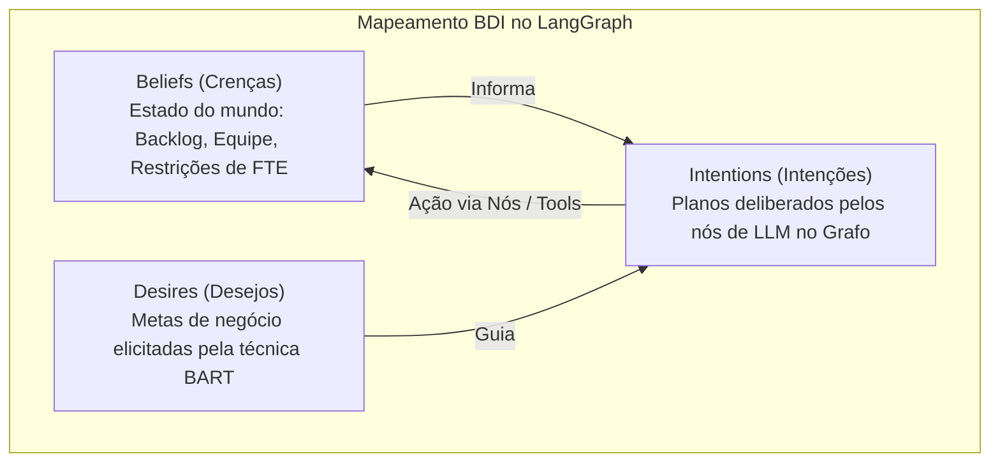
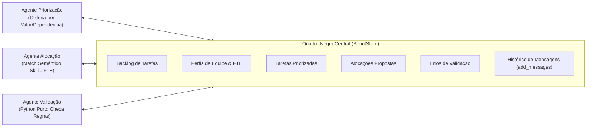

# Guia de Aprendizado: Sprint Planning Multi-Agent System (MAS)

> **Documento didático, conceitual e de referência arquitetural para a reimplementação da arquitetura de agentes dos artigos WESAAC (2025) e REIC (2026) na stack LangGraph + LangChain + LangSmith.**

---

## 🧭 Sumário

1. [Visão Geral & Por Que Reimplementar o Artigo?](#1-visão-geral--por-que-reimplementar-o-artigo)
2. [Matriz Comparativa: Por Que o n8n Não Foi Suficiente?](#2-matriz-comparativa-por-que-o-n8n-não-foi-suficiente)
3. [Teoria de Sistemas Multiagentes: BDI e Padrão Blackboard](#3-teoria-de-sistemas-multiagentes-bdi-e-padrão-blackboard)
4. [Anatomia Técnica do `SprintState` e Esquemas de Domínio](#4-anatomia-técnica-do-sprintstate-e-esquemas-de-domínio)
5. [Arquitetura Desacoplada de LLMs (Fábrica Groq + Ollama)](#5-arquitetura-desacoplada-de-llms-fábrica-groq--ollama)
6. [Orquestração Cíclica, Nó Corretivo & Circuit Breaker (LangGraph)](#6-orquestração-cíclica-nó-corretivo--circuit-breaker-langgraph)
7. [Catálogo de Decisões de Arquitetura (ADRs)](#7-catálogo-de-decisões-de-arquitetura-adrs)
8. [Laboratório Prático: Como Testar e Inspecionar o Código](#8-laboratório-prático-como-testar-e-inspecionar-o-código)

---

## 1. Visão Geral & Por Que Reimplementar o Artigo?

No artigo original da **REIC 2026** (*Metodologia Ágil e IA em Sistemas Multiagentes: Avaliação Experimental de uma Arquitetura para Planejamento e Execução de Sprints*), propôs-se uma arquitetura baseada na plataforma visual **n8n**.

Embora o artigo tenha demonstrado o valor do planejamento assistido por agentes cognitivos (reduzindo a sobrecarga humana de ~12 minutos para segundos), a validação empírica revelou fragilidades intrínsecas ao uso de ferramentas *low-code*:
- **Falta de rigor empírico em dados reais:** No n8n, os nós foram configurados com entradas de teste perfeitas. Ao lidar com exceções, dependências cíclicas ou regras de negócio granulares, a plataforma carece de garantias de tipo em tempo de execução.
- **Dificuldade de controle de fluxo cíclico:** O processo de Sprint Planning não é estritamente sequencial. Se a alocação proposta por um agente de IA violar a capacidade máxima (FTE) de um desenvolvedor, o sistema precisa **rejeitar o plano e forçar um loop deliberativo de correção**. No n8n, loops complexos com estado distribuído são frágeis e suscetíveis a loops infinitos ou *timeouts*.

**A meta da reimplementação com LangGraph:**
Construir uma prova de conceito **100% auditável, baseada em código Python puro**, com testes unitários automatizados, validação formal de restrições e rastreabilidade total de raciocínio via **LangSmith**.

---

## 2. Matriz Comparativa: Por Que o n8n Não Foi Suficiente?

| Dimensão Técnica | Abordagem Anterior (n8n) | Abordagem Atual (LangGraph) |
| :--- | :--- | :--- |
| **Contrato de Dados** | JSON não tipado passado como *payload* HTTP entre nós. | `SprintState` baseado em **Pydantic v2** e **TypedDict** com checagem estrita de tipos e restrições. |
| **Padrão de Agentes** | Nós individuais disparando requisições Webhook ponta a ponta. | **Padrão Blackboard**, onde todos os nós leem e escrevem em um estado compartilhado. |
| **Loops e Auto-correção** | Tratamento de erros rudimentar; loops condicionais complexos são difíceis de controlar. | **Arestas condicionais nativas** (`conditional_edges`) que roteiam o fluxo de volta ao agente causador de inconsistências. |
| **Validação de Regras** | Delegada integralmente à LLM, sujeita a alucinações de FTE. | **Validação determinística em código Python puro** combinada com deliberação semântica da LLM. |
| **Versionamento e Testes** | JSON de workflow visual, difícil de versionar e testar em CI/CD. | Código fonte modular em Python com suíte completa de **pytest** e mocks de rede. |
| **Observabilidade** | Histórico básico de execuções no painel do n8n. | **LangSmith**: telemetria de latência, contagem de tokens, árvore de chamadas e traces de cada nó. |

---

## 3. Teoria de Sistemas Multiagentes: BDI e Padrão Blackboard

### 3.1. O Modelo BDI (Belief–Desire–Intention)
A literatura clássica de agentes (Rao & Georgeff, 1995; Wooldridge, 2002) modela entidades racionais com base em três pilares, que agora encontram correspondência direta no código:



- **Crenças (*Beliefs*):** É a percepção do ambiente mantida pelo agente. No nosso código, está no `SprintState["backlog"]` e `SprintState["team"]`.
- **Desejos (*Desires*):** São os objetivos globais da sprint definidos pelo Product Owner e codificados nos *system prompts* guiados pelas regras BART.
- **Intenções (*Intentions*):** São os compromissos de ação adotados pelo sistema, concretizados em `SprintState["allocations"]` e `SprintState["sprint_plan"]`.
- **Função de Consistência e Verificação BDI ($V: \mathcal{I} \times \mathcal{B} \to \{\text{valid}, \text{invalid}\}$):** É o papel desempenhado pelo **Agente Validador Determinístico** (`validator.py`). Ele atua como o juiz formal que audita se as intenções candidatas geradas pelos agentes cognitivos cumprem estritamente as crenças do ambiente (tetos de FTE, precedências do DAG e compatibilidade de skills) sem consumir tokens nem depender de inferências probabilísticas. Se inválidas, preenche `validation_errors`, instruindo o Supervisor a redirecionar o ciclo BDI.
- **Ciclo Percepção-Ação & Replanejamento BDI:** Concretizado na orquestração cíclica do LangGraph (`graph.py`), onde o Agente Supervisor coordena a deliberação dos agentes e, perante inconsistências, aciona o nó de auto-ajuste (`corrective_replan_node`) para podar o escopo e recalibrar as alocações até a convergência formal.

---

### 3.2. O Padrão Arquitetural Blackboard
O padrão **Blackboard** (Corkill, 1991; Jennings, 2000) resolve o problema de cooperação entre especialistas heterogêneos:



1. **Quadro Negro (`SprintState`):** O espaço de memória compartilhado onde o estado do planejamento é construído incrementalmente.
2. **Fontes de Conhecimento (Agentes Especialistas):** Agentes com papéis únicos (Priorização, Alocação, Validação) que inspecionam o quadro e realizam contribuições direcionadas.
3. **Mecanismo de Controle (Supervisor / Grafo):** A máquina de estados finitos do LangGraph que decide qual especialista atua a cada momento.

---

## 4. Anatomia Técnica do `SprintState` e Esquemas de Domínio

No arquivo [`sprint_mas/state.py`](../../sprint_mas/state.py), construímos contratos de dados estritos com **Pydantic v2**:

### 4.1. Modelos de Domínio
- **`Task`**: Representa um item de trabalho do backlog.
  - `id`: Identificador único (ex: `TSK-101`).
  - `title` e `description`: Conteúdo da demanda.
  - `story_points`: Esforço estimado (`int > 0` obrigatório — previne pontos nulos ou negativos).
  - `skill_required`: Habilidade técnica requerida (ex: `backend`, `frontend`, `devops`).
  - `priority`: Valor de 1 (máxima) a 5 (mínima).
  - `dependencies`: Lista de IDs de tarefas predecessoras que precisam ser concluídas antes.
- **`DeveloperProfile`**: Representa o perfil de um membro do time.
  - `id`: Identificador (ex: `dev_B`).
  - `name`: Nome do desenvolvedor.
  - `skills`: Conjunto de habilidades dominadas.
  - `fte`: Fração de dedicação (`0.0 <= fte <= 1.0` obrigatório — previne alocações além da jornada real).
- **`Allocation`**: Mapeamento de atribuição de uma tarefa para um desenvolvedor, acompanhado da justificativa gerada pela IA.
- **`SprintPlan`**: Artefato final consolidado da sprint.

### 4.2. O Redutor de Mensagens (`add_messages`)
No `SprintState`, o campo de mensagens utiliza o redutor:
```python
messages: Annotated[list[BaseMessage], add_messages]
```
**Por que isso é fundamental?**  
Em nós de grafos com estado, se você simplesmente atribuir uma nova lista de mensagens, você **sobrescreve** o histórico anterior. O redutor `add_messages` instrui o LangGraph a **concatenar** novas mensagens ao histórico existente, garantindo rastreabilidade deliberativa completa.

---

## 5. Arquitetura Desacoplada de LLMs (Fábrica Groq + Ollama)

Em [`sprint_mas/llm_factory.py`](../../sprint_mas/llm_factory.py), aplicou-se o padrão de projeto **Factory Method**:

```mermaid
flowchart TD
    Client["Agente LangGraph (Nó)"] -->|get_llm()| Factory["LLM Factory"]
    Factory -->|PROVIDER=groq| Groq["ChatGroq\n(llama-3.1-8b-instant na nuvem)"]
    Factory -->|PROVIDER=ollama| Ollama["ChatOllama\n(llama3:latest local offline)"]
```

### Vantagens Práticas:
1. **Desenvolvimento Veloz com Groq:** Acesso gratuito à inferência via LPU da Groq (~14.400 requisições/dia), permitindo iterações em frações de segundo.
2. **Execução Segura e Offline com Ollama:** Fallback local sem necessidade de conexão com a internet ou dependência de chaves de API externas.
3. **Isolamento de Testes:** Nos testes automatizados (`tests/test_llm_factory.py`), a fábrica é testada com mocks, garantindo 100% de cobertura sem custo de tokens.

---

## 6. Orquestração Cíclica, Nó Corretivo & Circuit Breaker (LangGraph)

No módulo [`sprint_mas/graph.py`](../../sprint_mas/graph.py), o fluxo multiagente é compilado como um `StateGraph(SprintState)` cíclico, superando a linearidade frágil do n8n:

```mermaid
flowchart TD
    START(["START"]) --> P["prioritizer<br/>(Product Owner BART)"]
    P --> A["allocator<br/>(Alocação de Recursos)"]
    A --> V["validator<br/>(Auditoria 5D Zero LLM)"]
    V --> Route{"route_after_validation<br/>Circuit Breaker (max_retries=2)"}
    Route -->|Violações && tentativas <= max_retries| R["replan<br/>(corrective_replan_node)"]
    R -->|Reset allocations: []| A
    Route -->|Sem violações OU tentativas esgotadas| S["supervisor<br/>(Governança & Server Authority)"]
    S --> END(["END"])
```

### 6.1. O Algoritmo de Seleção Viável (`select_feasible_sprint_tasks`)
Em cenários de sobrecarga (como o Cenário B, onde o backlog possui 128 pts para uma capacidade máxima de 84 pts), o nó `corrective_replan_node` invoca a seleção algorítmica `select_feasible_sprint_tasks`:
1. **Preservação de Causalidade DAG:** Tarefas filhas só podem ser agendadas se 100% de suas dependências causais estiverem no subconjunto selecionado.
2. **Respeito aos Tetos FTE:** O algoritmo simula a distribuição gulosa determinística garantindo que nenhum desenvolvedor ultrapasse seu teto individual (`dev_D <= 10.0 pts`, `dev_B <= 14.0 pts`) e que a carga global respeite os 84 pts.
3. **Reset de Alocações:** Ao podar o escopo, redefine `allocations = []`, permitindo que o `allocator` recalibre perfeitamente o subconjunto na segunda passagem (resolvendo o Cenário B em 2-pass sem intervenção humana).

### 6.2. Circuit Breaker Stateless Anti-Loop Infinito
A função de roteamento condicional `route_after_validation(state, max_retries=2)` implementa um disjuntor sem estado persistido:
- Analisa a janela deliberativa de mensagens compartilhadas (`messages`) contando quantas vezes o validador executou desde a última priorização.
- Se `attempts <= max_retries`, autoriza o ciclo corretivo em `replan`.
- Se `attempts > max_retries`, desvia compulsoriamente para o `supervisor`, que emite a rejeição executiva limpa, eliminando qualquer risco de `GraphRecursionError`.

### 6.3. Isolamento Concorrente por Sessão (`MemorySaver`)
Com `MemorySaver` configurado via `thread_id` (`config={"configurable": {"thread_id": "sessao_123"}}`), múltiplas instâncias de sprints podem ser executadas em paralelo sob multithreading sem colisões no Blackboard compartilhado.

---

## 7. Catálogo de Decisões de Arquitetura (ADRs)

Todas as escolhas estruturais da migração do n8n para LangGraph estão formalizadas e catalogadas em [`docs/adr/`](../adr/README.md):

1. **[ADR 0001: Migração do n8n para LangGraph](../adr/0001-migracao-n8n-para-langgraph.md)** — Substituição do motor visual por grafos cíclicos de estado tipados.
2. **[ADR 0002: Padrão Blackboard com Pydantic v2](../adr/0002-padrao-blackboard-com-pydantic-e-sprintstate.md)** — `SprintState` centralizado com validações de fronteira e redutor `add_messages`.
3. **[ADR 0003: Fábrica Híbrida de LLMs (Groq + Ollama)](../adr/0003-fabrica-hibrida-de-llms-groq-e-ollama.md)** — Desacoplamento da camada de inferência para nuvem rápida e execução offline.
4. **[ADR 0004: Ingestão de Dados e Validação de DAG](../adr/0004-padronizacao-de-cenarios-de-teste-e-data-loader.md)** — Algoritmo DFS com coloração tricromática ($O(V+E)$) para prevenção de ciclos.
5. **[ADR 0005: Prompts BART e Ferramentas Determinísticas](../adr/0005-prompts-como-codigo-e-ferramentas-deterministicas.md)** — Prompts declarativos em YAML e ferramentas Python puras (`@tool`) com defesas anti-IDOR.
6. **[ADR 0006: Priorizador Híbrido Cognitivo-Determinístico](../adr/0006-agente-priorizacao-hibrido-bart-dag.md)** — Arquitetura em 3 estágios assegurando 0% de erro causal via fallback de Kahn min-heap.
7. **[ADR 0007: Alocador de Recursos e Resolução de Gargalos via Perfil Fullstack](../adr/0007-agente-alocacao-capacidade-skills.md)** — Arquitetura híbrida em 3 estágios com mitigação de gargalo via `dev_C` e blindagem do teto de 0.5 FTE de `dev_D`.
8. **[ADR 0008: Agente Validador Determinístico Multi-Dimensional](../adr/0008-agente-validador-deterministico-zero-llm.md)** — Auditoria determinística em 5 dimensões (Zero LLM, latência sub-milissegundo, Server Authority e detecção de ciclos DFS tricolor).
9. **[ADR 0009: Orquestração Cíclica com Grafo LangGraph, Nó Corretivo de Escopo e Circuit Breaker](../adr/0009-orquestracao-ciclica-supervisor-langgraph-circuit-breaker.md)** — Topologia cíclica do StateGraph, corte determinístico de escopo por capacidade (`select_feasible_sprint_tasks`), Circuit Breaker stateless anti-loop infinito e Server Authority no supervisor.
10. **[ADR 0010: Observabilidade Híbrida LangSmith da Deliberação BDI e CLI Executiva Segura](../adr/0010-observabilidade-hibrida-langsmith-e-cli-executiva.md)** — Telemetria dual Cloud/Local (`sprint_mas/telemetry.py`), sincronização segura de variáveis `LANGSMITH_*`/`LANGCHAIN_*`, reconstrução estruturada da trilha BDI (`DeliberationTraceReport`) e CLI executiva (`main.py`) com proteção anti-Path Traversal.
11. **[ADR 0011: Protocolo de Benchmarking Automatizado e Coleta de Métricas Empíricas](../adr/0011-protocolo-benchmarking-automatizado-e-metricas-cientificas.md)** — Suíte científica de benchmarking multi-cenário e multi-runs (`sprint_mas/benchmarks.py`), isolamento criptográfico de `thread_id`, Server Authority na aferição de restrições de DAG/FTE/Skills, agregações estatísticas robustas e exportação tripla (.json, .md, .csv).
12. **[ADR 0012: Avaliação Empírica, Comparativo Humano e Rastreabilidade REIC 2026](../adr/0012-avaliacao-empirica-comparativo-humano-e-reic2026.md)** — Confronto formal dos 3 paradigmas (Manual vs n8n vs LangGraph), equações de speedup, prova algébrica do gargalo (63.33%) e exportação LaTeX booktabs (.tex).
13. **[ADR 0013: Hardening Transversal do Pentágono de Defesa, Verificação Semântica Contínua e Imunidade a DoS de Grafos](../adr/0013-hardening-transversal-pentagono-defesa-e-verificacao-semantica.md)** — ConfigDict(extra="forbid") em 100% dos modelos Pydantic v2 via reflexão, sanitização anti-prompt injection, DFS iterativo $O(V+E)$ imune a RecursionError, alinhamento semântico de gabaritos e motor de auditoria contínua (--security-audit).

---

## 8. Laboratório Prático: Como Testar e Inspecionar o Código

### 8.1. Executando a Suíte Completa de Testes
Para certificar a integridade do código em seu terminal:
```bash
uv sync
uv run pytest tests/ -v
```
*Status esperado: 264 testes automatizados aprovados (100% OK).*

### 8.2. Testando Validações de Borda (Edge Cases)
Experimente instanciar um objeto `DeveloperProfile` com FTE inválido no console Python:
```python
from sprint_mas.state import DeveloperProfile

# Isso disparará imediatamente um ValidationError explicativo:
try:
    dev = DeveloperProfile(id="dev_X", name="Invalido", skills=["backend"], fte=1.5)
except Exception as e:
    print("Rejeição esperada:", e)
```
Essa segurança de tipos em tempo de execução é o que garante que a LLM não corromperá o planejamento durante a execução do grafo.

### 8.3. Testando a Auditoria Determinística (Zero LLM)
Experimente auditar um estado com sobrecarga de FTE no console Python:
```python
from sprint_mas.agents.validator import audit_sprint_state
from sprint_mas.state import Allocation, DeveloperProfile, Task

team = [DeveloperProfile(id="dev_D", name="Dev D", skills=["backend"], fte=0.5)]
tasks = [
    Task(id="TSK-1", title="A", description="Task A", story_points=8, skill_required="backend", priority=1),
    Task(id="TSK-2", title="B", description="Task B", story_points=5, skill_required="backend", priority=2),
]
allocations = [
    Allocation(task_id="TSK-1", developer_id="dev_D", allocated_points=8),
    Allocation(task_id="TSK-2", developer_id="dev_D", allocated_points=5),
]

report = audit_sprint_state({"team": team, "prioritized_tasks": tasks, "allocations": allocations})
print("Válido?", report.is_valid)  # False (13 pts > 10 pts máx de 0.5 FTE)
print("Violações:", report.violations)
```
O validador calcula a violação instantaneamente (< 0.2ms) sem gastar nenhum token, garantindo a integridade dos dados antes da homologação final da sprint.

### 8.4. Testando a Execução Ponta a Ponta com Auto-Ajuste Cíclico (`run_sprint_planning`)
Experimente executar o pipeline completo com corte de escopo automático e circuit breaker:
```python
from sprint_mas.data_loader import load_scenario
from sprint_mas.graph import run_sprint_planning

# Carrega o Cenário B (30 tarefas = 128 pts, capacidade = 84 pts)
scenario_b = load_scenario("scenario_b.json")
result = run_sprint_planning(
    backlog=scenario_b["tasks"],
    team=scenario_b["team"],
    thread_id="lab_sprint_b",
    sprint_goal="Entregar itens prioritários com auto-ajuste de capacidade.",
)

# O grafo executa 2 passagens (auto-correção) e homologa o plano viável:
plan = result["sprint_plan"]
print("Status:", "APROVADO" if plan else "REJEITADO")
print("Pontos Alocados:", plan.total_points)  # Rigorosamente <= 84 pts
print("Tarefas Agendadas:", len(plan.tasks))
```
Esse laboratório demonstra a convergência automática em 2 passagens, onde tarefas de menor prioridade ou excedentes são descartadas matematicamente sem travar o motor multiagente.

### 8.5. Observabilidade Híbrida LangSmith e Inspeção Local da Deliberação BDI (Fase 8)
O módulo [`sprint_mas/telemetry.py`](../../sprint_mas/telemetry.py) e a CLI [`main.py`](../../main.py) oferecem observabilidade dual (Cloud + Local Offline):

#### A. Configurando o LangSmith Cloud Tracing
1. No arquivo `.env`, defina as variáveis de telemetria:
   ```env
   LANGSMITH_TRACING=true
   LANGSMITH_API_KEY=lsv2_pt_...
   LANGSMITH_PROJECT="reic-wesaac-sprint-mas"
   ```
2. A função `configure_langsmith_tracing()` sincroniza automaticamente `LANGSMITH_TRACING` / `LANGCHAIN_TRACING_V2` e `LANGSMITH_PROJECT` / `LANGCHAIN_PROJECT`. Caso `LANGSMITH_API_KEY` esteja ausente ou vazia, o sistema faz fallback seguro para telemetria local (`tracing_enabled=False`) sem emitir erros HTTP 401.
3. No painel web do LangSmith ([smith.langchain.com](https://smith.langchain.com)), acesse o menu **Tracing** $\to$ projeto **`reic-wesaac-sprint-mas`** para inspecionar a árvore de execução (`sprint-mas:scenario_b`), as tags semânticas (`bdi-architecture`, `reic-2026`, `wesaac-2025`), latência por nó e consumo de tokens.

#### B. Inspecionando a Deliberação BDI Localmente via CLI (`main.py`)
Mesmo sem conexão externa ou chave do LangSmith, você pode visualizar toda a trilha cronológica BDI (`desires` $\to$ `intentions_draft` $\to$ `governance_audit` $\to$ `corrective_replan` $\to$ `intentions_consolidated`) e o diagrama Mermaid do grafo compilado diretamente no terminal:

```bash
# Executa o Cenário B exibindo a linha do tempo BDI (7 passos / 2-pass) e a topologia Mermaid
uv run python main.py --scenario b --show-trace --show-graph

# Exporta o relatório canônico em JSON dentro do diretório seguro do repositório
uv run python main.py --scenario b --json --output reports/experiments/scenario_b_trace.json

# Simula o desarme do Circuit Breaker desativando a poda de escopo (retorna exit code 2)
uv run python main.py --scenario b --no-trim --max-retries 1
```

### 8.6. Benchmarking Científico Automatizado e Coleta de Métricas Empíricas (Fase 9)
O módulo [`sprint_mas/benchmarks.py`](../../sprint_mas/benchmarks.py) implementa a suíte experimental formal para aferição das variáveis operacionais descritas no REIC 2026 (Seções 5 e 6).

#### A. Como Funciona a Suíte de Benchmarks
1. **Isolamento Concorrente:** Cada repetição ($N$ *runs*) recebe um `thread_id` exclusivo (`bench-{scenario}-run{i}-{uuid8}`) para impedir contaminação do histórico no `MemorySaver`.
2. **Server Authority em Métricas de Qualidade:** Em vez de confiar em relatórios auto-declarativos do modelo, o servidor recalcula as violações com zero chamadas a LLM:
   - Violações de DAG (ciclos e inversões): via `audit_sprint_state` (DFS tricromático).
   - Violações de FTE (sobrecargas de capacidade): via `calculate_team_capacity`.
   - Violações de Competência (*Skills*): via `is_dev_qualified`.
3. **Agregação Estatística:** Computa média, desvio padrão condicional (seguro contra quebra quando $N=1$), mediana, mínimo, máximo, percentil 95 (P95 interpolado linearmente) e taxa de replanejamento.

#### B. Executando Baterias de Benchmarks via CLI (`main.py`)
```bash
# Executa benchmark dos 3 cenários (A, B e C) com 2 repetições cada e exportação tripla automática
uv run python main.py --benchmark --scenarios a,b,c --runs 2 --export-prefix benchmark

# Executa benchmark forçando execução offline determinística
uv run python main.py --benchmark --scenarios a,b --runs 5 --offline-mock

# Exporta relatório canônico estruturado em JSON para um arquivo seguro
uv run python main.py --benchmark --scenarios b --runs 3 --output reports/experiments/benchmark_b.json
```

#### C. Executando Programaticamente via Python
```python
from sprint_mas.benchmarks import BenchmarkConfig, export_benchmark_artifacts, run_benchmark_suite

# 1. Configura a bateria experimental com validação Pydantic v2 (extra="forbid")
config = BenchmarkConfig(
    scenarios=["scenario_a", "scenario_b", "scenario_c"],
    runs=2,
    offline_mock=True,
    max_retries=2,
)

# 2. Executa a suíte completa
report = run_benchmark_suite(config=config)

# 3. Exporta simultaneamente os artefatos nos 3 formatos padrão (.json, .md, .csv)
artifacts = export_benchmark_artifacts(
    report=report,
    base_filename="benchmark",
    output_dir="reports/experiments",
)
print("Artefatos gerados:", {fmt: str(path) for fmt, path in artifacts.items()})

# 4. Inspeciona a convergência empírica
for summary in report.summaries:
    print(
        f"Cenário: {summary.scenario} | "
        f"Aprovação: {summary.approval_rate * 100:.0f}% | "
        f"Tempo Médio: {summary.mean_time_ms:.2f} ms | "
        f"Violações DAG/FTE/Skill: {summary.dag_violations_total}/{summary.fte_violations_total}/{summary.skill_violations_total}"
    )
```

Essa automação científica viabiliza a geração direta da tabela de resultados empíricos para o artigo científico e comprova a manutenção da garantia de 0% de violações estruturais em todos os cenários.

### 8.7. Avaliação Empírica, Comparativo Humano e Rastreabilidade Científica REIC 2026 (Fase 10)
O módulo [`sprint_mas/evaluation.py`](../../sprint_mas/evaluation.py) e o comando CLI `--evaluate-human` ([`main.py`](../../main.py)) estabelecem a ponte formal entre os resultados empíricos publicados nos artigos acadêmicos (WESAAC 2025 e REIC 2026) e o motor multiagente em produção.

#### A. Confronto Multi-Paradigma: Manual vs. n8n vs. LangGraph BDI
O artigo REIC 2026 (Seções 5 e 6) confronta três paradigmas de planejamento de sprints:

| Dimensão Experimental | M-Manual (Planejamento Humano) | M-Agente n8n (Legado Low-Code) | M-Agente LangGraph BDI (Este Projeto) |
|---|---|---|---|
| **Tempo Cenário B (30 tarefas)** | `765.000,0 ms` (12m 45s) | `4.200,0 ms` (4,2s) | `< 100,0 ms` (Offline) / `~2-4s` (Groq Cloud) |
| **Speedup Cenário B (vs. Manual)** | $1,0\text{x}$ (Linha de Base) | $182,14\text{x}$ (Referência Paper) | **$> 7.000\text{x}$** (Offline) / **$> 190\text{x}$** (Online) |
| **Fadiga Cognitiva Cenário B** | `HIGH_FATIGUE` (Exaustão mental) | Nula (Automatizado) | Nula (Automatizado com feedback explicativo) |
| **Viabilidade Cenário C (100 tarefas)** | `INFEASIBLE` (Inviável humanamente) | `99,5%` (0,5% de timeouts de API) | **`100,0%`** (Resiliente via Circuit Breaker) |
| **Erro em Dependências Causais** | `0,0%` (após revisão exaustiva) | `0,0%` | **`0,0%`** (Provado via Kahn Min-Heap + DFS) |
| **Sobrecarga de FTE (`dev_D` <= 10 pts)**| Respeitado após 12m45s de ajuste | Respeitado via prompt BART | **`0%` Violações** (Garantido deterministicamente) |

#### B. Formulação Matemática de Speedup e Redução de Tempo
Para comparar formalmente os paradigmas e mitigar anomalias de ponto flutuante em testes com mocks de latência zero, o módulo adota equações com piso defensivo:

$$\text{Speedup } (S) = \frac{T_{\text{manual\_ms}}}{\max(T_{\text{agent\_ms}}, 0.001)}$$

$$\text{Redução de Tempo } (R) = \left(1 - \frac{T_{\text{agent\_ms}}}{T_{\text{manual\_ms}}}\right) \times 100\%$$

Onde $T_{\text{manual\_ms}} = 765.000,0\text{ ms}$ (Cenário B) e $T_{\text{agent\_ms}}$ é a média monotônica das repetições aferida por `time.perf_counter()`.

#### C. Comprovação Algébrica do Teorema do Gargalo de Backend (Seção 6.3)
A Seção 6.3 do REIC 2026 destaca como a arquitetura multiagente resolve desbalanceamentos de competências. A função `analyze_resource_bottleneck_mitigation` valida deterministicamente as três condições teóricas no Cenário B:
1. **Densidade do Gargalo:** Das 30 tarefas do backlog, exatamente 19 exigem `backend`, configurando uma densidade de **$63,33\%$** ($\frac{19}{30} \times 100\%$).
2. **Absorção por Perfil Fullstack:** O desenvolvedor Fullstack (`dev_C`, 1.0 FTE = 20 pts nominais) absorve compulsoriamente tarefas e story points de `backend`, liberando os especialistas dedicados.
3. **Blindagem de Capacidade Fracionada:** O desenvolvedor com disponibilidade de meio período (`dev_D`, 0.5 FTE = 10 pts nominais) recebe estritamente $\le 10,0$ pontos alocados, evitando burnouts de equipe.

#### D. Exportação Científica Canônica (LaTeX Booktabs)
Para viabilizar a submissão direta a periódicos e conferências (SBC, IEEE, ACM), o sistema gera tabelas em LaTeX com o pacote `booktabs` (sem linhas verticais):

```latex
\begin{table}[htbp]
\centering
\caption{Cross-Paradigm Empirical Evaluation: Human Manual vs. n8n Workflow vs. LangGraph BDI MAS}
\label{tab:empirical_evaluation}
\begin{tabular}{lrrrrrrr}
\toprule
\textbf{Scenario} & \textbf{Manual (ms)} & \textbf{n8n (ms)} & \textbf{LangGraph (ms)} & \textbf{Speedup (vs Man.)} & \textbf{Time Red. (\%)} & \textbf{Speedup (vs n8n)} & \textbf{Success (\%)} \\
\midrule
Scenario\_A & -- & -- & 62.8 & -- & -- & -- & 100.0\% \\
Scenario\_B & 765,000.0 & 4,200.0 & 27.0 & 28,364.85x & 100.00\% & 155.73x & 100.0\% \\
Scenario\_C & -- & -- & 88.9 & -- & -- & -- & 100.0\% \\
\bottomrule
\end{tabular}
\end{table}
```

#### E. Execução via CLI e Programaticamente via Python
```bash
# Executa a avaliação empírica contra os baselines humanos exportando os 4 formatos (.json, .md, .csv, .tex)
uv run python main.py --evaluate-human --scenarios a,b,c --runs 2 --export-prefix empirical_eval

# Exporta diretamente a tabela LaTeX para o manuscrito científico
uv run python main.py --evaluate-human -s scenario_b -o reports/experiments/evaluation.tex
```

```python
from sprint_mas.evaluation import BenchmarkConfig, export_empirical_evaluation, run_empirical_evaluation

# 1. Configura a avaliação empírica
config = BenchmarkConfig(scenarios=["scenario_a", "scenario_b", "scenario_c"], runs=2, offline_mock=True)

# 2. Executa a suíte comparativa
eval_report = run_empirical_evaluation(config=config)

# 3. Exporta simultaneamente os artefatos (.json, .md, .csv, .tex) com bloqueio anti-Path Traversal
artifacts = export_empirical_evaluation(eval_report, base_filename="empirical_eval")
print("Artefatos científicos gerados:", {fmt: str(path) for fmt, path in artifacts.items()})

# 4. Inspeciona a mitigação do gargalo da Seção 6.3
comp_b = next(c for c in eval_report.comparisons if c.scenario == "scenario_b")
print("Densidade Backend:", f"{comp_b.bottleneck_analysis.backend_density_pct}%")
print("Carga dev_D (0.5 FTE):", f"{comp_b.bottleneck_analysis.dev_d_allocated_points} pts (<= 10.0 pts)")
```

### 8.8. Hardening do Pentágono de Defesa e Sonda Programática Contínua (Fase 11)
O módulo [`sprint_mas/security_audit.py`](../../sprint_mas/security_audit.py) e a flag `--security-audit` na CLI ([`main.py`](../../main.py)) viabilizam auditorias de segurança instantâneas (tempo médio de execução de ~120ms) sem chamadas a modelos de linguagem (Zero LLM / Zero Tokens):

#### A. Os 5 Pilares do Pentágono de Defesa Auditados
1. **Pilar 1 — Isolamento de Sessão & Estado:** Prova que checkpoints do `MemorySaver` com `thread_id` distintos nunca vazam estado entre sessões concorrentes.
2. **Pilar 2 — Server Authority & RBAC:** Garante que o servidor recalcula todos os story points e rejeita alucinações de aprovação de LLMs quando o estado viola regras de negócio.
3. **Pilar 3 — Anti-IDOR Sistemático:** Certifica que identificadores arbitrários (`ghost_dev`, tarefas inexistentes) são bloqueados nas ferramentas analíticas e no validador.
4. **Pilar 4 — Concorrência, Idempotência & Anti-DoS:** Valida que o algoritmo DFS iterativo tricromático processa grafos de 1.500 tarefas em $O(V+E)$ sem `RecursionError` e detecta ciclos circulares.
5. **Pilar 5 — Segredos, Inputs & Parsers Seguros:** Inspeciona 100% dos modelos Pydantic v2 garantindo `extra="forbid"`, neutraliza vetores de Path Traversal em loaders de disco e bloqueia injeções de prompt na meta da sprint.

#### B. Execução via CLI e Programaticamente via Python
```bash
# Executa a auditoria completa do Pentágono de Defesa exibindo o relatório no terminal
uv run python main.py --security-audit

# Executa e exporta os artefatos estruturados (.json e .md) com proteção de caminho
uv run python main.py --security-audit --export-prefix sec_audit_report

# Emissão em formato JSON puro no stdout
uv run python main.py --security-audit --json
```

```python
from sprint_mas.security_audit import run_pentagon_security_audit, format_security_audit_markdown

# 1. Executa a auditoria completa em ~120ms (zero LLM)
report = run_pentagon_security_audit()

# 2. Inspeciona o resultado global e métricas
print(f"Auditoria Aprovada? {report.all_passed}")
print(f"Total de Sondas: {len(report.probes)} | Checks Semânticos: {len(report.semantic_checks)}")

# 3. Formata e imprime o relatório executivo
print(format_security_audit_markdown(report))
```


