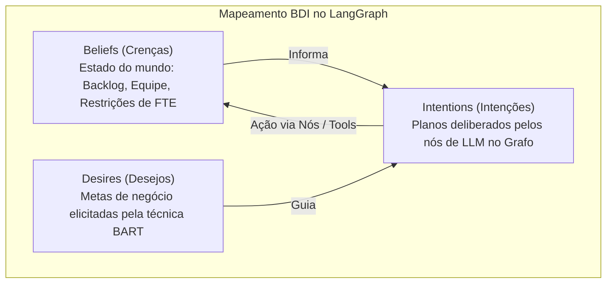
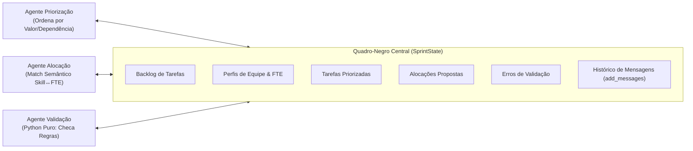

# Guia de Aprendizado: Sprint Planning Multi-Agent System (MAS)

> **Documento didático, conceitual e de referência arquitetural para a reimplementação da arquitetura de agentes dos artigos WESAAC (2025) e REIC (2026) na stack LangGraph + LangChain + LangSmith.**

---

## 🧭 Sumário

1. [Visão Geral & Por Que Reimplementar o Artigo?](#1-visão-geral--por-que-reimplementar-o-artigo)
2. [Matriz Comparativa: Por Que o n8n Não Foi Suficiente?](#2-matriz-comparativa-por-que-o-n8n-não-foi-suficiente)
3. [Teoria de Sistemas Multiagentes: BDI e Padrão Blackboard](#3-teoria-de-sistemas-multiagentes-bdi-e-padrão-blackboard)
4. [Anatomia Técnica do `SprintState` e Esquemas de Domínio](#4-anatomia-técnica-do-sprintstate-e-esquemas-de-domínio)
5. [Arquitetura Desacoplada de LLMs (Fábrica Groq + Ollama)](#5-arquitetura-desacoplada-de-llms-fábrica-groq--ollama)
6. [Catálogo de Artefatos & Histórico de Entregas por Dia](#6-catálogo-de-artefatos--histórico-de-entregas-por-dia)
7. [Laboratório Prático: Como Testar e Inspecionar o Código](#7-laboratório-prático-como-testar-e-inspecionar-o-código)

---

## 1. Visão Geral & Por Que Reimplementar o Artigo?

No artigo original da **REIC 2026** (*Metodologia Ágil e IA em Sistemas Multiagentes: Avaliação Experimental de uma Arquitetura para Planejamento e Execução de Sprints*), propôs-se uma arquitetura baseada na plataforma visual **n8n**.

Embora o artigo tenha demonstrado o valor do planejamento assistido por agentes cognitivos (reduzindo a sobrecarga humana de ~12 minutos para segundos), a validação empírica revelou fragilidades intrínsecas ao uso de ferramentas *low-code*:
- **Falta de rigor empírico em dados reais:** No n8n, os nós foram configurados com entradas de teste perfeitas. Ao lidar com exceções, dependências cíclicas ou regras de negócio granulares, a plataforma carece de garantias de tipo em tempo de execução.
- **Dificuldade de controle de fluxo cíclico:** O processo de Sprint Planning não é estritamente sequencial. Se a alocação proposta por um agente de IA violar a capacidade máxima (FTE) de um desenvolvedor, o sistema precisa **rejeitar o plano e forçar um loop deliberativo de correção**. No n8n, loops complexos com estado distribuído são frágeis e suscetíveis a loops infinitos ou *timeouts*.

**A meta da reimplementação com LangGraph:**
Construir uma prova de conceito **100% auditável, baseada em código Python puro**, com testes unitários automatizados, validação formal de restrições e rastreabilidade total de raciocínio via **LangSmith**.

---

## 2. Matriz Comparativa: Por Que o n8n Não Foi Suficiente?

| Dimensão Técnica | Abordagem Anterior (n8n) | Abordagem Atual (LangGraph) |
| :--- | :--- | :--- |
| **Contrato de Dados** | JSON não tipado passado como *payload* HTTP entre nós. | `SprintState` baseado em **Pydantic v2** e **TypedDict** com checagem estrita de tipos e restrições. |
| **Padrão de Agentes** | Nós individuais disparando requisições Webhook ponta a ponta. | **Padrão Blackboard**, onde todos os nós leem e escrevem em um estado compartilhado. |
| **Loops e Auto-correção** | Tratamento de erros rudimentar; loops condicionais complexos são difíceis de controlar. | **Arestas condicionais nativas** (`conditional_edges`) que roteiam o fluxo de volta ao agente causador de inconsistências. |
| **Validação de Regras** | Delegada integralmente à LLM, sujeita a alucinações de FTE. | **Validação determinística em código Python puro** combinada com deliberação semântica da LLM. |
| **Versionamento e Testes** | JSON de workflow visual, difícil de versionar e testar em CI/CD. | Código fonte modular em Python com suíte completa de **pytest** e mocks de rede. |
| **Observabilidade** | Histórico básico de execuções no painel do n8n. | **LangSmith**: telemetria de latência, contagem de tokens, árvore de chamadas e traces de cada nó. |

---

## 3. Teoria de Sistemas Multiagentes: BDI e Padrão Blackboard

### 3.1. O Modelo BDI (Belief–Desire–Intention)
A literatura clássica de agentes (Rao & Georgeff, 1995; Wooldridge, 2002) modela entidades racionais com base em três pilares, que agora encontram correspondência direta no código:



- **Crenças (*Beliefs*):** É a percepção do ambiente mantida pelo agente. No nosso código, está no `SprintState["backlog"]` e `SprintState["team"]`.
- **Desejos (*Desires*):** São os objetivos globais da sprint definidos pelo Product Owner e codificados nos *system prompts* guiados pelas regras BART.
- **Intenções (*Intentions*):** São os compromissos de ação adotados pelo sistema, concretizados em `SprintState["allocations"]` e `SprintState["sprint_plan"]`.

---

### 3.2. O Padrão Arquitetural Blackboard
O padrão **Blackboard** (Corkill, 1991; Jennings, 2000) resolve o problema de cooperação entre especialistas heterogêneos:



1. **Quadro Negro (`SprintState`):** O espaço de memória compartilhado onde o estado do planejamento é construído incrementalmente.
2. **Fontes de Conhecimento (Agentes Especialistas):** Agentes com papéis únicos (Priorização, Alocação, Validação) que inspecionam o quadro e realizam contribuições direcionadas.
3. **Mecanismo de Controle (Supervisor / Grafo):** A máquina de estados finitos do LangGraph que decide qual especialista atua a cada momento.

---

## 4. Anatomia Técnica do `SprintState` e Esquemas de Domínio

No arquivo [`sprint_mas/state.py`](../../sprint_mas/state.py), construímos contratos de dados estritos com **Pydantic v2**:

### 4.1. Modelos de Domínio
- **`Task`**: Representa um item de trabalho do backlog.
  - `id`: Identificador único (ex: `TSK-101`).
  - `title` e `description`: Conteúdo da demanda.
  - `story_points`: Esforço estimado (`int > 0` obrigatório — previne pontos nulos ou negativos).
  - `skill_required`: Habilidade técnica requerida (ex: `backend`, `frontend`, `devops`).
  - `priority`: Valor de 1 (máxima) a 5 (mínima).
  - `dependencies`: Lista de IDs de tarefas predecessoras que precisam ser concluídas antes.
- **`DeveloperProfile`**: Representa o perfil de um membro do time.
  - `id`: Identificador (ex: `dev_B`).
  - `name`: Nome do desenvolvedor.
  - `skills`: Conjunto de habilidades dominadas.
  - `fte`: Fração de dedicação (`0.0 <= fte <= 1.0` obrigatório — previne alocações além da jornada real).
- **`Allocation`**: Mapeamento de atribuição de uma tarefa para um desenvolvedor, acompanhado da justificativa gerada pela IA.
- **`SprintPlan`**: Artefato final consolidado da sprint.

### 4.2. O Redutor de Mensagens (`add_messages`)
No `SprintState`, o campo de mensagens utiliza o redutor:
```python
messages: Annotated[list[BaseMessage], add_messages]
```
**Por que isso é fundamental?**  
Em nós de grafos com estado, se você simplesmente atribuir uma nova lista de mensagens, você **sobrescreve** o histórico anterior. O redutor `add_messages` instrui o LangGraph a **concatenar** novas mensagens ao histórico existente, garantindo rastreabilidade deliberativa completa.

---

## 5. Arquitetura Desacoplada de LLMs (Fábrica Groq + Ollama)

Em [`sprint_mas/llm_factory.py`](../../sprint_mas/llm_factory.py), aplicou-se o padrão de projeto **Factory Method**:

```mermaid
flowchart TD
    Client["Agente LangGraph (Nó)"] -->|get_llm()| Factory["LLM Factory"]
    Factory -->|PROVIDER=groq| Groq["ChatGroq\n(llama-3.1-8b-instant na nuvem)"]
    Factory -->|PROVIDER=ollama| Ollama["ChatOllama\n(llama3:latest local offline)"]
```

### Vantagens Práticas:
1. **Desenvolvimento Veloz com Groq:** Acesso gratuito à inferência via LPU da Groq (~14.400 requisições/dia), permitindo iterações em frações de segundo.
2. **Execução Segura e Offline com Ollama:** Fallback local sem necessidade de conexão com a internet ou dependência de chaves de API externas.
3. **Isolamento de Testes:** Nos testes automatizados (`tests/test_llm_factory.py`), a fábrica é testada com mocks, garantindo 100% de cobertura sem custo de tokens.

---

## 6. Catálogo de Decisões de Arquitetura (ADRs)

Todas as escolhas estruturais da migração do n8n para LangGraph estão formalizadas e catalogadas em [`docs/adr/`](../adr/README.md):

1. **[ADR 0001: Migração do n8n para LangGraph](../adr/0001-migracao-n8n-para-langgraph.md)** — Substituição do motor visual por grafos cíclicos de estado tipados.
2. **[ADR 0002: Padrão Blackboard com Pydantic v2](../adr/0002-padrao-blackboard-com-pydantic-e-sprintstate.md)** — `SprintState` centralizado com validações de fronteira e redutor `add_messages`.
3. **[ADR 0003: Fábrica Híbrida de LLMs (Groq + Ollama)](../adr/0003-fabrica-hibrida-de-llms-groq-e-ollama.md)** — Desacoplamento da camada de inferência para nuvem rápida e execução offline.
4. **[ADR 0004: Ingestão de Dados e Validação de DAG](../adr/0004-padronizacao-de-cenarios-de-teste-e-data-loader.md)** — Algoritmo DFS com coloração tricromática ($O(V+E)$) para prevenção de ciclos.
5. **[ADR 0005: Prompts BART e Ferramentas Determinísticas](../adr/0005-prompts-como-codigo-e-ferramentas-deterministicas.md)** — Prompts declarativos em YAML e ferramentas Python puras (`@tool`) com defesas anti-IDOR.
6. **[ADR 0006: Priorizador Híbrido Cognitivo-Determinístico](../adr/0006-agente-priorizacao-hibrido-bart-dag.md)** — Arquitetura em 3 estágios assegurando 0% de erro causal via fallback de Kahn min-heap.

---

## 7. Laboratório Prático: Como Testar e Inspecionar o Código

### 7.1. Executando a Suíte Completa de Testes
Para certificar a integridade do código em seu terminal:
```bash
uv sync
uv run pytest tests/ -v
```

### 7.2. Testando Validações de Borda (Edge Cases)
Experimente instanciar um objeto `DeveloperProfile` com FTE inválido no console Python:
```python
from sprint_mas.state import DeveloperProfile

# Isso disparará imediatamente um ValidationError explicativo:
try:
    dev = DeveloperProfile(id="dev_X", name="Invalido", skills=["backend"], fte=1.5)
except Exception as e:
    print("Rejeição esperada:", e)
```
Essa segurança de tipos em tempo de execução é o que garante que a LLM não corromperá o planejamento durante a execução do grafo.
