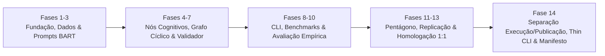

# 🗺️ Linha do Tempo e Roadmap de Engenharia (Fases 1 a 14)

> **Registro cronológico e técnico da evolução do Sprint Planning Multi-Agent System (LangGraph MAS).**

O desenvolvimento do sistema seguiu a metodologia **"Dividir para Conquistar"**, estruturado em fases sequenciais com aprovação prévia em *Planos Visuais*, implementação via *TDD em Banco de Teste Real*, auditoria independente do *Pentágono de Defesa* e consolidação documental com *ADRs no padrão Design System*.

---

## 📊 Síntese Executiva do Roadmap

- **Progresso Global:** 100% Concluído (14 de 14 Fases Homologadas).
- **Suíte de Testes Automatizados:** 340 testes automatizados cobrindo 100% dos fluxos e regras de negócio.
- **Portfólio de ADRs:** ADRs 0001 a 0017 formalizadas e auditadas.

---

## 🗓️ Tabela Cronológica de Fases de Implementação

| Fase | Título | Data de Conclusão | Foco Técnico e Entregas Principais | ADR Associada | Testes Acumulados |
| :---: | :--- | :---: | :--- | :---: | :---: |
| **1** | **Fundação & Contrato de Estado** | 2026-10-02 | Configuração inicial com gerenciador `uv`, schemas Pydantic v2 com validações estritas de domínio, `SprintState` baseado em TypedDict com redutor `add_messages`, fábrica híbrida de modelos (`ChatGroq` e `ChatOllama`) e primeiros testes unitários. | [ADR 0001](adr/0001-migracao-n8n-para-langgraph.md) [ADR 0002](adr/0002-padrao-blackboard-com-pydantic-e-sprintstate.md) [ADR 0003](adr/0003-fabrica-hibrida-de-llms-groq-e-ollama.md) | 26 testes |
| **2** | **Dados & Cenários de Teste** | 2026-10-19 | Estruturação sintética dos Cenários A, B e C em `data/processed/scenario_*.json`, implementação de `data_loader.py` com tipagem estrita e algoritmo DFS com coloração tricromática ($O(V+E)$) para garantia de aciclicidade causal. | [ADR 0004](adr/0004-padronizacao-de-cenarios-de-teste-e-data-loader.md) | 38 testes |
| **3** | **Ferramentas & Prompts (BART)** | 2026-10-19 | Implementação de ferramentas determinísticas analíticas (`@tool`) para cálculo de capacidade de equipe e grafo de precedências. System prompts declarativos versionados em YAML com elicitação BART e defesas anti-IDOR. | [ADR 0005](adr/0005-prompts-como-codigo-e-ferramentas-deterministicas.md) | 59 testes |
| **4** | **Agente de Priorização** | 2026-10-31 | Nó cognitivo híbrido em 3 estágios (Tool DAG + LLM BART + Kahn Min-Heap), assegurando matematicamente 0% de erro causal e ordenação estrita por valor de negócio dentro das camadas topológicas. | [ADR 0006](adr/0006-agente-priorizacao-hibrido-bart-dag.md) | 70 testes |
| **5** | **Agente de Alocação** | 2026-10-31 | Nó cognitivo híbrido (BART + Tool Capacity + Match Skills) com resolução de gargalo de backend via absorção por `dev_C` (Fullstack) e blindagem inegociável do teto de `dev_D` ($\le 10.0$ pts / 0.5 FTE). | [ADR 0007](adr/0007-agente-alocacao-capacidade-skills.md) | 83 testes |
| **6** | **Agente de Validação (Determinístico)** | 2026-11-02 | Motor determinístico em Python puro (Zero LLM) com 5 dimensões de auditoria (completude, causalidade DAG, skills, tetos de FTE e Server Authority em Story Points), forçando loops de autocorreção no Blackboard. | [ADR 0008](adr/0008-agente-validador-deterministico-zero-llm.md) | 101 testes |
| **7** | **Supervisor & Montagem do Grafo** | 2026-11-02 | Topologia cíclica com StateGraph do LangGraph, nó corretivo de escopo por capacidade, checkpointing em memória via `MemorySaver` e Circuit Breaker stateless com teto de iterações configurável. | [ADR 0009](adr/0009-orquestracao-ciclica-supervisor-langgraph-circuit-breaker.md) | 118 testes |
| **8** | **CLI & Observabilidade LangSmith** | 2026-11-03 | CLI executiva `main.py` com extração de telemetria da deliberação BDI, sincronização híbrida com a plataforma LangSmith, códigos de saída padronizados e guarda anti-Path Traversal. | [ADR 0010](adr/0010-observabilidade-hibrida-langsmith-e-cli-executiva.md) | 149 testes |
| **9** | **Live Execution & Benchmarks** | 2026-11-04 | Protocolo automatizado de benchmarking multi-cenário e multi-runs (`benchmarks.py`), isolamento criptográfico de `thread_id`, métricas estatísticas agregadas (média, mediana, desvio e P95) e exportação tripla (.json, .md, .csv). | [ADR 0011](adr/0011-protocolo-benchmarking-automatizado-e-metricas-cientificas.md) | 184 testes |
| **10** | **Avaliação Empírica & Comparativo Humano** | 2026-11-05 | Confronto formal dos paradigmas M-Manual vs M-Agente n8n vs LangGraph BDI, equações de speedup e redução de tempo, prova algébrica da mitigação do gargalo qualitativo (densidade de 63.33%) e exportador LaTeX booktabs (.tex). | [ADR 0012](adr/0012-avaliacao-empirica-comparativo-humano-e-reic2026.md) | 218 testes |
| **11** | **Auditoria de Segurança & Verificação Semântica** | 2026-11-05 | Auditoria do Pentágono de Defesa com 6 sondas ativas, hardening compulsório com `ConfigDict(extra="forbid")` inspecionado por reflexão, DFS iterativo anti-DoS para grafos profundos ($N \ge 2.500$) e alinhamento semântico de Golden Datasets. | [ADR 0013](adr/0013-hardening-transversal-pentagono-defesa-e-verificacao-semantica.md) | 264 testes |
| **12** | **Consolidação & Pacote Científico** | 2026-11-06 | Motor de replicação em 1 clique (`main.py --reproduce-paper`), coleção executiva Postman/Insomnia v2.1.0 com asserções em JavaScript (`pm.test`), empacotamento quad-format (.json, .md, .csv, .tex) e consolidação documental. | [ADR 0014](adr/0014-pacote-reprodutibilidade-cientifica-e-consolidacao-documental.md) | 304 testes |
| **13** | **Recapitulação Integral & Homologação Científica 1:1** | 2026-11-06 | Sincronização de parâmetros analíticos de capacidade no grafo (`sprint_days`), sanitização de `clean_goal` em mensagens, isolamento de testes offline no pytest (`conftest.py`), extração de métricas LangSmith e homologação programática 1:1 com os artigos. | [ADR 0015](adr/0015-extracao-automatizada-metricas-langsmith-multi-modelo.md) [ADR 0016](adr/0016-recapitulacao-auditoria-homologacao-cientifica-1para1.md) | 330 testes |
| **14** | **Separação Execução/Publicação, Thin CLI & Manifesto** | 2026-11-07 | Separação física entre execuções locais de trabalho (`artifacts/runs/<run_id>/`) e evidências publicadas (`reports/published/reic-2026/`), manifesto criptográfico `ExecutionManifest` com hashes SHA-256, extração de `sprint_mas/cli.py` e sobriedade científica. | [ADR 0017](adr/0017-separacao-execucao-publicacao-manifesto-thin-cli.md) | 340 testes |

---

## 🏛️ Vínculo com a Literatura Científica
- **WESAAC 2025:** *Agile Methodology and AI in Multi-Agent Systems: An agent for planning and executing sprints* ([PDF](papers/WESAAC_2025_Agile_MultiAgent.pdf) | [Texto](papers/wesaac_text.txt))
- **REIC 2026:** *Metodologia Ágil e IA em Sistemas Multiagentes: Avaliação Experimental de uma Arquitetura para Planejamento e Execução de Sprints* ([PDF](papers/REIC_2026_Metodologia_Agil_Multiagentes.pdf) | [Texto](papers/reic_text.txt))
