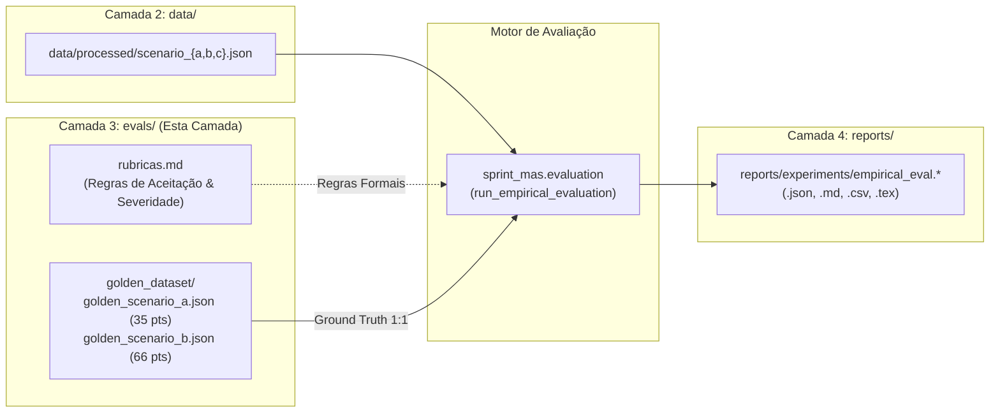

# Camada 3 LLMOps: Avaliação & Rubricas — `evals/`

> **Camada de governança analítica, critérios de aceitação e gabaritos de referência (*Ground Truth*) para benchmarking empírico do Sprint Planning MAS.**

Dentro da arquitetura de 4 camadas LLMOps do projeto (`configs/`, `data/`, `evals/`, `reports/`), o diretório `evals/` centraliza os contratos de validação qualitativa e quantitativa que atestam a fidelidade dos agentes inteligentes em relação aos padrões de engenharia ágil e aos resultados dos artigos **WESAAC 2025** e **REIC 2026**.

---

## 🏛️ Papel Arquitetural no Pipeline de Engenharia



---

## 📁 Estrutura de Arquivos

```
evals/
├── README.md               # Este índice documental e guia da Camada 3
├── rubricas.md             # Especificação matemática das rubricas e critérios de severidade
└── golden_dataset/         # Gabaritos de referência ótima (Ground Truth)
    ├── golden_scenario_a.json  # Gabarito Cenário A (Smoke Test: 10 tarefas, 35 pts)
    └── golden_scenario_b.json  # Gabarito Cenário B (Gargalo Backend: 15 tarefas, 66 pts)
```

---

## 📐 1. Rubricas de Avaliação (`rubricas.md`)

O documento [`evals/rubricas.md`](./rubricas.md) estabelece os critérios formais para aprovação de um plano de sprint gerado pelo sistema:

| Dimensão | Critério Formal | Meta de Engenharia | Severidade da Violação |
|---|---|:---:|:---:|
| **Causalidade (DAG)** | Toda dependência $T_j$ de uma tarefa $T_i$ deve preceder $T_i$ no cronograma da sprint. | **100% (0 violações)** | 🔴 **Crítica** (Invalidação imediata do plano) |
| **Capacidade (FTE)** | Carga alocada por desenvolvedor $\le \text{sprint\_days} \times \text{points\_per\_day} \times \text{fte}$. | **100% (0 sobrecargas)** | 🔴 **Crítica** (Reprovação pelo Agente Validador) |
| **Afinidade Técnica** | `task.skill_required` compatível com o vetor `dev.skills`. | $\ge 95\%$ | 🟡 **Alta** (Alerta de risco operacional) |
| **Mitigação de Gargalo** | Absorção preferencial de backend pelo perfil Fullstack (`dev_C`). | Observado | 🟢 **Média** (Otimização combinatória) |
| **Speedup Operacional** | Tempo total de execução do SMA vs. baseline humano ($765\text{ s}$). | $\ge 182\times$ ($< 10\text{ s}$) | 🟢 **Média** (Meta de eficiência) |

---

## 🎯 2. Gabaritos de Referência (`golden_dataset/`)

Os gabaritos canônicos representam a alocação ótima matematicamente provada e alinhada com as publicações acadêmicas da UFC Quixadá.

### A. Cenário A — Smoke Test (`golden_scenario_a.json`)
- **Backlog de Entrada:** 10 tarefas sintéticas (`TSK-001` a `TSK-010`), sem dependências encadeadas complexas.
- **Equipe:** 3 desenvolvedores com dedicação total (`fte = 1.0` $\rightarrow$ teto de 20.0 pts cada; capacidade total da sprint = 60 pts).
- **Resultado Canônico Homologado:**
  - **Tarefas Alocadas:** 10 tarefas (100% do backlog).
  - **Story Points Totais:** **35 pontos**.
  - **Distribuição de Carga:** Equilibrada entre os desenvolvedores respeitando competências primárias (backend, frontend, devops).
  - **Violações Lógicas:** 0 violações de DAG e 0 violações de FTE.

### B. Cenário B — Gargalo Qualitativo de Backend (`golden_scenario_b.json`)
- **Backlog de Entrada:** 30 tarefas (`TSK-101` a `TSK-130`) totalizando **128 Story Points brutos**.
- **Restrição Estrutural:** 19 tarefas exigem competência `backend` (densidade de **63,33%** do backlog).
- **Equipe (5 Desenvolvedores / Capacidade Nominal: 84 pts):**
  - `dev_A`: Frontend Developer (1.0 FTE $\rightarrow$ teto 20 pts)
  - `dev_B`: Backend Specialist (0.7 FTE $\rightarrow$ teto 14 pts)
  - `dev_C`: Fullstack Developer (1.0 FTE $\rightarrow$ teto 20 pts — **Pivô de Mitigação**)
  - `dev_D`: Backend Specialist (0.5 FTE $\rightarrow$ **teto estrito de 10.0 pts inegociável**)
  - `dev_E`: Frontend Developer (1.0 FTE $\rightarrow$ teto 20 pts)
- **Resultado Canônico Homologado (Pós Corte Determinístico de Escopo):**
  - **Tarefas Alocadas:** 15 tarefas prioritárias.
  - **Story Points Totais:** **66 pontos**.
  - **Alocação Específica por Membro da Equipe:**
    - `dev_A` (Frontend): 10.0 pts (`TSK-106`, `TSK-116`) — 50% de ocupação.
    - `dev_B` (Backend): 13.0 pts (`TSK-101`, `TSK-103`) — 92.8% de ocupação.
    - `dev_C` (Fullstack): **19.0 pts em tarefas de backend** (`TSK-102`, `TSK-104`, `TSK-105`, `TSK-113`) — mitigando o estrangulamento da sprint.
    - `dev_D` (Backend): **10.0 pts exatos** (`TSK-107`, `TSK-108`) — blindagem rigorosa do teto de 0.5 FTE.
    - `dev_E` (Frontend): 14.0 pts (`TSK-111`, `TSK-121`, `TSK-126`, `TSK-128`, `TSK-130`) — 70% de ocupação.

---

## 🔬 3. Integração com `sprint_mas.evaluation`

O motor em [`sprint_mas/evaluation.py`](../sprint_mas/evaluation.py) consome diretamente os arquivos desta camada para efetuar avaliações automatizadas:

```python
from sprint_mas.evaluation import run_empirical_evaluation, EmpiricalEvaluationConfig

# Execução empírica contra os gabaritos e baselines do paper
config = EmpiricalEvaluationConfig(
    scenarios=["scenario_a", "scenario_b"],
    runs=2,
    offline_mock=True,
)

report = run_empirical_evaluation(config)

# Verificação programática dos gabaritos
for comp in report.comparisons:
    print(f"Cenário: {comp.scenario}")
    print(f"Acurácia contra Golden Dataset: {comp.golden_match_accuracy_pct}%")
    print(f"Gargalo Mitigado: {comp.bottleneck_analysis.fullstack_mitigation_active}")
    print(f"Teto dev_D Respeitado: {comp.bottleneck_analysis.dev_d_capacity_respected}")
```

### Execução via CLI:
```bash
# Executa avaliação empírica formal e exporta artefatos em reports/experiments/
uv run python main.py --evaluate-human --scenarios a,b --runs 2 --export-prefix empirical_eval
```
