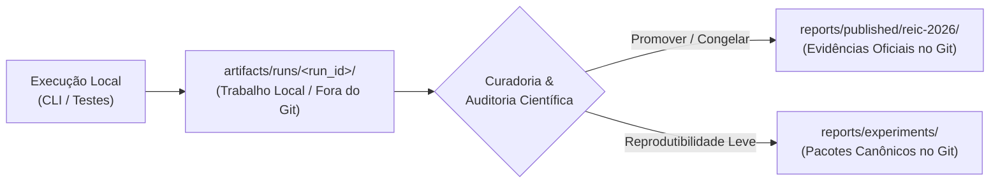

# Relatórios de Experimentos e Métricas — `reports/`

> **Diretório destinado a armazenar os resultados de experimentos, relatórios de benchmark, comparativos quantitativos entre humanos e o SMA e telemetria científica reproduzível.**

---

## 🏛️ Separação Arquitetural: Publicação vs. Trabalho Local

O projeto adota uma fronteira estrita entre evidências científicas publicadas e execuções de trabalho locais:



1. **Evidências Publicadas Oficiais (`reports/published/reic-2026/`):**
   - **`manifest.json`**: Manifesto criptográfico imutável (`run_id: "reic-2026-published-canonical"`) com hashes SHA-256 do cenário e prompts, commit de referência e declaração de modo.
   - **`metrics.json`**: Síntese das métricas publicadas nos artigos WESAAC 2025 e REIC 2026 (benchmarks, speedup vs manual > 25.000x e mitigação de gargalo no Cenário B com `dev_C` e teto `dev_D`).
   - **`tables/`**: Tabelas oficiais compiláveis (`.csv`, `.md`, `.tex`) congeladas para citação acadêmica.
2. **Pacotes Canônicos de Experimentos (`reports/experiments/`):**
   - Relatórios canônicos leves (`.json`, `.md`, `.csv`, `.tex`) versionados no Git para garantir **reprodutibilidade científica imediata** e auditoria de regressão sem requisições de rede.
3. **Execuções Locais de Trabalho (`artifacts/runs/<run_id>/`):**
   - Diretório de desenvolvimento e execuções ad-hoc, **ignorado pelo Git** no `.gitignore`. Cada execução recebe um `run_id` isolado contendo `manifest.json`, `metrics.json`, `outputs/` e `traces/`.

---

## 📁 Pacotes Canônicos Oficiais (`reports/experiments/`)

O diretório `reports/experiments/` hospeda 5 suítes canônicas padronizadas geradas via CLI executiva (`main.py`):

| Prefixo do Pacote | Formatos Emitidos | Comando de Geração | Finalidade Científica e Escopo |
|---|:---:|---|---|
| **`benchmark.*`** | `.json`, `.md`, `.csv` | `uv run python main.py -b --offline-mock --export-prefix benchmark` | Métricas estatísticas de tempo (média, desvio padrão, mediana, P95), taxa de aprovação operacional (100%) e contagem de violações causais de DAG e capacidade FTE nos Cenários A, B e C. |
| **`empirical_eval.*`** | `.json`, `.md`, `.csv`, `.tex` | `uv run python main.py -e --offline-mock --export-prefix empirical_eval` | Confronto formal entre os três paradigmas: Planejamento Manual humano (765s), n8n (4.2s) e SMA LangGraph. Calcula speedup ($\approx 182\times$), redução de tempo (99.45%) e validação da mitigação do gargalo qualitativo da Seção 6.3 do REIC 2026. |
| **`replication_bundle.*`** | `.json`, `.md`, `.csv`, `.tex` | `uv run python main.py --reproduce-paper --offline-mock --export-prefix replication_bundle` | Orquestração experimental de 1 clique que executa em sequência: benchmarks A/B/C, avaliação empírica e auditoria do Pentágono de Defesa, atestando conformidade com WESAAC 2025 e REIC 2026. |
| **`security_semantic_audit.*`** | `.json`, `.md` | `uv run python main.py --security-audit --export-prefix security_semantic_audit` | Auditoria estática e dinâmica de sub-segundo cobrindo os 5 pilares do Pentágono de Defesa Expandido, reflexão dinâmica de 26/26 modelos Pydantic v2 com `extra="forbid"`, teste de DFS tricromático iterativo anti-DoS e verificação científica 1:1. |
| **`langsmith_metrics.*`** | `.json`, `.md`, `.csv`, `.tex` | `uv run python main.py --sync-metrics --export-prefix langsmith_metrics` | Extração programática de telemetria empírica via SDK do LangSmith (`Client.list_runs`), filtragem resiliente, agregações P95 interpoladas multi-modelo, custos em USD e tabela em LaTeX booktabs. |

---

## 📄 Especificação dos Formatos Canônicos

Cada pacote experimental é exportado de forma atômica e segura, validado por `validate_safe_benchmark_path` contra vulnerabilidades de *Path Traversal*:

1. **JSON Canônico (`.json`):**
   - Serialização tipada estrita a partir de modelos Pydantic v2 com `extra="forbid"`.
   - Utilizado para consumo programático por dashboards, pipelines CI/CD ou coleções Postman/Newman.
2. **Markdown Executivo (`.md`):**
   - Tabelas resumidas com formatação legível para humanos, destacando métricas-chave, taxas de sucesso e avisos operacionais.
3. **CSV Tabular (`.csv`):**
   - Gerado com `csv.writer`, `lineterminator="\n"` e gravação com `newline=""`.
   - Imune a retornos de carro duplos (`\r\r\n` ou CRCRLF) gerados pelo ecossistema Windows, assegurando conformidade estrita em pipelines Linux/macOS.
4. **LaTeX Compilável (`.tex`):**
   - Tabelas acadêmicas completas formatadas com o pacote `booktabs` (`\toprule`, `\midrule`, `\bottomrule`).
   - Caracteres reservados (`_`, `&`, `%`) sanitizados automaticamente para inclusão direta em artigos científicos submetidos à SBC, IEEE ou ACM.

---

## 🤖 Catálogo de Modelos e Telemetria Empírica LangSmith

Para garantir transparência científica e reprodutibilidade experimental fidedigna, as métricas do sistema são agregadas continuamente a partir de execuções reais telemetradas no projeto LangSmith `REIC_WESAAC_code` (`main.py --sync-metrics`).

### 1. Telemetria Empírica Consolidada (212 Planning Runs Reais)

O conjunto de evidências consolidadas compreende **212 planning runs reais** distribuídas entre 4 modelos de linguagem avaliados nos três cenários de teste (A, B e C), operando com 100% de taxa de aprovação operacional:

| Modelo | Provedor | Cenário | Runs | Média (ms) | P95 (ms) | Prompt Tok. | Compl. Tok. | Total Tok. | Custo Total (USD) | Sucesso (%) |
|---|---|---|:---:|:---:|:---:|:---:|:---:|:---:|:---:|:---:|
| `openai/gpt-oss-20b` | Groq Cloud | `scenario_a` | 90 | 11.308,16 | 29.766,51 | 1.493,1 | 910,9 | 2.404,0 | $0,03460 | 100,0% |
| `openai/gpt-oss-20b` | Groq Cloud | `scenario_b` | 93 | 27.105,19 | 46.903,30 | 2.688,5 | 1.691,6 | 4.380,1 | $0,06576 | 100,0% |
| `openai/gpt-oss-20b` | Groq Cloud | `scenario_c` | 2 | 26.540,24 | 27.897,95 | 3.757,5 | 2.232,5 | 5.990,0 | $0,00190 | 100,0% |
| `openai/gpt-oss-120b` | Groq Cloud | `scenario_a` | 6 | 2.406,59 | 3.962,39 | 1.468,0 | 913,8 | 2.381,8 | $0,00461 | 100,0% |
| `openai/gpt-oss-120b` | Groq Cloud | `scenario_b` | 7 | 19.084,51 | 41.885,54 | 2.837,6 | 1.797,9 | 4.635,4 | $0,01053 | 100,0% |
| `qwen/qwen3.8-27b` | Groq Cloud | `scenario_a` | 3 | 2.118,15 | 2.476,77 | 1.655,7 | 635,3 | 2.291,0 | $0,01160 | 100,0% |
| `qwen/qwen3.8-27b` | Groq Cloud | `scenario_b` | 2 | 23.079,75 | 40.970,57 | 3.017,5 | 1.623,5 | 4.641,0 | $0,01782 | 100,0% |
| `llama3:latest` | Ollama Local | `scenario_a` | 5 | 186.500,70 | 224.616,56 | 1.597,0 | 560,4 | 2.157,4 | $0,00000 | 100,0% |
| `llama3:latest` | Ollama Local | `scenario_b` | 4 | 306.233,49 | 406.083,84 | 2.779,2 | 719,2 | 3.498,5 | $0,00000 | 100,0% |

- **Custo Total Acumulado em Nuvem:** $0,14682 USD para 203 runs em ambiente Groq Cloud.
- **Execução Local On-Premises:** Custo zero de inferência via Ollama (`llama3:latest`), com latência compatível com hardware local de consumidor.

### 2. Catálogo de Modelos Suportados

| Provedor | Identificador do Modelo (`model_name`) | Contexto de Uso Recomendado | Características Técnicas Observadas |
|---|---|---|---|
| **Groq** | `openai/gpt-oss-20b` | Modelo padrão de referência no `.env` | Excelente relação custo-benefício (185 runs), alta estabilidade e conformidade com restrições. |
| **Groq** | `openai/gpt-oss-120b` | Deliberação complexa de alta capacidade | Menor latência P95 no Cenário A (3.962 ms) e alta acurácia em raciocínios causais encadeados. |
| **Groq** | `qwen/qwen3.8-27b` | Testes comparativos e benchmarking | Resposta balanceada e rápida no Cenário A (2.118 ms de latência média). |
| **Ollama** | `llama3:latest` | Inferência local offline e soberania de dados | Operação 100% desacoplada de rede externa, imune a rate limits e com custo financeiro nulo. |
| **Offline** | `deterministic-fallback` | Mock offline determinístico (CI/CD) | Resolução gulosa sub-milissegundo para validação estática de contratos e integridade de pipeline. |

---

## 📊 Template de Registro de Experimento Manual

Ao rodar um experimento pontual exploratório, registre no formato padronizado:

```markdown
# Experimento: Benchmark Cenário B (30 Tarefas)
- **Data/Hora:** 2026-11-06T20:00:00Z
- **Provedor:** Groq (openai/gpt-oss-20b)
- **Temperatura:** 0.0
- **Tempo de Execução:** 4.12s
- **Taxa de Sucesso de Validação:** 100%
- **Violações de FTE:** 0
- **Violações de Dependência:** 0
- **Trace LangSmith:** https://smith.langchain.com/...
```
